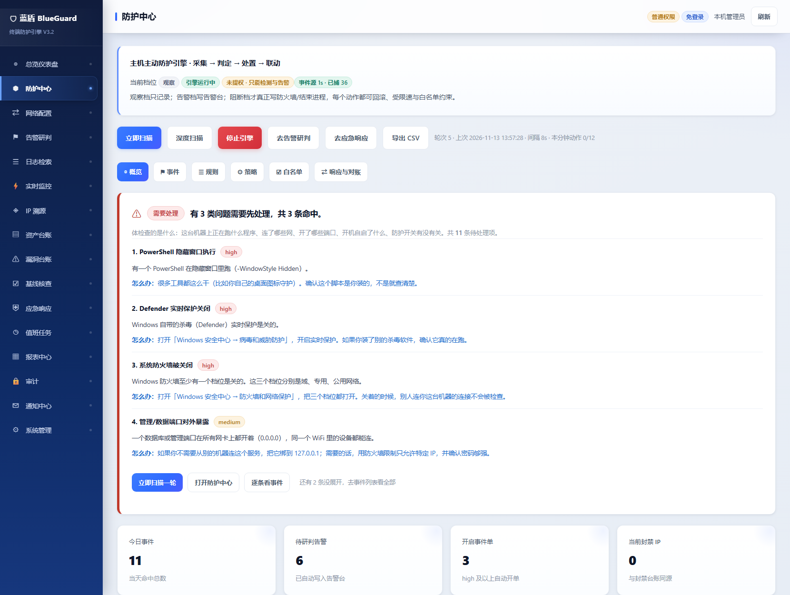
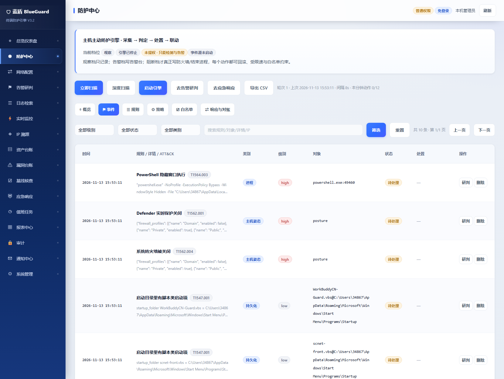
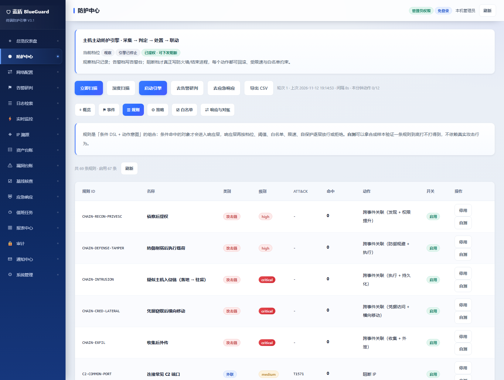
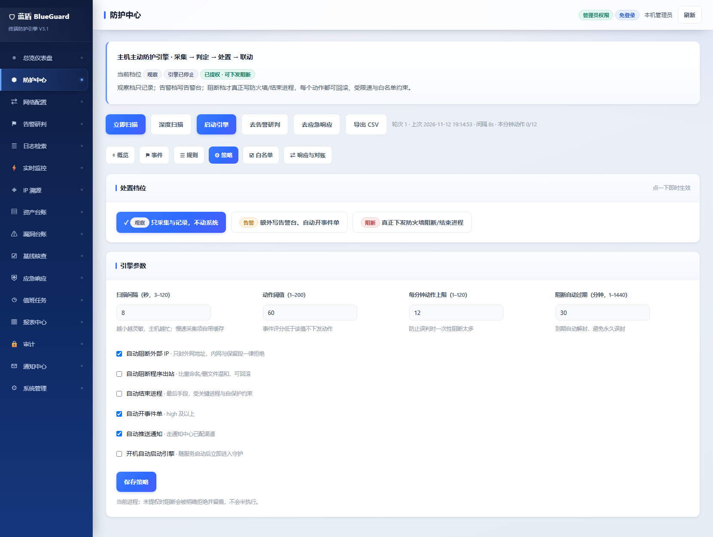
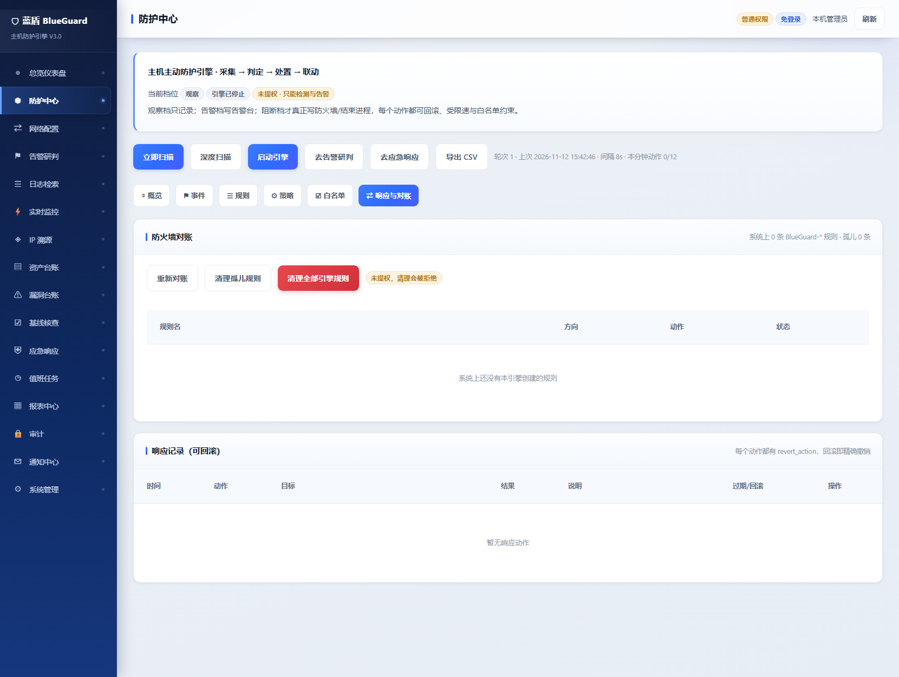
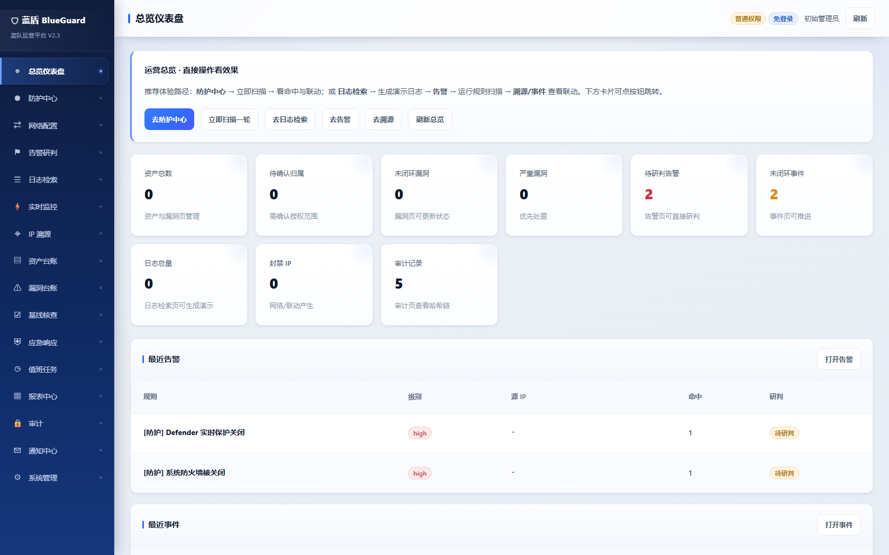

# 蓝盾 BlueGuard · 终端防护引擎 V3.2

> Windows 10/11 单机便携版 ｜ 打开即用、无需登录 ｜ 完全离线 ｜ 采集 → 判定 → 处置 → 联动闭环

蓝盾本来是一套"蓝队运营台"（台账、告警研判、日志检索、事件流转、审计留痕）。V3.0 在它下面接入了一台**真正会动手的主机防护引擎**（Guard Core）：定时采集本机进程、连接、监听端口、启动项与主机安全姿态，用 69 条带 ATT&CK 映射的规则（另含 5 条攻击链模板）做判定，按三档策略决定是只记录、只告警，还是直接下发防火墙阻断 / 结束进程，并且每个动作都可回滚、有限速、有白名单和自保护。

它不再只是"看板"，而是**能拦事儿的本地防火墙式防护台**。

V3.1 按攻击者的真实手法重做了一遍检测面：进程对象补上父进程（`winword.exe → cmd.exe` 和 `explorer.exe → cmd.exe` 不是一回事）、规则扩到 69 条覆盖执行/持久化/提权/凭据/发现/规避/横向/外传/影响九组、ATT&CK 覆盖 53 项，并把半小时内的散点事件按战术拼成**攻击链**。



| 事件研判（带 ATT&CK 映射） | 规则库（69 条 + 5 条攻击链） |
|---|---|
|  |  |

| 处置策略（观察 / 告警 / 阻断） | 响应与对账（可回滚） |
|---|---|
|  |  |



---

## 快速开始

### 方式一：双击 exe（推荐）

1. 双击 `dist\BlueGuard.exe`
2. 程序自动挑一个本地端口、起独立应用窗口（Edge/Chrome `--app` 模式，无地址栏）
3. **不需要账号密码**，打开就是防护中心

### 方式二：源码启动

```bat
启动.bat
```

或手动：

```bat
python -m backend.app
```

数据全部落在 `backend\data\`（exe 版是 `dist\data\`），跟着文件夹走，拷走就能用。

### 想要回口令登录？

```bat
set BLUEGUARD_AUTH=password
python -m backend.app
```

此时走原来的登录页，初始账号 `admin` / `BlueGuard@2026`，首次登录强制改密。默认是 `open`（免登录）。

---

## 防护引擎做什么

### 采集（每轮 1 秒左右，深度轮 5–15 秒）

| 采什么 | 怎么采 | 说明 |
|---|---|---|
| 进程 | `Get-CimInstance Win32_Process` | 一次调用拿到 377+ 进程的 PID、父进程、路径、命令行；psutil 仅兜底 |
| 网络连接 | psutil net_connections | 本机 TCP 四元组 + 状态，500+ 条 |
| 监听端口 | 连接表派生 | 暴露面盘点 |
| 启动项 | 注册表 Run/RunOnce + 启动文件夹 + 非 Microsoft 计划任务 | 实测 50 条 |
| 主机姿态 | Get-NetFirewallProfile / Get-MpComputerStatus / SMB1 / RDP | 防火墙档位、Defender 开关、SMBv1、RDP |
| 主机指标 | psutil | CPU / 内存 / 运行时长 |

慢调用全部带 TTL 缓存（启动项 30s、姿态 60s），所以常规轮次稳定在 1 秒内，不会把机器拖住。

### 事件源：短命进程靠什么抓（V3.2 新增）

轮询有个天生的盲区：**存活不到 8 秒的进程，两次采样之间就生灭完了，轮询永远看不到**。而这恰恰是大量攻击行为的形状——编码命令、一次性下载器、`cmd /c` 横向工具、脚本 host 的短命子进程。

V3.2 加了第二个数据源：WMI 的 `__InstanceCreationEvent`（进程创建事件）。

| | 轮询快照 | WMI 事件源 |
|---|---|---|
| 粒度 | 8 秒（配置 3–120 秒） | 约 1 秒 |
| 看到什么 | 采样那一刻活着的进程 | 每一个被创建出来的进程 |
| 需要管理员 | 否 | **否**（不改审核策略、不开 ETW 会话） |
| 拿到什么 | 全量快照（连接/监听/启动项/姿态都靠它） | 进程创建：pid、父 pid、路径、完整命令行 |

两条数据源在引擎里走**同一个判定与处置函数**（`_consume`），所以去重、告警、事件单、处置、审计的行为完全一致。队列是有界的（4000 条），引擎每轮排空一次。

实测（`tests/bg_watch_test.py`、`tests/bg_watch_live.py`）：

```
一个只活 2.2 秒的 pwsh -EncodedCommand：
  轮询快照 375 个进程 —— 不含它
  事件源捕获 pid=7532，命令行完整
  引擎判出 2 条：PowerShell 编码命令执行（high）、PowerShell 隐藏窗口执行（high）
```

边界说清楚：`WITHIN 1` 是 1 秒粒度，**存活 < 1 秒的进程仍可能漏**。这是「从 8 秒降到 1 秒」，不是 ETW 那种零漏报；要彻底做到零漏报需要 ETW（`Microsoft-Windows-Kernel-Process`），那条路需要管理员权限。

#### 事件源怎么不把自己报出来

这是加事件源时踩得最狠的一个坑，也是最能说明"规则引擎好不好用"的地方：订阅进程的命令行本身就是 `pwsh -EncodedCommand <base64>`，看起来和攻击者一模一样。三道防线：

| 防线 | 做法 | 解决什么 |
|---|---|---|
| 按 pid 剔除 | `platform_win.note_spawned(pid)` 记下本程序 spawn 的每个子进程 | 父进程还在的时候 |
| 按父进程剔除 | `policy.is_self_process(ppid, ...)` | 父进程信息还能查到的时候 |
| 按命令行特征剔除 | 解码 `-EncodedCommand`，认 `__InstanceCreationEvent` / `ManagementEventWatcher` | 父进程早就退出了，只剩一个孤儿进程 |

第三道还顺手解决了另一个真问题：程序被强杀（任务管理器 / 崩溃）时，订阅进程收不到停止信号，会卡在 `WaitForNextEvent()` 上一直活着。所以 `watcher.start()` 会先做一次 `_cleanup_orphans()`——只杀"解码后确实是 WMI 进程订阅 **且** 父进程已死"的那种，不碰别人开着的终端。`/api/guard/status` 的 `watch.orphans_killed` 能看到清掉了几个。

顺带把两条 PowerShell 规则也收紧了：`PS-HIDDEN` / `PS-ENCODED` 原来在整条命令行里搜 `-WindowStyle` 和 `-enc`，结果被运维脚本正文里的 `Start-Process xxx -WindowStyle Hidden` 骗到。现在加了负向前瞻，遇到 `-Command` / `-File` 就停止匹配，只看 PowerShell 自己的参数区（`tests/bg_rules_ps.py`，10 组正反例）。

### 判定（69 条内置规则 + 5 条攻击链模板，条件用可编辑的 DSL）

覆盖七类：进程、连接、监听、启动项、主机姿态、日志、攻击链。每条规则带 ATT&CK 编号、严重度、可编辑的启用开关。

典型规则（按攻击者手法组织）：

- 执行面：`OFFICE-CHILD-SHELL` Office 拉起 shell（T1566.001，critical）、`EXPLORER-CHILD-LOLBIN`、`BROWSER-CHILD-SHELL`、`EXEC-FROM-TEMP`、`PS-ENCODED` / `PS-HIDDEN` / `PS-FROM-STRING`、`LOLBIN-MSHTA` / `LOLBIN-REGSVR32` / `LOLBIN-RUNDLL32`、`RUNDLL32-ORDINAL`、`MSHTA-REMOTE`、`CERTUTIL-DECODE`
- 持久化：`PERSIST-SERVICE-CREATE`、`PERSIST-SCHTASK-SYSTEM`、`PERSIST-WMI-SUBSCRIPTION`（T1546.003，critical）、`PERSIST-IFEO`、`PERSIST-TEMP` / `PERSIST-LOLBIN`
- 提权与凭据：`UAC-BYPASS-PARENT`、`PRIVESC-TOOL`、`LSASS-DUMP`（T1003.001，critical，可自动结束）、`SAM-DUMP`、`BROWSER-CRED-ACCESS`
- 规避：`LOG-CLEAR`、`DEFENDER-EXCLUSION`、`AMSI-BYPASS`、`FIREWALL-OPEN-HOLE`、`AV-SERVICE-STOP`、`TIMESTOMP`
- 横向：`LATERAL-TOOL`、`LATERAL-ADMIN-SHARE`、`LATERAL-WINRM`、`PASS-THE-HASH`
- 收集外传：`STAGING-ARCHIVE`、`EXFIL-UPLOAD`、`EXFIL-DNS-TOOL`
- 主机姿态与协议：`FIREWALL-OFF` / `DEFENDER-OFF` / `SMB1-ON` / `RDP-OPEN`（本机实测能真报）、`C2-COMMON-PORT` / `SMB-EXTERNAL` / `RDP-EXTERNAL` / `DB-EXTERNAL`（只对公网地址生效）、`LISTEN-PORT-HIJACK`、`LISTEN-ADMIN-EXPOSED`

进程对象带 `parent_name` / `parent_exe` / `parent_cmdline`——`winword.exe` 起 `cmd.exe` 和 `explorer.exe` 起 `cmd.exe` 是两回事，只有父进程能定性。

条件 DSL 支持嵌套 `all/any/not` 与 `eq/ne/contains/startswith/endswith/regex/in/not_in/gt/lt/exists`，另有两个专门算子：`internal` / `external`（自动判内外网，规则里不用手写网段）。规则可以在界面上改严重度、开关、条件，还能用内置合成样本一键自测"这条规则到底打不打得到"。

### 攻击链关联（chain）

单条规则看到的是"一个可疑动作"。攻击链看的是"这台机器上半小时内出现了几种不同战术"。

`backend/guard/chain.py` 把最近 30 分钟的事件按 ATT&CK 战术分桶，5 条链模板各自声明需要哪些战术同时在场：

| 链模板 | 要求 | 级别 |
|---|---|---|
| `CHAIN-INTRUSION` | 执行 + 持久化（再加任一战术，至少 3 个战术） | critical |
| `CHAIN-CRED-LATERAL` | 凭据访问 + 横向移动 | critical |
| `CHAIN-EXFIL` | 收集 + 外泄 | critical |
| `CHAIN-RECON-PRIVESC` | 发现 + 权限提升 | high |
| `CHAIN-DEFENSE-TAMPER` | 防御规避 + 执行 | high |

命中后写一条 `category=chain` 的事件，证据里带**按时间排序的战术序列**（例如 `执行 → 持久化 → 命令与控制`）和组成它的具体规则，然后照常进告警、开事件单（critical 记 P1）、走处置与审计。

**什么证据才有资格参与拼链**（这条是实测定出来的，不是拍脑袋）：

- 只认 `high` / `critical`。`low` 级的"启动目录有个 .vbs"能凑齐战术，但它证明不了任何意图。
- 排除 `posture` 类。防火墙本来就关着、Defender 本来就被关——那是环境状态，不是攻击行为。

改之前，这台开发机真的拼出过一条 critical 的「疑似主机入侵链」：证据是"防火墙被关闭 + Defender 被关闭 + 启动目录 6 个用户自己的 .vbs"，全是它自己的日常状态。改之后 0 误报。

实测（喂三条散点事件）：只有执行 + 持久化两个战术时**不拼链**；补上一条命令与控制后 `CHAIN-INTRUSION` 命中，事件证据为 `['执行','持久化','命令与控制']`，事件单 P1；同窗口再跑一次被去重合并，不刷第二条。逐级验门槛的脚本 `bg_chain_gate.py`：姿态+低危+中危不拼、单战术不拼、两战术（执行+规避）不拼、补第三战术才命中、误报定性后链随之消失——5/5 PASS。


### 处置（有护栏，不是乱杀）

| 动作 | 效果 | 回滚 |
|---|---|---|
| 封禁 IP | Windows 防火墙入站阻断规则 `BlueGuard-Block-*` | 一键删规则 |
| 阻断程序出站 | 出站 Block -Program `BlueGuard-Prog-<hash>` | 一键删规则 |
| 封禁端口 | 入站 TCP 端口阻断 `BlueGuard-Port-*` | 一键删规则 |
| 结束进程 | 直接 kill | 不可回滚（界面明示） |

护栏顺序（先判"该不该"，再判"能不能"）：

1. 档位不是 `block` → 直接拒绝（`MODE_MONITOR`）
2. 内网/回环 IP → 拒绝（`INTERNAL_IP`）
3. 白名单命中 → 跳过
4. 系统关键进程 / 自身进程 → 拒绝（`PROTECTED` / `SELF_PROTECTED`）
5. 端口 53/80/443 → 拒绝（`PROTECTED_PORT`）
6. 当前进程没提权 → 明确拒绝（`ELEVATION_REQUIRED`），**不静默失败、不留半截规则**
7. 超过每分钟动作上限 → 拒绝（`RATE_LIMITED`）
8. 才真正下发，写 `guard_responses` + 审计链

每个动作都带到期时间（默认 30 分钟），到期自动拆除；界面"响应与对账"会把**数据库记录的阻断**和**主机上真实存在的防火墙规则**做对账，多余的手工残留能一键清理。

**自动之外还有手动**：事件详情里可以直接点「阻断 xxx 入站 / 阻断该程序出站 / 阻断本机端口 / 结束进程」，不用等规则替你决定。手动动作走同一套护栏——档位、内网地址、白名单、自保护、限速一个都不少，执行完照样能一键回滚，照样进审计链。

实测证据（`backend/_selftest_respond.py` 在提权环境下跑）：

```
PASS block_ip ok            PASS 系统姿态在管理  ['BlueGuard-Block-198.51.100.9']
PASS blocklist 标记          PASS revert ok       PASS 系统姿态消失  []
PASS block_port ok          PASS 端口规则在管理   PASS 端口规则消失
PASS 拒绝结束 System         PASS 拒绝结束自身     PASS 拒绝结束宿主  INTERNAL_IP
PASS 触发限速                limited=3            PASS audit verify   (True, 19, None)
```

### 联动（一条链路走到底）

```
采集 → 规则命中 → guard_events
                     ├─ 去重（同规则同对象 5 分钟；姿态 60 分钟 / 启动项 30 分钟 / 监听 15 分钟）
                     ├─ log_alerts（[防护] 前缀，同规则同源合并计数）
                     ├─ incidents（high 及以上自动开单，P1/P2，同标题未关则复用并追加处置记录）
                     ├─ guard_responses（按档位与开关自动处置）
                     ├─ blocklist（封禁台账同源）
                     ├─ audit_logs（哈希链，改一条就断链）
                     └─ 报表中心 CSV 导出
```

也就是说：**一条可疑连接进来，能一路走到告警、事件单、封禁台账、审计记录和报表**，不用人工搬运。

### 运营侧的数据从哪来（V3.1 补）

防护引擎自己会采数据，但资产台账和日志检索原本只能手录、手填——空表等于没有。这两个口子现在接上了：

**资产自动发现**（资产管理 → 自动发现本机）

一次采集网卡 IP/MAC、系统版本、全部监听端口与监听进程，按 IP 幂等写入 `assets / asset_ips / asset_services`：

- 重复点只更新，不会重复建资产；同一个 IP 不可能属于两台机器
- 上一次发现过、这一次没在监听的端口会被**清掉**，避免台账越积越多、三个月后看到一堆早就不存在的端口
- 动态端口段（49152 以上且拿不到所属进程）不入账，实测一台机器能刷 8 条这种噪音
- 手工改过的字段（负责人、重要度）不被覆盖

实测：`WORKSTATION-01 / Windows 10 / 4 个 IP（含 WSL 与 VMware 虚拟网卡）/ 16 个真实监听端口`，其中 1433 sqlservr 与 8888 btPanel 绑在 `0.0.0.0`，属于真实对外暴露面。

**Windows 事件日志采集**（日志检索 → 采集 Windows 日志）

从 System / Application / Security 真实读取（Security 需管理员），一次最多 6 个日志、每个 500 条，`since_hours` 控制时间窗：

- 按「时间 + 正文前 160 字」去重，反复点采集不会把同一条灌十遍（实测第二次采集 0 新增、239 条跳过）
- 补 `host`（本机名），日志才能和资产台账对上
- 级别归一成 `info / warn / error`，时间统一成本地时区字符串——包括 PowerShell JSON 吐的 `/Date(1794336826000)/` 这种怪格式，否则排序会把它们全挤在一堆
- 采集后立即进 FTS5 索引，中文两字词走 LIKE 兜底，`?level=error` 可单独筛错误事件

实测：一次采集 System 91 + Application 137 条，`/logs/stats` 给出按级别/主机/天的分布，`level=error` 命中 5 条真实的 BitLocker、httpd.exe 崩溃、文件访问失败事件。

---

## 界面

| 页面 | 干什么 |
|---|---|
| **防护中心** | 引擎启停、立即/深度扫描、事件研判与删除（单条 / 删已关闭 / 删误报 / 清空）、69 条规则开关与自测、三档策略、白名单、响应回滚与防火墙对账、CSV 导出 |
| 总览仪表盘 | 资产/漏洞/告警/事件/封禁/审计的总账，第一屏是「体检结论」（这是什么、你该干什么），可直接跳防护中心 |
| 告警研判 | `[防护]` 告警与原有规则告警同池，可确认/误报/转事件 |
| 日志检索 | 一键采集 Windows 事件日志（多日志 + 去重 + 级别归一），FTS5（trigram）+ LIKE 回退，中文两字词也能查，可按级别筛 |
| 实时监控 | 本机 TCP 连接实时快照（不是 pcap） |
| IP 溯源 | 对可疑 IP 做情报位与关联串联 |
| 资产台账 | 一键自动发现本机（IP/MAC/系统/监听端口），也可手工补录，详情里看端口与服务 |
| 漏洞/基线/事件/值班/报表/审计/通知/设置 | 原有蓝队运营能力，全部保留 |

前端是**单文件** `frontend/index.html`，无构建、无 CDN、无外链，CSP 用 nonce 禁掉内联脚本，XSS 侧靠"服务端入库实体化 + 前端统一 `esc()`"两道防线。

---

## 权限：要不要"以管理员身份运行"

| 能力 | 普通权限 | 管理员 |
|---|---|---|
| 采集、判定、记录、告警、开单、审计 | ✅ | ✅ |
| 防火墙阻断 / 结束进程 | ❌ 明确拒绝并留痕 | ✅ |
| 读 Security 事件日志 | ❌ | ✅ |

程序用 `whoami /groups` 的完整性级别判断（`S-1-16-12288` 高完整性才算提权），不是靠"账号在不在管理员组"——后者在 UAC 过滤令牌下会误判成 True，然后下发防火墙时炸一堆 `Access is denied`。

**只想看不想动**：保持默认 `观察` 档，引擎只记录与告警，碰都不碰系统。
**要它真拦**：右键 exe → 以管理员身份运行，档位切 `告警`（只告警不处置）或 `阻断`（自动处置）。

---

## 自测（全部可复跑）

```bat
python backend\_selftest_core.py        :: 建表/迁移/FTS/审计链/篡改检测
python backend\_selftest_platform.py    :: 网卡枚举/事件日志/快照/三级验证/崩溃补扫
python backend\_selftest_guard.py       :: 规则/事件/联动 API 端到端
python backend\_selftest_respond.py     :: 处置护栏、拒绝路径、回滚、限速
python tests\bg_watch_test.py           :: 事件源：短命进程被判出来并落库
python tests\bg_watch_live.py           :: 事件源 + 内置规则联合（活 2 秒的编码命令）
python tests\bg_rules_ps.py             :: PowerShell 两条规则的正反例（防自噬 / 防正文误报）
python tests\bg_events_del.py           :: 事件删除与批量清理 + 审计链是否还站得住
python tests\bg_smoke_ops.py            :: 运营侧冒烟（资产发现 / 日志采集 / 检索）
```

`_selftest_guard.py` 需要先起服务：

```bat
python -m uvicorn backend.app:app --host 127.0.0.1 --port 18080
python backend\_selftest_guard.py
```

最近一次全量结果（本机 Windows 11 / Python 3.8 源码版 + 3.11 打包版）：

- core：schema_version=3、业务表 51、FTS 生效、审计链 `ok=True`、UPDATE/DELETE 被触发器拒绝、绕过触发器篡改后校验报"内容被篡改：payload_hash 不匹配"
- platform：7 张网卡、System/Application 日志可读、快照回读一致、三级验证 True、崩溃补扫 0
- guard：21 项全 PASS（规则自测正反例、手动深扫 hits=10、事件/告警/事件单联动、策略读写、白名单、ATT&CK 53 条、导出 CSV）
- respond：未提权时四类动作全部明确拒绝且留痕、无残留规则；自保护/内网/关键进程判定正确；审计链完整；收尾规则清零
- watch：12 项全 PASS（活 2 秒的进程，轮询快照里没有、事件源捕获、引擎落库、证据含命令行与父进程）
- watch-live：全 PASS（活 2.2 秒的 `pwsh -EncodedCommand` 被内置规则判出 2 条 high）
- rules-ps：10 项全 PASS（真攻击 `-EncodedCommand` / `-w h` / `-e b64` 打得中；运维的 `Start-Process -WindowStyle Hidden`、DSH 工具调用、`-File` 脚本放得过）
- events-del：14 项全 PASS（单条删、重复删 404、删已关闭、删误报、按 id 列表删、空列表 400、清空全部、审计留痕、**删完之后审计链仍 `全链完整`**）
- 打包版回归：13 条事件里 0 条自噬，`watch.orphans_killed` 能清掉强杀留下的孤儿订阅进程

另有三个攻击方视角的实测脚本（在 `%TEMP%`，不进包）：

| 脚本 | 测什么 | 结果 |
|---|---|---|
| `bg_atk_rules.py` | 29 组"攻击者真命令 vs 运维相似行为"正反例 | PASS 53 / FAIL 0 |
| `bg_atk_chain.py` | 喂散点事件测攻击链拼接、落库、开单、去重 | PASS 11 / FAIL 0 |
| `bg_chain_gate.py` | 链的证据门槛：姿态/低危/单战术/两战术都不该拼 | PASS 5 / FAIL 0 |
| `bg_atk_live.py` | 真实主机两轮扫描：耗时、命中、噪声 | 深扫 5.35s / 常规 0.78s，9 条命中全可解释 |

---

## 架构

```
backend/
├── app.py              主应用：中间件、健康检查、前端托管、guard 生命周期
├── config.py           配置（版本、数据目录、AUTH_MODE、host/port）
├── schema.py           建表与迁移（含 FTS 动态建表、guard_* 六表）
├── auth.py             身份解析（open 免登录 / password 口令 + 会话 + API Token）
├── audit.py            哈希链审计（append-only 触发器 + 链校验）
├── db.py               连接与事务
├── search.py           FTS5 trigram + LIKE 回退检索
├── platform_win.py     所有系统调用的唯一出口（PowerShell + psutil）
├── routes.py           业务路由（资产/漏洞/日志/告警/事件/基线/值班/报表/审计/溯源）
├── guard_api.py        防护中心路由（/api/guard/*，23 个端点）
├── live_monitor.py     实时连接监控
├── netmgr.py           网络配置变更与回滚
└── guard/              防护引擎
    ├── mitre.py        ATT&CK 技术字典
    ├── policy.py       三档策略、白名单、自保护、内网判定
    ├── probes.py       轮询采集（进程/连接/监听/启动项/姿态，带 TTL 缓存）
    ├── watcher.py      进程创建事件源（WMI，约 1 秒粒度，抓短命进程）
    ├── chain.py        攻击链关联（跨事件拼战术序列）
    ├── discover.py     资产自动发现（网卡/IP/监听端口入台账）
    ├── advice.py       体检结论（把规则命中翻译成人话：这是什么、该怎么办）
    ├── rules.py        条件 DSL + 69 条内置规则 + 5 条链模板
    ├── respond.py      处置执行 + 护栏 + 回滚 + 限速
    └── engine.py       主循环、去重、告警/事件/台账联动
frontend/
└── index.html          单文件前端（16 个页面，零构建）
docs/                   设计文档、使用文档、审查报告、验收报告、截图
```

---

## 能力边界（先说清楚不是什么）

- **不是 EDR**：不做内核回调、不做文件完整性监控、不拦内存注入。是"用户态巡检 + 进程创建事件订阅 + 防火墙处置"。
- **不是 NDR/IDS/IPS**：不看流量镜像，只看本机连接表；不做协议解析。
- **不是杀毒**：不扫文件特征、不做静态查杀。
- **单机形态**：数据全在本地 `data\`，没有服务端、没有多机管理（团队模式是预留配置，未实现下发）。
- **阻断依赖系统防火墙**：主机防火墙服务被停掉时，阻断动作会失败并明确报错，不会假装成功。
- **仍有采样缝隙**：事件源是 WMI 的 1 秒粒度，存活不到 1 秒的进程仍可能漏；做不到 ETW 的零漏报。
- **规则是启发式**：69 条规则会有误报，尤其"未知进程监听敏感端口"这类。所以默认 `观察` 档，先看几天再开 `阻断`，并把自家业务进程加白。

正确用法：**你自己拥有完全控制权的 Windows 机器**上，当作本地主机防护与蓝队运营台。别拿它当"挂公网就能发现攻击"的设备。

---

## 免责声明

本软件仅限在**您本人拥有完全控制权的设备**上运行，用于本地安全自查、演练与教学。请勿用于未授权的系统访问或其他非法活动。使用本软件造成的任何直接或间接后果由使用者自行承担。

---

*蓝盾 BlueGuard · 终端防护引擎 Workstation 版 · 本地授权使用*
