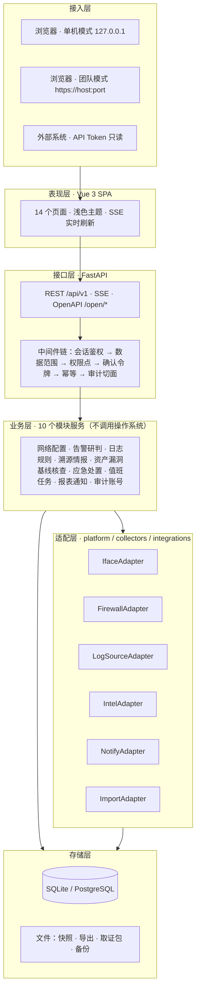
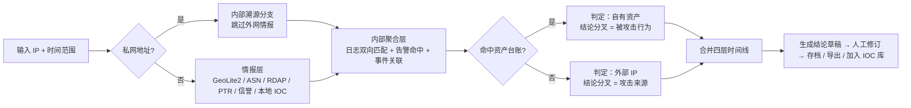
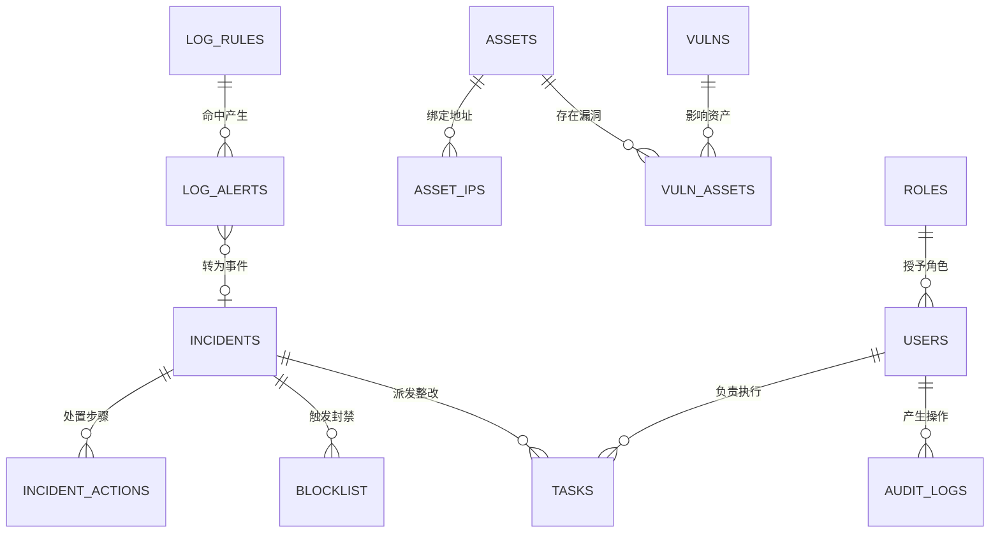
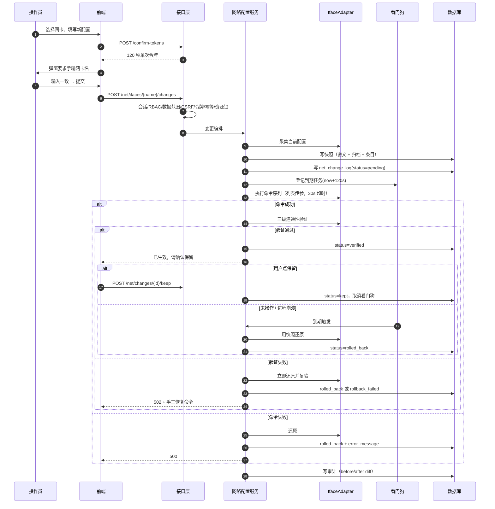
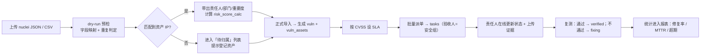
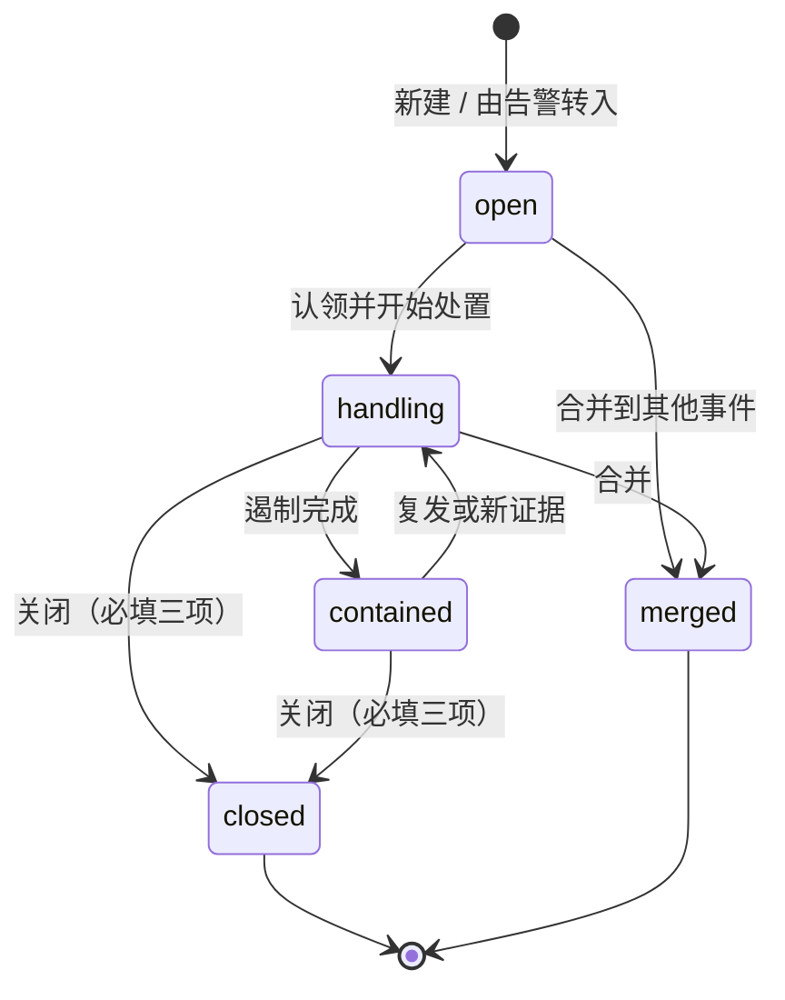

# 蓝盾（BlueGuard）· 网络安全蓝队运营平台设计文档

| 项 | 内容 |
|---|---|
| 文档名称 | 蓝盾（BlueGuard）网络安全蓝队运营平台 · 系统设计文档 |
| 文档版本 | V2.1 |
| 编制日期 | 2026-11-04 |
| 文档状态 | 评审稿 |
| 适用阶段 | 立项评审、研发实现、测试验收、交付部署 |
| 配套交付 | `prototype/index.html`（可点击高保真原型，14 页）、`docs/设计文档_评审版.html`（浏览器阅读版） |
| 适用对象 | 安全运营团队、研发团队、交付与实施人员、评审人 |

**修订记录**

| 版本 | 日期 | 修订内容 | 修订人 |
|---|---|---|---|
| V1.0 | 2026-11-04 | 首次成稿：7 模块、23 张表、8 页面 | 架构组 |
| V2.1 | 2026-11-04 | 明确交付语义：默认形态改为**单机便携版（拷走即用、零依赖、离线可用）**；多人使用降级为「同一部署内多账号」，明确不做多机联机/实时协同；新增 3.4 便携版四条硬指标、11.7 离线可用与换机迁移、11.8 十分钟可用性验收 | 架构组 |
| V2.0 | 2026-11-04 | 按「功能完善、可交付他人使用」重构：模块扩至 14 个，新增告警研判台、漏洞台账、基线核查、值班与任务、报表中心、通知中心、系统管理；表扩至 42 张；页面扩至 14 个；部署支持**单机模式**与**团队模式**双形态；新增开放接口（API Token）与数据范围隔离 | 架构组 |

**V2.0 相对 V1.0 的关键变化**

| 变化 | 说明 |
|---|---|
| 定位升级 | 从「单机自用工具」升级为「可交付、可多人协同的运营平台」，支持交付给他人部署使用 |
| 部署双形态 | 单机模式（回环、SQLite、单人为主）与团队模式（局域网 HTTPS、PostgreSQL、多用户并发） |
| 协同能力 | 自定义角色、数据范围隔离、值班表与交接班、任务派发、通知外发、报表分发 |
| 运营闭环 | 告警 → 事件 → 处置 → 漏洞 → 基线 → 报表，形成完整运营链路而非单点工具 |
| 可集成 | API Token 开放只读接口、Webhook 外发、外部扫描结果导入、IOC 批量导入 |
| 可交付 | 初始化向导、备份恢复界面、健康自检、升级与版本说明、许可与免责声明 |

---

## 1 概述

### 1.1 背景与问题

中小型网络与单机环境的安全运营普遍存在六个断点：

1. **配置与记录分离**：改网卡 IP、切网段这类高频操作靠手工敲命令，改完不记、改错不回，事后无法回答「谁在几点把哪台机器改到哪个网段」。
2. **溯源靠人肉拼接**：拿到可疑 IP，要在防火墙日志、系统事件日志、资产表、情报网站之间来回切换，最后靠记忆写结论，无法复现。
3. **台账与漏洞脱节**：资产台账在 Excel，扫描结果在另一个文件，整改跟踪靠口头，漏洞与资产、责任人、SLA 对不上。
4. **审计不可信**：自建工具的操作日志可被直接改库删除，出了问题不能作为证据。
5. **处置无闭环**：封禁之后不清楚防火墙里到底有没有生效；事件处置靠群聊，交接班没有留痕。
6. **只看不运营**：没有周报月报、没有 SLA 统计、没有值班机制，安全团队的工作量无法向管理层呈现。

蓝盾把这六件事收在一个可交付的平台上：**网络配置、告警研判、日志检索、IP 溯源、资产与漏洞、基线核查、应急响应、值班任务、报表输出、审计与通知**。

### 1.2 产品定位

**面向防守方的网络安全运营平台。以「单机成品、拷走即用」为默认交付形态：一个压缩包解压、双击启动、浏览器打开就能用，不需要装数据库、不需要联网、不需要运维。**

判据很简单：把安装包发给一个不懂技术的人，他能在 10 分钟内自己跑起来并把资产录进去——达不到这个标准就不算交付完成。

| 维度 | 默认形态：单机便携版 | 可选形态：多账号协同（同一台机器或同一内网部署） |
|---|---|---|
| 面向对象 | 个人值守 / 应急取证 / 交付给第三方使用 | 3–30 人的安全小组共用一套部署 |
| 交付物 | 一个 zip（Windows）/ 一个 tar.gz（Linux），解压即用 | 同一套程序，换成 PG 并开监听 |
| 访问方式 | 仅本机 `127.0.0.1`，随机端口 | 内网 `https://<主机>:<端口>`，可加 IP 白名单 |
| 存储 | SQLite 单文件，随目录走 | PostgreSQL 14+ |
| 依赖 | **零外部依赖**（Python 运行时已打进包、前端静态资源本地化） | 需要一台 PG |
| 网络 | **完全离线可用**（情报走本地库与离线模式） | 可选开启外网情报 |
| 并发 | 单人（可建多个本地账号区分职责） | 多用户并发、按人审计、数据范围隔离 |

**关键说明**：

- 上文「多人使用」指**在同一次部署里建多个账号**（比如一个部署放在值班机上，班长/值班员用不同账号登录），**不是多台机器联机、不是实时协同编辑**。平台没有房间、没有同步协议、没有服务端集群。
- 两种形态共用同一套代码与数据模型，靠启动配置 `deployment.mode` 切换；升级路径是「先自己用顺，再给小组用」，切换时提供数据迁移工具（SQLite → PostgreSQL）。
- 交付给他人的场景（客户、同事、外包团队）一律走默认形态：他不改配置、不装依赖、不需要你远程协助。

### 1.3 设计原则

| 原则 | 落地方式 |
|---|---|
| 危险操作可逆 | 改网络配置必须先快照、执行后必须验证、验证失败自动回滚，再加 120 秒延迟生效看门狗兜住「把自己改失联」 |
| 凡是写操作必留痕 | 写操作统一走审计切面，记录变更前后值；审计表用哈希链 + 只增触发器，禁止改删 |
| OS 调用收口 | `netsh` / PowerShell / `ip` / `nmcli` 只出现在 `platform/` 适配层，业务层依赖三个 Protocol 接口，保证可单测、可跨平台 |
| 明文与密文分离 | 日志正文脱敏后入全文索引供检索；原始正文列级加密，查看原文单独授权并再次留痕 |
| 结论可追溯 | 每条溯源结论、每次处置、每个漏洞修复都绑定 `trace_id` 与证据路径 |
| 能力不越界 | 只做防守侧能力，不含扫描/爆破/利用/提权；外部扫描结果只做**导入**，平台自身不发起探测 |
| 交付即可用 | 初始化向导、健康自检、备份恢复、版本信息、许可声明齐备，拿到安装包的人不看文档也能跑起来 |

### 1.4 术语表

| 中文名 | 英文键名 / 表名 | 说明 |
|---|---|---|
| 部署模式 | `deployment.mode` | `standalone` 单机 / `team` 团队 |
| 网卡 | `iface` | 网络适配器 |
| 网卡快照 | `net_iface_snapshots` | 某一时刻网卡完整配置的加密存档 |
| 变更记录 | `net_change_log` | 一次网卡变更的执行记录，含验证结果与看门狗时间 |
| 延迟生效看门狗 | `watchdog` | 变更后启动的定时还原任务，超时未确认自动还原 |
| 情报缓存 | `ip_intel_cache` | IP 归属地、ASN、Whois、信誉的本地缓存，按 TTL 分级过期 |
| 溯源记录 | `ip_trace_records` | 一次溯源分析的结论存档 |
| 情报条目 | `ioc_entries` | IOC 指标库（IP/域名/URL/哈希），支持批量导入与本地命中 |
| 采集源 | `log_sources` | 日志来源配置 |
| 检测规则 | `log_rules` | 日志匹配规则，兼容 Sigma YAML 子集 |
| 告警 | `log_alerts` | 规则命中后聚合去重形成的待研判条目 |
| 告警研判 | `triage` | 对告警做定性（真实/误报/待观察）与归并的分诊过程 |
| 事件 | `incidents` | 需要跟踪处置流程的安全事件，分 P1–P4 |
| 处置动作 | `incident_actions` | 事件内的一次具体动作（封禁、隔离、取证、备注） |
| 封禁清单 | `blocklist` | 期望生效的封禁集合，与系统防火墙规则做对账 |
| 漏洞 | `vulns` | 一个漏洞条目，含 CVSS、来源、状态、SLA |
| 基线策略 | `baseline_policies` | 一组配置核查项（等保 2.0 / CIS 等） |
| 核查发现 | `baseline_findings` | 某台主机在某检查项上的结果（合规/不合规/无法核查） |
| 任务 | `tasks` | 派发给某人的待办（整改、复查、值守事项） |
| 值班班次 | `duty_shifts` | 某时段的主值班/备值班安排 |
| 交接班记录 | `duty_handovers` | 班次交接的事项、未闭环项、附件 |
| 报表模板 | `report_templates` | 定义报表包含哪些区块与统计口径 |
| 通知渠道 | `notify_channels` | 邮件 / Webhook / 企业微信 / 钉钉 |
| 通知规则 | `notify_rules` | 什么事件、什么级别、发给谁（渠道 + 接收人） |
| 自定义角色 | `roles` | 权限点集合，可继承内置角色 |
| 数据范围 | `scope` | 角色可见的数据边界（全部 / 本部门 / 仅自己负责） |
| 开放令牌 | `api_tokens` | 供外部系统调用的只读 Token，绑定权限点与来源 IP |
| 审计日志 | `audit_logs` | 平台内写操作记录，哈希链串接，只增不改 |
| 确认令牌 | `confirm_tokens` | 危险操作的二次确认凭证，绑定操作人与载荷哈希，单次有效 |
| 幂等键 | `idempotency_keys` | 防止重复提交导致重复执行 |
| 风险分 | `risk_score` | 0–100 的 IP 风险综合分，见 5.5.3 |
| 归属确认 | `authz_confirmed` | 资产是否已确认归属与授权 |

---

## 2 范围与边界

### 2.1 功能模块全景（14 个）

| 编号 | 模块 | 核心能力 | 页面路由 | 主要使用者 |
|---|---|---|---|---|
| M1 | 总览仪表盘 | 关键指标、趋势、榜单、采集健康、SLA 概览 | `/dashboard` | 全员 |
| M2 | 网络配置管理 | 网卡枚举、静态/DHCP 切换、多 IP、网关/DNS、启停、快照与回滚、变更历史 | `/network` | 处置员 / 运维 |
| M3 | 告警研判台 | 告警队列、攻击链视图、批量研判、误报学习、转事件 | `/alerts` | 一线研判 |
| M4 | 日志采集与检索 | 6 类采集源、全文检索、原文查看、检测规则、投递测试 | `/logs` | 一线研判 |
| M5 | IP 溯源与情报库 | 情报查询、内部聚合、资产关联、时间线、结论存档；IOC 库管理 | `/trace` | 一线研判 / 追踪 |
| M6 | 资产与指纹台账 | 资产 CRUD、归属确认、多 IP、服务指纹、CSV 导入导出 | `/assets` | 资产管理 |
| M7 | 漏洞台账 | 漏洞登记/导入、CVSS、资产关联、修复跟踪、复测、SLA | `/vulns` | 漏洞管理 |
| M8 | 基线核查 | 基线策略、只读核查、结果归集、整改派单、合规率统计 | `/baseline` | 合规 / 加固 |
| M9 | 应急响应与隔离 | 事件管理、封禁/解封/端口封禁/主机隔离、对账、取证包 | `/incident` | 处置负责人 |
| M10 | 值班与任务 | 值班表、交接班、任务派发/跟踪/督办、待办中心 | `/duty` | 全体 / 班长 |
| M11 | 报表中心 | 报表模板、定时生成、分发、归档、SLA 与工作量统计 | `/reports` | 管理层 / 汇报 |
| M12 | 审计 | 全量写操作留痕、哈希链校验、合规导出 | `/audit` | 审计员 |
| M13 | 通知中心 | 渠道配置、通知模板、订阅规则、静默时段、发送日志 | `/notify` | 管理员 |
| M14 | 系统管理 | 账号、自定义角色、部门、API Token、备份恢复、健康自检、升级 | `/settings` | 管理员 |

### 2.2 非目标（明确不做，避免范围蔓延）

| 不做的事 | 原因 |
|---|---|
| 端口扫描、指纹探测、口令爆破、漏洞利用、提权 | 平台定位是防守方运营台。漏洞数据来自**导入**外部扫描结果（nuclei JSON/CSV）或人工登记，平台自身不发起探测 |
| 自建 Elasticsearch 集群 / 替代 SIEM | 单机用 SQLite FTS5、团队模式用 PostgreSQL `pg_trgm`，检索能力上限见 6.5 |
| APT 组织归因 | 归因属国家级情报能力，平台只回答「这个 IP 在我们环境里做了什么」 |
| 内置反编译、沙箱、动态分析 | 样本逆向通过「导出取证包 → 外部工具分析 → 结论回填」完成 |
| 云端 SaaS 多租户 | 团队模式为**单组织多用户**，不做跨租户隔离与计费 |
| 多机联机 / 实时协同 / 服务端集群 | 本平台的「多人使用」指**同一次部署里建多个账号**，不做跨机器联机、房间、同步协议、分布式集群。数据只有一份，在本机 `data/` 目录里 |
| 工单系统替代 | 只做轻量任务与派单，不与 Jira/禅道做双向同步（V2 提供 Webhook 单向通知） |

### 2.3 角色与典型场景

**内置角色**

| 角色 | 定位 | 关键限制 |
|---|---|---|
| `admin` 管理员 | 平台维护者 | 全部权限；可管理账号、角色、系统参数、备份 |
| `analyst` 研判员 | 一线告警研判 | 可研判告警、检索日志、查溯源；**不可**改网络配置、不可封禁（需提交处置申请） |
| `responder` 处置员 | 事件处置 | 研判 + 处置动作（封禁/隔离）+ 网络配置；不可见审计 |
| `auditor` 审计员 | 合规检查 | 全平台只读 + 审计可读可校验可导出；无任何写权限 |
| 自定义角色 | 按需组合 | 由管理员勾选权限点 + 设定数据范围（全部/本部门/仅本人负责） |

**数据范围隔离**：角色可绑定 `scope`，控制「能看到哪些数据」：`all` 全部、`dept` 本部门（按 `users.department` 匹配资产的 `department`）、`own` 仅本人负责的资产与由本人处置的事件。查询层在仓储层统一注入范围条件，而不是在各页面各写一遍——这是多用户场景最容易出越权的地方。

**场景一：应急切网段（M9 + M4）**
值守发现某台机器疑似横向移动源头，需要立即把本机从业务网段切到隔离网段取证。处置员在网卡页选择网卡 → 编辑 → 改成隔离网段静态 IP → 预览 diff → 手输网卡名确认 → 执行。系统先快照、再执行、再验证网关与 DNS；验证通过后进入 120 秒看门狗倒计时，处置员在倒计时内点「配置正常，保留变更」。若忘了点、浏览器断了、或进程崩了，120 秒后自动还原。

**场景二：从告警到事件到报表（M3 → M9 → M11）**
研判员在告警台看到一条 P2 候选：某 IP 对 3 台主机发起 RDP 爆破并成功一次。点开攻击链视图确认时间顺序 → 定性「真实」→ 转事件并指派给处置员 → 处置员封禁 IP、隔离主机、固定证据 → 修复完成后关闭事件并填根因 → 周报自动汇总「本周 P1–P4 数量、平均响应时长、TOP 攻击来源」。

**场景三：漏洞与基线闭环（M7 + M8 + M10）**
管理员导入上周外网扫描的 nuclei JSON 结果 → 平台按 IP 自动匹配资产与责任人 → 生成 37 条漏洞，其中 5 条高危超 SLA → 批量派单给责任人（生成 `tasks`）→ 同时跑一次基线核查，发现 12 台主机未开启登录审计 → 一并派单整改 → 整改完成后责任人上传复测结果，平台更新状态与合规率。

**场景四：交接班（M10 + M13）**
夜班结束前，值班人填写交接班记录：本班新增告警 18 条、已闭环 15 条、未闭环 3 条（列明）、待跟进事项 2 条。提交后系统通过通知渠道把交接摘要推送给白班接班人与班长；未闭环项自动转入接班人的待办列表。

### 2.4 合规声明与使用边界

1. **使用范围**：仅可用于**自有资产**或**已取得书面授权**的网络与主机。资产台账的 `authz_confirmed`（归属确认）是这条红线的技术落点：未确认归属的资产不得作为封禁、隔离目标，接口层直接拒绝（`AUTHZ_NOT_CONFIRMED`）。
2. **最小影响**：处置动作默认最小化（封单个 IP 而非整段、隔离保留管理通道），并提供撤销。
3. **数据留存**：日志可能含个人信息与业务数据。正文脱敏后入库、原文加密存储，默认保留 90 天（可配），到期自动清理；导出文件带导出人、时间、`trace_id` 水印。
4. **不留后门**：不提供隐藏账号、不提供绕过审计的接口、不提供远程控制能力。审计表在数据库层用触发器禁止 `UPDATE` / `DELETE`。
5. **多人使用时的责任划分**：每个操作绑定具体账号与角色，数据范围受角色约束；审计记录不可由任何角色（含管理员）删除，管理员只能新增与查询。
6. **交付声明**：交付给第三方时须随附本文件的第 2.4 节与附录 C「交付清单与免责说明」；平台不承诺替代专业安全服务，配置错误导致的网络中断由操作人负责，平台提供回滚能力但不承担业务损失。

---

## 3 总体架构

### 3.1 分层架构



**分层职责**

| 层 | 职责 | 不允许做的事 |
|---|---|---|
| 表现层 | 渲染、表单校验、二次确认交互、按权限隐藏入口 | 不拼接系统命令、不做权限判断（权限只在后端生效） |
| 接口层 | 参数校验、鉴权、数据范围注入、幂等、审计切面、统一响应 | 不写业务规则 |
| 业务层 | 业务编排、事务边界、状态机流转 | 不直接 `subprocess`、不硬编码 `netsh` |
| 适配层 | 系统命令封装、输出解析、第三方协议、错误归一 | 不含业务判断 |
| 存储层 | 数据持久化与索引 | 不存明文密钥 |

### 3.2 运行时拓扑

**单机模式**

```
┌──────────────────────────────────────────────────────────────┐
│ 浏览器 http://127.0.0.1:52381/?t=<一次性令牌>                  │
└───────────────────┬──────────────────────────────────────────┘
                    │ 仅回环，无外网监听
┌───────────────────▼──────────────────────────────────────────┐
│ uvicorn 单进程（bind 127.0.0.1）                              │
│  ├─ /api/v1/*        业务接口                                 │
│  ├─ /api/v1/events/stream  SSE 推送                            │
│  └─ /assets/*        前端静态资源                              │
├──────────────────────────────────────────────────────────────┤
│ 后台任务（asyncio）：采集轮询 · 规则引擎 · 看门狗 · 对账        │
│                     · 报表定时 · 通知派发 · 保留期清理          │
└──────────────────────────────────────────────────────────────┘
```

**团队模式**

```
┌──────────────────────────────────────────────────────────────┐
│ 团队浏览器 https://sec-ops.corp.local                          │
└───────────────────┬──────────────────────────────────────────┘
                    │ TLS（内置自签 或 反向代理提供的证书）
┌───────────────────▼──────────────────────────────────────────┐
│ Nginx / Caddy（可选，推荐）                                    │
│  · TLS 终止 · IP 白名单 · 请求体限流 · 访问日志                 │
└───────────────────┬──────────────────────────────────────────┘
┌───────────────────▼──────────────────────────────────────────┐
│ uvicorn（2–4 worker）+ 独立 scheduler 进程                     │
│  · 多 worker 承载并发请求                                      │
│  · scheduler 通过 PostgreSQL advisory lock 选主，单人执行定时任务 │
├──────────────────────────────────────────────────────────────┤
│ PostgreSQL 14+ （业务库）· 本地文件系统（快照/导出/取证包）       │
└──────────────────────────────────────────────────────────────┘
```

**为什么团队模式要单独拆 scheduler**：定时任务（采集、看门狗、对账、报表）在多 worker 下会被每个进程各执行一次。若靠进程内标志位去重，重启即失效。团队模式把定时任务放进单独进程，用 PG advisory lock 保证只有主实例执行，避免「同一台机器被采集两次」「同一份报表生成三份」。

### 3.3 代码目录结构

```
软件/
├─ docs/                                   设计文档与评审版
├─ prototype/                              可点击原型
├─ backend/
│  ├─ app/
│  │  ├─ main.py                           应用装配、启动令牌、静态资源挂载
│  │  ├─ scheduler.py                      定时任务入口（团队模式独立进程）
│  │  ├─ core/
│  │  │  ├─ config.py                      配置加载（环境变量 > 本地文件 > settings 表 > 默认）
│  │  │  ├─ security.py                    会话、CSRF、确认令牌、argon2、TOTP
│  │  │  ├─ rbac.py                        权限点定义、角色解析、数据范围依赖
│  │  │  ├─ scope.py                       数据范围 SQL 注入器（all/dept/own）
│  │  │  ├─ crypto.py                      AES-GCM、DPAPI/KMS、密钥装载
│  │  │  ├─ masker.py                      敏感值脱敏（统一规则）
│  │  │  ├─ audit.py                       审计切面、哈希链写入
│  │  │  ├─ idempotency.py                 幂等键
│  │  │  ├─ errors.py                      错误码与统一异常
│  │  │  └─ response.py                    统一响应包
│  │  ├─ db/
│  │  │  ├─ session.py                     双引擎装配（SQLite / PG）、PRAGMA 或连接池
│  │  │  ├─ models/                        每张表一个模块（42 张）
│  │  │  ├─ search.py                      检索抽象（FTS5 / pg_trgm 双实现）
│  │  │  └─ migrations/                    Alembic 版本脚本
│  │  ├─ platform/                         ★ OS 适配层（唯一允许出现系统命令的地方）
│  │  │  ├─ iface_base.py · iface_windows.py · iface_linux.py
│  │  │  ├─ firewall_base.py · firewall_windows.py · firewall_linux.py
│  │  │  ├─ psrunner.py                    子进程执行器（列表传参/超时/编码）
│  │  │  └─ connectivity.py                网关 ICMP / DNS / TCP 验证
│  │  ├─ integrations/                     第三方集成（协议封装，无业务逻辑）
│  │  │  ├─ intel_geoip.py · intel_rdap.py · intel_reputation.py
│  │  │  ├─ notify_smtp.py · notify_webhook.py · notify_wecom.py · notify_dingtalk.py
│  │  │  └─ import_nuclei.py · import_csv.py · import_ioc.py
│  │  ├─ modules/
│  │  │  ├─ net/        router · service · schema · snapshot · watchdog
│  │  │  ├─ alerts/     router · service · schema · triage · chain
│  │  │  ├─ logs/       router · service · schema · search
│  │  │  ├─ rules/      router · service · engine · builtin/
│  │  │  ├─ trace/      router · service · schema · timeline · ioc
│  │  │  ├─ asset/      router · service · schema · importer
│  │  │  ├─ vuln/       router · service · schema · importer · sla
│  │  │  ├─ baseline/   router · service · schema · runner · builtin/
│  │  │  ├─ incident/   router · service · schema · evidence · report
│  │  │  ├─ duty/       router · service · schema · task
│  │  │  ├─ report/     router · service · schema · renderer · schedule
│  │  │  ├─ notify/     router · service · schema · dispatcher
│  │  │  ├─ audit/      router · service · chain · exporter
│  │  │  ├─ dashboard/  router · service
│  │  │  └─ system/     router · service · user · role · token · backup · health
│  │  ├─ collectors/                       采集器
│  │  └─ static/                           前端构建产物
│  ├─ tests/                               单测（适配层用假实现）+ 集成测试
│  ├─ pyproject.toml · alembic.ini
├─ frontend/
│  ├─ src/
│  │  ├─ main.ts · App.vue · router.ts
│  │  ├─ api/ · layout/ · components/ · views/（14 个页面）
│  │  └─ styles/tokens.css
│  └─ vite.config.ts                       base:'./'，build 输出到 backend/app/static
├─ deploy/
│  ├─ docker/Dockerfile · docker-compose.yml（含 PG）
│  ├─ windows/install.ps1 · service.md
│  ├─ linux/bluedeploy.sh · bluedeploy.service
│  └─ nginx/bluedeploy.conf                TLS 与 IP 白名单示例
└─ data/                                   运行时数据（不入版本库）
   ├─ blueguard.db · master.key
   ├─ snapshots/ · exports/ · evidence/ · backups/
   └─ logs/app.log
```

### 3.4 交付形态与打包演进

**默认交付形态是第一行那个 zip。** 其余形态是给不同人群的可选项，不是主线。

| 优先级 | 形态 | 交付物 | 谁用 | 启动方式 | 用户需要准备什么 |
|---|---|---|---|---|---|
| **P0 默认** | Windows 便携版 | `BlueGuard-v2.0-win-x64.zip`（PyInstaller one-folder + 静态资源 + Python 运行时） | 交付给客户 / 同事 / 第三方 | 解压后双击 `BlueGuard.exe`，自动开浏览器 | **什么都不用装**，解压即可 |
| P0 | Linux 便携版 | `blueguard-v2.0-linux-x64.tar.gz` | 同上，Linux 桌面 | `./blueguard` | 解压即可 |
| P1 | 安装包 | `.msi` / `.deb`（带开始菜单、卸载项） | 需要「像正规软件一样」安装 | 安装后在开始菜单打开 | 双击安装 |
| P2 | Linux 服务版 | deb/rpm + systemd unit | 企业内网长期运行 | `systemctl start blueguard` | 需要 root |
| P2 | 容器版 | Docker 镜像 + compose（含 PostgreSQL） | 已有容器平台的组织 | `docker compose up -d` | 需要 Docker |
| P3 | 源码版 | 仓库 + `pip install` / `npm build` | 研发与二次开发 | `python -m uvicorn app.main:app` | Python 3.11+ / Node 20+ |

**便携版必须满足的四条硬指标**（这是「发出去别人能用」的验收线）：

1. **零依赖**：Python 运行时、依赖包、前端静态资源全部打进目录；目标机器不需要装 Python、Node、数据库、VC 运行库。
2. **离线可用**：不访问任何外网也能完整使用（情报走本地 mmdb 与离线模式，字体/图标/CDN 全部本地化，不引用任何远程资源）。
3. **数据跟着目录走**：所有数据在 `data/` 下，整个文件夹拷到 U 盘换台机器就能接着用（主密钥同目录，见 11.7）。
4. **卸载即删除**：不写注册表、不装服务、不在系统目录留文件；删掉文件夹即彻底卸载（便携版）。

**打包要点**：后端端口写 `data/runtime.json`（端口、PID、启动时间、模式），启动器读取后拼接 URL 并打开浏览器，业务代码零改动；前端 `base:'./'`，静态资源相对路径引用，可被 WebView 或 `file://` 之外的任意本地服务加载。

---

## 4 技术选型

| 层 | 选型 | 理由 | 被替换时的边界 |
|---|---|---|---|
| 后端框架 | FastAPI 0.115 + Uvicorn | 自带 OpenAPI，Pydantic 校验直接复用为入参校验；async 与采集器契合 | — |
| 进程模型 | 单机单进程；团队 2–4 worker + 独立 scheduler | 定时任务正确性依赖单实例，用 PG advisory lock 保证 | — |
| 数据库 | SQLite（WAL，单机）/ PostgreSQL 14+（团队） | 单机零运维单文件即备份；团队需要并发写、行级锁、更强索引 | 业务只依赖仓储接口，切库改 `db/session.py` 与方言 DDL 两处 |
| ORM / 迁移 | SQLAlchemy 2.0 async + Alembic | 异步 + 版本化迁移，双库共用同一套模型 | — |
| 检索 | SQLite FTS5 `trigram` / PG `pg_trgm` + GIN | 中文无空格分词，trigram 子串匹配对中文、IP、路径混合文本都稳，无需外部分词器 | `db/search.py` 双实现，接口签名不变 |
| 前端 | Vue 3 + Vite + TypeScript | 组合式 API 适合「筛选 + 表格 + 弹窗」重复结构 | — |
| UI | Element Plus（浅色主题） | 表格、分页、日期范围、抽屉、弹窗、树选择开箱可用 | 可换 Naive UI，接口不变 |
| 图表 | ECharts 5（按需引入） | 时间轴缩放、中文提示、堆叠柱/环形/关系图开箱可用 | — |
| 报表 | CSV（UTF-8 BOM）+ PDF（reportlab + 思源黑体）+ XLSX（openpyxl） | 纯 Python，无 GTK/浏览器依赖，打包零额外 DLL | — |
| 对称加密 | AES-256-GCM | 认证加密，密文被篡改可检出 | — |
| 主密钥 | Windows DPAPI；Linux 0600 文件；团队模式支持外部 KMS 文件 | 主密钥不落明文 | — |
| 口令 / 双因子 | argon2id + TOTP（RFC 6238） | 本地同样要防离线爆破；团队模式建议开启 TOTP | — |
| 通知 | SMTP（aiosmtplib）、HTTP Webhook、企业微信/钉钉机器人 | 覆盖企业最常见通知渠道，无需自建消息服务 | `NotifyAdapter` 接口可扩短信 |
| 任务调度 | 自研 asyncio 调度 + cron 表达式解析 | 任务种类少（采集/对账/报表/清理），引入 Celery 过重 | 若任务量与并发上升，换 Celery + Redis |
| 子进程 | `asyncio.create_subprocess_exec` + 列表传参 | 无 `shell=True`，从根上消除命令注入 | — |

**版本基线**：Python ≥ 3.11（本机 3.13 已满足）、Node ≥ 20（本机 22.22 已满足）、PostgreSQL ≥ 14（团队模式）。

---

## 5 功能设计

> 每个模块按「目标 → 功能点 → 关键规则 → 权限点 → 异常与边界」展开。接口清单见第 7 章，表结构见第 6 章，页面规格见第 10 章。

### 5.1 M1 总览仪表盘

**目标**：30 秒内回答「现在有没有事、事有多大、数据在不在流、团队在不在岗」。

**指标卡（10 张，每张 = 数值 + 环比 + 点击下钻）**

| 卡片 | 口径 | 下钻 |
|---|---|---|
| 今日告警 | `log_alerts` 中 `first_seen_at` 落在今日且已研判为真实/待观察的条数 | `/alerts?range=today` |
| 待研判告警 | `status='new'` 且 `first_seen_at` 距今 > 15 分钟（超过研判 SLA） | `/alerts?overdue=1` |
| 未处置事件 | `incidents.status IN ('open','handling','contained')` | `/incident?status=active` |
| 超 SLA 事件 | 未关闭且 `now > sla_due_at` | `/incident?overdue=1` |
| 资产总数 | `assets.status != 'retired'` | `/assets` |
| 24 小时日志量 | `logs` 中 `event_time > now-24h` 计数 | `/logs?range=24h` |
| 高危漏洞 | `vulns.status IN ('confirmed','fixing') AND cvss_score >= 7.0` | `/vulns?level=high` |
| 基线合规率 | 最近一次核查中「合规项 / 可核查项」 | `/baseline` |
| 生效封禁 | `blocklist.removed_at IS NULL AND sync_state='synced'` | `/incident?tab=blocklist` |
| 网卡健康 | 期望可达网卡中「已启用且有默认网关」的比例 | `/network` |

**图表**

- 告警趋势：近 7 天按天堆叠柱，堆叠维度 `severity`（critical/high/medium/low），low 在最下。
- 事件优先级分布：P1–P4 环形。
- 处置时效：近 30 天「告警→认领」「事件→关闭」两张折线（中位数），用于判断团队是否在 SLA 内。

**榜单与状态**

- 最近高危告警（8 条）：规则名、命中对象、时间、状态。
- 最近敏感操作（8 条）：来自 `audit_logs` 中 `risk_level IN ('sensitive','critical')`。
- 采集源健康表：源、类型、状态、速率、最近采集、错误摘要。
- **当前值班**：今日主值班/备值班姓名与联系方式、是否在岗（最近 30 分钟有操作）。团队模式下这是管理者最关心的信息之一。

**规则**：所有指标走单次聚合查询（`/dashboard/summary` 一次返回 10 个指标），避免 10 个并发请求；页面打开后通过 SSE 订阅告警、事件、采集状态变化，收到事件后仅局部刷新对应卡片。

**权限点**：`dashboard:read`（所有角色默认具备）。

**边界**：无数据时显示 `0` 与「近 7 天无数据」占位；采集源异常时顶部黄色提示条，点击跳 `/logs?tab=sources`；数据范围非 `all` 的用户，所有指标按范围重算（例如仅统计本部门资产相关告警）。

### 5.2 M2 网络配置管理

**目标**：把「改 IP」从一条不可回退的命令，变成一次可快照、可验证、可回滚、可审计的操作。这是平台区别于普通 SIEM 的差异化能力。

#### 5.2.1 网卡枚举

展示字段：网卡名（`iface_name`）、描述、MAC、状态（已连接/已断开/已禁用）、速率、DHCP 是否开启、IPv4 地址列表（主/次标记）、IPv6 链路本地、默认网关、DNS 列表、接口跃点数、GUID。

数据来源：Windows 优先 PowerShell `Get-NetAdapter` + `Get-NetIPAddress` + `Get-NetRoute` 组合（结构化 JSON，避免解析 `netsh` 中文文本）；Linux 用 `ip -j addr` + `ip -j route`。解析失败降级到文本解析，并在界面标注「降级解析」。

筛选：默认隐藏「已禁用且无 IP」的虚拟网卡（WSL、VMware host-only），提供开关显示全部。

#### 5.2.2 支持的变更动作

| 动作 `action` | 参数 | 说明 |
|---|---|---|
| `set_static` | `ip`、`prefix_len`、`gateway`、`dns[]` | 切换为静态并设置主地址 |
| `set_dhcp` | `dns_from_dhcp` | 切换为自动获取 |
| `add_ip` / `del_ip` | `ip`、`prefix_len` | 追加/删除次要 IP（禁止删除主 IP） |
| `set_gateway` | `gateway`、`metric` | 修改默认网关 |
| `set_dns` | `dns[]` | 修改 DNS（最多 4 个） |
| `enable` / `disable` | — | 启停网卡 |

**前置校验（执行前全部完成）**

1. 网卡存在且未被其他变更锁定（`RESOURCE_LOCKED`）。
2. IP 格式与网段合法性：`ipaddress` 解析；`prefix_len` 与 IP 版本一致；拒绝 `0.0.0.0`、组播、广播；静态 IP 与网关必须同网段（跨网段要求显式 `allow_cross_subnet=true`）。
3. DNS 必须为合法 IP。
4. `disable` 额外校验：该网卡是否为唯一可达管理通道（唯一「已启用 + 有默认网关」的网卡）。若是则拒绝，`force=true` 才允许且审计标 `critical`。
5. 管理员权限检测：无权限返回 `ELEVATION_REQUIRED`，只给指引，不尝试提权。

#### 5.2.3 变更执行流水

```
① 权限与前置校验（含数据范围：仅本部门资产所属主机可操作）
② 采集变更前配置 → 生成快照（trigger=pre_change）
      · 明文 JSON 落 data/snapshots/<id>.json，算 sha256
      · AES-GCM 加密后写 payload_enc
      · 结构化条目写 net_snapshot_items（供 diff）
③ 写 net_change_log(status=pending)，登记看门狗（now+120s）
④ 执行命令（列表传参，单条 30s 超时），命令序列写 command_trace（脱敏）
⑤ 连通性验证三级
      L1 网关 ICMP：4 次探测，成功 ≥2 通过
      L2 DNS 解析：2s 内返回通过
      L3 TCP 握手（可选）：3s 连接
⑥ 通过 → status=verified，看门狗进入待确认倒计时
   失败 → 立即用快照还原 → 复验
        还原成功 → rolled_back，返回失败原因与差异
        还原失败 → rollback_failed，全局红色横幅 + 可粘贴的手工恢复命令
⑦ 写审计（success/failed，含 before/after diff）
```

**延迟生效看门狗（最重要的安全阀）**

- 执行成功即登记「到期自动还原」；`watchdog_at` 记录到期时间。
- 用户点「配置正常，保留变更」→ `kept`，取消任务。
- 到期未确认 → 自动还原 → `rolled_back`，`note=watchdog_auto_restore`，SSE 通知。
- **进程重启恢复**：启动时扫描 `status='verified'` 记录，未到期重新登记，已过期立即还原。这是独立于进程内存的保险。
- 时长可配（默认 120 秒，范围 60–600）。

#### 5.2.4 快照与回滚

- 快照列表：触发方式（变更前/手动/还原前/启动）、时间、操作人、IP 摘要、`digest` 前 12 位。
- 详情：结构化字段 + 原始 JSON 下载（需 `net:snapshot:download`，下载写审计）。
- **diff 视图**：与当前配置对比，新增绿 `+`、删除红 `−`、变更左右并排。
- **一键回滚**：同样走确认令牌 + 快照 + 验证 + 看门狗；回滚前先给当前配置拍 `auto_pre_restore` 快照，保证「回滚也能回滚」。
- 保留：默认 90 天或每网卡最近 50 份，先到者为准；手动快照永久保留。

#### 5.2.5 变更历史

表列：时间、网卡、动作、操作人、验证结果（三级图标）、状态、耗时、`trace_id`。展开可见命令序列、before/after diff、错误信息、关联快照入口。

**权限点**：`net:read`、`net:write`、`net:snapshot:rollback`、`net:snapshot:download`。

**异常与边界**

| 情况 | 处理 |
|---|---|
| 无管理员权限 | `ELEVATION_REQUIRED`，不改任何配置 |
| 网卡被占用 | `RESOURCE_LOCKED`，返回持锁人与开始时间 |
| 命令返回非 0 | 解析 stderr 归一为中文原因，立即回滚 |
| 验证超时 | 视为失败进入回滚（默认 L1 8s / L2 3s / L3 4s，可配） |
| 目标 IP 已存在 | 执行前预检直接拒绝并提示冲突网卡 |
| 变更中网卡被拔出 | 命令失败 → 回滚；网卡已不存在则标 `rollback_failed` 并提示人工介入 |
| Linux 无 `nmcli` | 降级 `ip` 命令；NetworkManager 接管场景提示「配置可能被覆盖」 |

### 5.3 M3 告警研判台

**目标**：把「一堆告警」变成「几条可决策的结论」，并让多人协作时不重复处理。

#### 5.3.1 研判队列

- **排序公式（确定性，可配置权重）**：

```
priority = severity_weight(severity)          # critical 40 / high 25 / medium 12 / low 4
         + asset_weight(最高涉及资产重要度)     # criticality × 4
         + internal_bonus                      # 涉及自有资产 +10
         + hit_weight                          # min(15, hit_count / 4)
         + age_weight                          # min(10, 等待分钟 / 30)
```

  列表默认按 `priority` 降序，支持切换按时间/严重级排序。公式与权重写在 `settings` 里，改权重需审计。

- **认领锁定**：研判员点「认领」后写 `log_alerts.handled_by` 与 `locked_until`（默认 30 分钟），其他人看到「已被 张三 处理中」且不可重复认领；超时未处理自动释放，避免「有人认领了但下班了」。

- **批量研判**：勾选多条 → 批量定性（真实/误报/待观察）、批量打标签、批量转事件（**同源自动合并**：同一 `src_ip` 且时间窗 2 小时内的告警合并为 1 个事件，避免一个攻击者产生 12 个事件）。

#### 5.3.2 攻击链视图

以 `src_ip` 为中心，把该源在时间窗内的告警按 MITRE ATT&CK 战术阶段归并展示：

| 阶段 | 典型内置规则 | 展示 |
|---|---|---|
| 侦察 Reconnaissance | BL-0011 异常外联、端口探测类日志 | 灰 |
| 初始访问 Initial Access | BL-0001/0003/0004 暴力破解、BL-0002 爆破成功 | 橙 |
| 执行 Execution | BL-0009 可疑 PowerShell、BL-0010 LOLBins | 橙 |
| 持久化 Persistence | BL-0008 服务安装、BL-0006 新建账号 | 红 |
| 提权 Privilege Escalation | BL-0007 加入管理员组 | 红 |
| 横向移动 Lateral Movement | BL-0003 SMB、RDP 内网连接 | 红 |
| 防御绕过 Defense Evasion | BL-0012 日志被清除 | 深红 |

- 视图形态：左列阶段、右列该阶段的告警卡片，卡片间按时间连箭头；顶部显示「该源共命中 N 个阶段，疑似攻击链完整度 4/7」。
- **判定纪律**：只呈现「观察到的告警」，不推断「一定是攻击链」。界面固定标注「阶段归并为辅助视图，不代表已完成攻击链确认」。

#### 5.3.3 定性结论

每条告警研判必须落一个结论（不可只关闭不填）：

| 结论 | 含义 | 后续动作 |
|---|---|---|
| `true_positive` 真实 | 确认为安全事件 | 必须转事件或关联已有事件 |
| `benign` 正常行为 | 业务正常，规则命中但不构成威胁 | 可选「加入例外」 |
| `false_positive` 误报 | 规则/解析问题 | 必须选择误报原因标签 |
| `need_info` 待补充 | 信息不足 | 转任务给资产责任人协助 |

**误报原因标签**（用于后续规则优化）：规则过宽 / 解析错误 / 资产标签缺失 / 业务变更未报备 / 测试流量 / 其他。

#### 5.3.4 例外与抑制

- 标记误报时可勾选「该规则对该对象抑制 24 小时/7 天/永久」，写入 `alert_suppressions`（不新建表，复用 `log_alerts.note` + `settings` 中的抑制表？——**采用独立字段**：`log_alerts.suppress_scope` 与 `suppress_until`，实现简单且可审计）。
- 抑制只影响**新告警的生成**，历史告警保留，避免「一抑制就看不见」。
- 抑制记录在告警台顶部「当前生效的抑制 3 条」中可查看与撤销。

**权限点**：`alert:read`、`alert:triage`（定性/认领）、`alert:suppress`、`incident:write`（转事件）。

**边界**：同一告警被两人同时认领时，后者收到 `RESOURCE_LOCKED` 并提示当前处理人；跨数据范围的告警对无权限用户不可见（列表与详情一致，不做「能看到标题看不到内容」的假隔离）。

### 5.4 M4 日志采集与检索

**目标**：把散落在系统各处的日志收进一个可检索、可规则化、可告警的管道。

#### 5.4.1 采集源（6 类）

| 类型 `kind` | 采集方式 | 游标 | 说明 |
|---|---|---|---|
| `win_event` | `Get-WinEvent -FilterHashtable @{LogName=…; StartTime=…; ID=…}` 输出 JSON | 最后一条 `RecordId` | 支持通道（Security/System/Application/Sysmon）与事件 ID 白名单 |
| `journald` | `journalctl -o json --since <cursor>` | `__CURSOR` | Linux 环境 |
| `file_tail` | 文件偏移增量读取，支持多行合并（以时间戳行开头） | 字节偏移 + inode | 自定义应用日志 |
| `syslog_udp` | 内置 UDP 监听（默认 5514） | 无（流式） | 网络设备日志 |
| `syslog_tcp` | 内置 TCP 监听（默认 601），支持 RFC 5425 TLS | 无（流式） | 需要可靠传输的设备 |
| `manual_import` | 上传 CSV/JSON/EVTX 导出文件 | 无 | 一次性回溯分析 |

**采集循环**：取上一轮游标之后的数据，批量入库（单批 ≤ 500 条），成功后更新游标；失败指数退避（5s→10s→30s→60s 封顶），连续失败 3 次标 `health='error'` 并 SSE 推送 + 触发通知规则。

**投递测试**：新建采集源时先「试采」——取 10 条样本回显、显示字段映射结果，不写库。避免配错通道导致空跑。

#### 5.4.2 入库与去重

- **归一化**：不同来源映射到统一字段（`host`、`username`、`src_ip`、`src_port`、`dst_ip`、`dst_port`、`event_id`、`level`、`category`、`message`）。
- **去重**：`dedup_hash = sha256(source_id + event_id + event_time + host + username + sha256(message))`，`(source_id, dedup_hash)` 唯一索引，重复被 `INSERT OR IGNORE` 丢弃，计数展示「本轮去重 N 条」。
- **明密分离**：`message_masked` 经 `Masker` 脱敏后入索引；`raw_enc` 存原文密文，`raw_sha256` 存摘要。
- **保留期**：默认 90 天，每日 03:00 清理，每批 5000 行避免长事务锁库；清理动作写审计（记录删除条数与时间范围）。

#### 5.4.3 检索

- 关键字：FTS5 / `pg_trgm` 匹配，支持 `AND`/`OR`/引号短语；中文靠 trigram 子串匹配。
- 时间范围：快捷 1h / 24h / 7d / 自定义；时间字段固定 `event_time`，同时显示 `ingested_at` 供排查延迟。
- 字段筛选：主机、账号、源 IP、目的 IP、事件 ID、级别、采集源、标签。
- 结果统计条：命中数、耗时（ms）、是否采样、时间跨度。
- 详情抽屉：全字段 + 关键字高亮 + 「查看原文」（需 `log:raw`，每次解密写审计）+ 「以此 IP 溯源」+ 「查看同主机」+ 「加入 IOC 库」。
- 性能约束：单次返回上限 500 条，超出提示缩小范围；聚合统计单独走无 limit 查询。

**两条由实测确认的检索约束（编码时必须实现，否则功能不可用）**

1. **含点号/连字符的关键词必须整体加双引号再进 MATCH**。实测：`MATCH '203.0.113'` 直接抛 `fts5: syntax error near "."`，`MATCH '"203.0.113"'` 才能命中。因此解析用户输入时，凡命中 `[0-9]+\.[0-9]+\.[0-9]+`、IPv6、`8.8.8.8:53`、`C:\path\x.exe`、`a-b` 形态的 token，一律包成 `"…"` 短语；解析失败按普通短语处理，绝不把原始输入直接拼进 MATCH（这同时是注入面）。
2. **少于 3 个字符的关键词 trigram 检索不到，必须走 `LIKE` 兜底**。实测：库里存 `用户登录失败`，`MATCH '登录失败'` 命中 1 条，`MATCH '登录'`、`MATCH '失败'` 均为 **0 条**（trigram 以 3 字符为单位建索引）。而中文用户极高频输入两字词（登录、失败、告警、封禁），若不兜底会大面积漏报——这是**假阴性**，比慢更危险。

```
查询改写规则（确定性，需单测）：
  拆词 → 对每个 token：
    len < 3           → 该 token 走 LIKE '%tok%'（前缀索引可用时用 LIKE 'tok%'）
    含 . : \ / - 空格 → 包成 "tok" 短语
    其余              → 原样作为 MATCH 词
  多 token 组合：全部走 MATCH 的部分用 AND 连接；混有短词时用子查询交集
  代价：短词 LIKE 无法用 FTS 索引，必须叠加 event_time 范围与主机/级别过滤把扫描量压下来；
       单次短词检索超过 2 秒返回「建议加时间范围或主机过滤」，不静默超时
```

#### 5.4.4 检测规则

**4 种匹配方式**

| `match_type` | 语义 | 示例 |
|---|---|---|
| `field` | 字段等值/集合 + 逻辑组合 | `event_id in [4625] and level = 'medium'` |
| `regex` | 指定字段正则 | `message ~ 'failed password for .* from (?P<ip>\d+\.\d+\.\d+\.\d+)'` |
| `threshold` | 窗口内按维度计数超阈值 | 5 分钟内同一 `src_ip` 的 4625 ≥ 10 次 |
| `sequence` | 有序事件序列 | 4625 连续失败 → 4624 成功 |

**表达式格式**：YAML，兼容 Sigma 子集的 `logsource` / `detection` / `condition` 三段，平台扩展放 `x-blueguard` 命名空间（`threshold`、`group_by`、`window_sec`、`suppress_sec`、`attack_tech`、`response_hint`），保证规则文件在 Sigma 工具链里仍可用。

**内置规则 16 条**（见附录 A），每条带 ATT&CK 编号与处置建议。

**规则变更安全阀**：新增/修改规则必须先跑「历史回放」——只统计命中数、不产生告警，可选近 7 天或自定义区间；确认命中量级合理后再启用。避免一条写松的规则把告警刷爆。

#### 5.4.5 告警生成与聚合

- 聚合：同规则 + 同 `agg_key`（如 `src_ip` 或 `host+username`）在 `suppress_sec` 窗口内（默认 600 秒）合并为 1 条，`hit_count` 累加，`sample_log_ids` 保留最多 20 条样本。
- 生成后立即触发通知规则判定（见 5.13），并把新告警推给研判台队列（SSE）。

**权限点**：`log:read`、`log:raw`、`rule:read`、`rule:write`、`source:write`、`source:test`。

**异常与边界**

| 情况 | 处理 |
|---|---|
| 采集源无读取权限 | `health='error'` + 中文原因（如「需管理员权限读取安全日志」），不反复重试打爆日志 |
| 文件被轮转 | 检测 inode 变化，按新文件从 0 开始续采，记录一次「重连续采」事件 |
| 单条超大日志（> 256KB） | 截断入库，`raw_enc` 保存前 256KB 并在详情标注「已截断」 |
| 时钟漂移 | 入库时与服务器时间偏差 > 5 分钟的记录标 `clock_skew` 标签，时间线视图单独提示 |
| 检索超时（> 10s） | 中断并提示「请缩小时间范围或增加主机/级别过滤」，同时记录慢查询供优化 |

### 5.5 M5 IP 溯源与情报库

**目标**：把一个孤立 IP 变成一份可复现、可存档、可导出的结论；把情报沉淀成可复用的库。

#### 5.5.1 四阶段流水



#### 5.5.2 情报层字段与降级

| 维度 | 来源 | 缓存 TTL | 失败降级 |
|---|---|---|---|
| 国家/省/市/ISP | 本地 GeoLite2 City（离线 mmdb） | 7 天 | 缺库时显示「未配置离线库」，不阻塞其余维度 |
| ASN | GeoLite2 ASN | 7 天 | 同上 |
| netname / 注册机构 / abuse 邮箱 | RDAP（`rdap.org` 聚合，超时 5s 降级 Whois 43 端口） | 7 天 | 显示「查询超时」并记录 `source_status` |
| 反查域名 PTR | 本机 DNS | 1 天 | 显示「无 PTR」 |
| 信誉 | VirusTotal / AbuseIPDB / OTX（Key 存 `settings.value_enc`） | 24 小时 | 未配 Key 或关闭 → 离线模式，`risk_score` 仅由本地数据计算 |
| 本地 IOC 命中 | `ioc_entries` | 实时 | — |

**离线模式**：设置页一键关闭全部外网情报源，情报层只输出地域（已下载 mmdb）与本地数据，界面标注「离线模式」。

#### 5.5.3 风险分算法（0–100，纯函数 + 单测）

```
score = clamp(0, 100,
      intel_w * intel_component      # 0–55
    + local_w * local_component      # 0–30
    + asset_w * asset_component      # 0–15
)
intel_component = 恶意源计数 × 18 + 可疑源计数 × 8，上限 55；本地 IOC 命中额外 +20（仍受 55 上限约束）
local_component = min(30, 规则命中告警数 × 6 + 暴力破解失败次数 / 10)
asset_component = 命中自有资产 ? 15 : 0
```

分档：`≥70` 恶意（红）、`40–69` 可疑（橙）、`1–39` 待观察（黄）、`0` 无记录（灰）。权重可在设置页调整（仅调权重不改公式结构）。

#### 5.5.4 内部聚合与时间线

- 两条查询并行：作为源 IP（它向外做了什么）、作为目的 IP（它被谁访问/被攻击了什么）。
- 聚合产出：日志条数、时间跨度、涉及主机数、账号数、规则与告警数、关联事件、源/目的端口分布。
- 四层时间线：日志（蓝）/ 告警（橙）/ 事件（红）/ 审计（灰），按时间升序合并。
- **超 500 条采样策略**（必须显式标注）：保留最早 50 与最晚 50，剩余额度按「命中规则的优先 → 时间均匀分布」填充；`timeline_meta` 记录 `total`/`shown`/`strategy`/`truncated`，界面显示「共 N 条，已采样展示 500 条」。

#### 5.5.5 结论与导出

结论四段（判定 / 依据 / 影响 / 建议）预填模板，操作员修订后存档到 `ip_trace_records`；支持导出 PDF（含情报快照、时间线、结论、生成时间与 `trace_id` 水印）与 CSV（明细）。

#### 5.5.6 情报库（IOC 管理）

| 能力 | 说明 |
|---|---|
| 条目类型 | IP / 域名 / URL / 文件哈希（MD5/SHA1/SHA256）/ 邮箱 |
| 来源 | 人工录入、溯源结论收藏、日志详情「加入 IOC」、批量导入（txt/csv，一行一条）、STIX 2.1 JSON 导入（V2 预留） |
| 属性 | 类型、值、威胁类型（C2/钓鱼/扫描/挖矿/勒索）、置信度（0–100）、有效期、来源、备注、标签 |
| 命中 | 日志入库时对 `src_ip`/`dst_ip`/域名做匹配（哈希类靠文件审计日志匹配），命中写 `ioc_entries.hit_count` 与 `last_hit_at`，并在日志详情标红 |
| 过期 | 超过 `expires_at` 自动转「失效」，不再参与命中与风险分计算，但保留历史命中记录 |
| 导出 | 标准 txt（一行一条）与 CSV，供防火墙/其他设备导入 |

**权限点**：`trace:read`、`trace:write`、`trace:export`、`ioc:read`、`ioc:write`、`ioc:import`。

**边界**：内网 IP 自动走内部分支并标 `intel.skipped=private_ip`；未登记私网 IP 判为「内网未登记资产」并给「补充登记」入口；IPv6 支持归属地但不支持 Whois；24 小时内重复查询命中缓存，界面给「强制重查」按钮。

### 5.6 M6 资产与指纹台账

**目标**：让「这个 IP 是不是我们的、谁负责、有多重要」有权威答案，同时成为处置与漏洞派单的授权依据。

**功能点**

1. **资产 CRUD**：名称、类型、主机名、操作系统、部门、责任人、联系方式、重要度（1–5 星）、风险等级、状态、标签、备注。
2. **多 IP 绑定**：一个资产可绑多个 IP 并标记主 IP；IP 全局唯一（`uq_asset_ips_ip`），避免「一个 IP 属于两台机器」。
3. **归属授权确认**：`authz_confirmed` + `authz_note`（授权书编号/工单号）。未确认的资产在处置页显示黄色标签，且不能作为封禁/隔离目标。
4. **服务指纹**：IP、端口、协议、服务名、产品版本、风险等级、来源（人工/外部导入/本机采集）、最近出现时间。**平台不发起探测**。
5. **CSV 批量导入**：两步式——先 `dry-run` 逐行预检（格式、IP 冲突、必填缺失、重要度越界）返回行号 + 列名 + 原因；确认后真正导入，产生一条汇总审计。
6. **导出**：CSV / XLSX，含全部登记字段与最后更新时间。
7. **关联视图**：资产详情展示 IP、指纹、日志量趋势、相关告警、相关事件、相关漏洞、基线核查结果。
8. **资产分组**：按部门/业务系统/网络区域打标签，供数据范围与报表按维度统计。

**关键规则**

- 删除采用软删除（`status='retired'`），保留历史关联。
- 修改 IP 绑定时若与其他资产冲突，拒绝并指出冲突资产。
- `criticality >= 4` 的资产修改风险等级或退役时，审计标 `sensitive`。
- 资产责任人变更时，自动把该资产未完成的任务转派给新责任人（需确认）。

**权限点**：`asset:read`、`asset:write`、`asset:import`、`asset:export`。

### 5.7 M7 漏洞台账

**目标**：让漏洞有归属、有责任人、有期限、有复测记录，而不是散在扫描报告里。

**功能点**

1. **漏洞登记**：标题、来源（外部扫描/人工发现/SRC/情报）、CVE / CWE、CVSS 3.1 向量与分数、受影响资产与端口、证据（文本 + 附件）、修复建议、状态、责任人、SLA 截止。
2. **外部结果导入**：
   - **nuclei JSON**：解析 `template-id`、`info.severity`、`matched-at`、`host`，按 host 匹配资产 IP；未匹配的 IP 进入「待归属」列表。
   - **CSV 通用模板**：字段映射页可自定义列名对应关系。
   - 导入前 dry-run 预检，重复漏洞（同资产 + 同 CVE + 同端口）自动合并为「重复命中」并累加计数。
3. **资产与责任人自动匹配**：命中 `asset_ips` 后自动带出部门、责任人、重要度，用于计算优先级。
4. **优先级（确定性公式）**：

```
risk = cvss_score × 10 + criticality × 4 + exposure_bonus(公网可达 +8) + age_penalty(超 SLA 天数 × 2)
```
   排序用 `risk`，但**定级仍以 CVSS 为准**，避免「重要资产上的低危被当成高危」的口径混乱。

5. **SLA**：按 CVSS 分档（严重 ≥9.0：7 天 / 高 7.0–8.9：15 天 / 中 4.0–6.9：30 天 / 低 <4.0：90 天），可在设置中调整；超期自动派发督办任务并触发通知。
6. **状态机**：`new 待确认 → confirmed 已确认 → fixing 修复中 → fixed 已修复 → verified 复测通过`，旁支 `risk_accepted 风险接受`、`false_positive 误报`。状态流转必须留备注。
7. **复测**：记录复测时间、复测人、复测证据（截图/命令输出），保留历史版本；复测不通过回到 `fixing`。
8. **统计**：按等级/部门/资产分布、修复率、平均修复时长（MTTR）、超期数。

**权限点**：`vuln:read`、`vuln:write`、`vuln:import`、`vuln:verify`、`vuln:export`。

**边界**：无 CVSS 时按来源给的等级映射（critical→9.5 等）并在界面标注「估算值」；同一 CVE 在多个资产上视为多条漏洞记录（便于按资产派单），但统计时可按 CVE 聚合查看。

### 5.8 M8 基线核查

**目标**：定期回答「我们的主机配置是否符合基线」，并把不符合项变成可跟踪的整改任务。

**功能点**

1. **基线策略**（`baseline_policies`）：策略名、适用平台（Windows/Linux）、对标标准（等保 2.0 三级 / CIS Benchmark / 自定义）、版本、启用状态。
2. **检查项**（`baseline_items`）：编号、分类（账号安全/日志审计/网络服务/权限管理/补丁管理）、描述、检查方式、期望值、风险等级、整改建议。
3. **检查方式（只读）**：

| 方式 | 实现 | 示例 |
|---|---|---|
| `registry` | 读注册表值 | `HKLM\...\Lsa\LimitBlankPasswordUse = 1` |
| `command` | 执行只读查询命令并解析输出 | `net accounts`、`auditpol /get /category:*` |
| `file_perm` | 检查文件/目录 ACL 或权限位 | `/etc/shadow` 权限应为 640 |
| `service_state` | 检查服务启动类型与运行状态 | 远程注册表服务应为禁用 |
| `config_file` | 解析配置文件键值 | `sshd_config: PermitRootLogin no` |

   **硬约束**：所有核查动作必须是只读查询，命令白名单内，**不允许任何写操作或加固动作**。平台只核查与建议，加固由人工执行——避免「一键加固把生产搞挂」。

4. **执行**：选择策略 + 目标主机范围（按资产部门/标签筛选）→ 逐项采集 → 判定（合规/不合规/无法核查 + 原因）→ 写 `baseline_findings`；一次执行生成一个 `run_id`，可对比两次执行的差异（新出现问题/已修复项）。
5. **结果视图**：
   - 矩阵视图：行 = 检查项，列 = 主机，色块表示合规/不合规/无法核查，支持按分类折叠。
   - 合规率：总体、按分类、按部门、按主机 TOP 不合格。
   - 明细：每条不合规项的实测值、期望值、整改建议。
6. **整改闭环**：勾选不合规项 → 批量生成 `tasks` 派给资产责任人；整改后对单主机单检查项「重新核查」，通过则关闭。
7. **基线报表**：合规率趋势（近 12 次执行）、TOP 10 问题项。

**权限点**：`baseline:read`、`baseline:write`（策略与检查项）、`baseline:run`、`baseline:export`。

**边界**：无法核查（权限不足/命令不存在/平台不支持）必须如实记为「无法核查」并给原因，**不得默认判为合规**——这是合规报告最容易造假的地方；同一检查项在多次执行中的结果保留历史，不做覆盖。

### 5.9 M9 应急响应与隔离

#### 5.9.1 事件管理

- 字段：编号（`INC-20261104-001`）、标题、类别（DoS/恶意代码/未授权访问/不当使用/侦察活动/社会工程/其他，对齐 NIST SP 800-61）、优先级 P1–P4、状态、摘要、影响、根因、改进措施、SLA 截止、发现时间、负责人、协办人、关闭时间。
- **优先级与 SLA**：

| 等级 | 含义 | 响应 SLA | 颜色 |
|---|---|---|---|
| P1 | 核心业务中断、大规模数据泄露 | ≤ 15 分钟 | 红 `#dc2626` |
| P2 | 重要系统受影响、敏感数据泄露 | ≤ 30 分钟 | 橙 `#d97706` |
| P3 | 边缘系统受影响、疑似入侵 | ≤ 2 小时 | 黄 `#ca8a04` |
| P4 | 扫描探测、误报、合规通知 | ≤ 8 小时 | 绿 `#059669` |

- SLA 超时：`now > sla_due_at` 且未关闭 → 列表置顶 + 红色标记 + SSE 推送 + 触发通知规则（升级到班长）。
- 状态机见 8.5；关闭必填根因、影响、改进措施，且至少一条处置动作。
- **协办**：事件可指定多名协办人，协办人可在事件内执行动作但不负责关闭；协办与处置动作都进时间轴。

#### 5.9.2 处置动作

| 动作 | 目标 | 实现 | 可撤销 |
|---|---|---|---|
| `block_ip` | IPv4/IPv6 | Windows `New-NetFirewallRule`；Linux `iptables -I` | 是 |
| `unblock_ip` | IP | 删除对应规则 | 是 |
| `block_port` | 端口 + 方向 | 防火墙规则 | 是 |
| `isolate_host` | 主机 | `full` 全断 / `allow_mgmt` 保留管理通道（可配白名单） | 是 |
| `restore_host` | 主机 | 删除隔离规则 | 是 |
| `collect_evidence` | 事件 | 打包日志区间 + 文件哈希 + 进程/连接快照 | 否（只增） |
| `note` | 事件 | 文本记录 | 否 |

**前置校验**：目标资产必须 `authz_confirmed=1`；`isolate_host` 必须校验隔离后是否保留可达管理通道，否则拒绝并要求 `force=true`（审计标 `critical`）。

每个动作入 `incident_actions`（序号、类型、目标、参数、结果、撤销引用、证据路径、操作人、时间），时间轴按 `seq` 展示，撤销动作也占序号。

#### 5.9.3 封禁清单与对账

- `blocklist` 存「期望生效」集合，`rule_ref` 存防火墙规则名（`BLUEGUARD-BLOCK-<hash8>`）。
- 对账（每 5 分钟 + 手动）：比对系统中 `BLUEGUARD-` 前缀规则与清单有效记录。
  - 清单有系统无 → `drifted`，可一键重建。
  - 系统有清单无 → 孤儿规则，可一键清理（清理写审计）。
  - 一致 → `synced`。
- 界面对账条：清单 / 生效 / 漂移 / 孤儿 + 一键同步。
- 临时封禁按 `expires_at` 自动解封并写审计。

#### 5.9.4 取证包

`collect_evidence` 产出 `data/evidence/EVD-<事件编号>-<时间戳>/`：

```
manifest.json      # 事件信息、采集时间、操作人、范围、工具版本
logs.jsonl         # 相关日志区间（含 log_id 与 trace_id）
file_hashes.csv    # 文件路径 / size / sha256 / mtime
processes.json     # 进程快照（名称/PID/父PID/命令行/启动时间）
netstat.json       # 连接快照
sha256sums.txt     # 逐文件校验和
```

包内不含样本二进制本体（避免平台成为样本仓库），只含哈希与元数据；确需样本时由操作员手工放入 `samples/`。包可导出，交外部逆向工具分析，结论以 `note` 回填，要求按「观察 / 推断 / 未知」三层表述。

**权限点**：`incident:read`、`incident:write`、`action:block`、`action:isolate`、`incident:export`。

### 5.10 M10 值班与任务

**目标**：把「谁在岗、谁负责、什么没闭环」写清楚，交接班不再靠群消息。

#### 5.10.1 值班表

- 周视图/月视图，班次类型：白班（08:00–20:00）、夜班（20:00–08:00）、24 小时、自定义。
- 每班次指定主值班 1 人、备值班 1–2 人，显示联系方式。
- 支持循环排班模板（如「三人轮转」），一键生成未来 4 周排班；冲突检测（同一人同一时段不可重复排班）。
- 「当前值班」信息在总览页与顶栏常驻显示，便于非值班人员找人。

#### 5.10.2 交接班

- **自动聚合**：生成交接班记录时自动带入三类事项——本班新增/未闭环事件、超 SLA 未完成任务、超研判 SLA 未定性告警。
- 交接内容：本班概况（自动统计：新增告警/已研判/转事件/关闭事件）、未闭环事项（逐条勾选是否移交给接班人）、待跟进事项（手工填写）、备注、附件。
- 提交后：未闭环项自动转入接班人待办；按通知规则推送交接摘要给接班人、班长。
- 交接需接班人「确认接收」才算完成，未确认时班长收到提醒。**这是团队模式防止「班交了但没人接」的关键机制。**

#### 5.10.3 任务

- 字段：标题、类型（整改/复查/值守/其他）、优先级、指派给、关联对象（漏洞/基线发现/事件/资产）、创建人、截止时间、状态、验收人、验收意见。
- 状态机：`pending 待处理 → doing 进行中 → review 待验收 → done 已完成`，旁支 `cancelled 已取消`。
- **验收闭环**：创建人（或指定验收人）验收通过才 `done`，避免「自己说完成就完成」。漏洞与基线整改任务的验收必须附证据（复测结果/截图）。
- 超期：`now > due_at` 且未完成 → 标红、进「超期」筛选、触发通知规则（可配置每日 09:00 汇总提醒）。
- 待办中心：我的任务 / 我创建的 / 待我验收 / 全部超期。

**权限点**：`duty:read`、`duty:write`（排班与交接）、`task:read`、`task:write`、`task:assign`、`task:verify`。

**边界**：数据范围 `own` 的用户只能看到指派给自己的任务与本人负责资产相关的任务；`dept` 用户可见本部门成员的任务（用于排班与督办）。

### 5.11 M11 报表中心

**目标**：把平台里的数据变成能直接交给管理层的文档，且口径可追溯。

**功能点**

1. **报表模板**（`report_templates`）：名称、类型（日报/周报/月报/专项/事件复盘/漏洞报表/合规报表）、包含区块（多选）、统计口径说明、适用范围（全部/指定部门）。
2. **可选区块**：

| 区块 | 内容 |
|---|---|
| 概览指标 | 告警数、事件数、漏洞数、合规率及环比 |
| 告警分析 | 按严重级/规则/源 IP TOP 10、趋势图 |
| 事件明细 | 事件列表（编号/标题/优先级/处置时长/负责人） |
| 处置时效 | 告警→认领、事件→关闭的中位数与 P95，超 SLA 数 |
| 漏洞统计 | 按等级/部门分布、修复率、MTTR、超期清单 |
| 基线合规 | 合规率、TOP 不合格项、按部门排名 |
| 工作量 | 按人统计研判数、处置数、关闭事件数、完成任务数 |
| 值班概况 | 排班执行率、交接班完成率 |

3. **定时生成**（`report_schedules`）：cron 表达式、模板、时间范围（上一日/上一周/上一月）、输出格式（PDF/XLSX）、分发方式（仅归档 / 邮件 / 同时发通知渠道）、收件人。
4. **生成**：异步任务（`export_jobs`），完成后给下载链接并归档到 `data/exports/reports/`；生成过程不阻塞界面，进度通过 SSE 推送。
5. **口径治理**：每个区块的 SQL 口径写在模板定义的 `metric_def` 字段里（JSON），随报表一起归档——**同样的报表半年后重跑必须得到可解释的差异**，避免「数字对不上又说不清为什么」。

**权限点**：`report:read`、`report:write`（模板与定时）、`report:export`。

**边界**：报表范围受生成人的数据范围约束；跨部门报表仅 `scope=all` 的角色可生成；生成失败保留错误原因并通知创建人。

### 5.12 M12 审计

**目标**：让审计结果在「有人想改」的前提下依然可信。

**记录范围**：所有 `POST`/`PUT`/`DELETE` 接口，以及「查看日志原文」这类敏感读操作。

**字段**：时间、操作人（`actor_id`/`actor_name`/`actor_role`）、动作码（如 `net.iface.set_static`）、目标类型/ID/名称、变更前值、变更后值、结果、风险等级、来源 IP、`trace_id`、`prev_hash`、`entry_hash`。

**哈希链**

```
entry_hash = sha256(prev_hash + "|" + entry_time + "|" + actor_name + "|" + action
                   + "|" + target_id + "|" + result + "|" + canonical(before) + "|" + canonical(after))
prev_hash  = 上一条 entry_hash（首条为 64 个 0）
```

- `canonical()` 为键排序后的紧凑 JSON，保证同内容同哈希。
- 数据库层 `BEFORE UPDATE`/`BEFORE DELETE` 触发器 `RAISE(ABORT)`，绕过应用层也会被拒。
- 校验接口 `POST /audit/verify` 从头顺序重算，返回 `{checked, valid, first_broken_id, broken_reason}`；10 万条内应 3 秒内完成。
- 界面常驻「链完整性：校验通过 · N 条」，异常变红并定位断链条目。

**脱敏**：`before_json`/`after_json` 统一走 `Masker`（password / token / JWT / 私钥块 / 身份证 / 手机号 / 银行卡 → `***`，保留末 4 位便于比对）。

**导出**：CSV（UTF-8 BOM）与 PDF（封面 + 统计摘要 + 明细 + 链校验结论 + 导出人/时间/`trace_id` 水印）。导出本身写审计。

**多用户场景的额外约束**：管理员的敏感操作（改角色、重置口令、导出审计）风险等级固定为 `critical`，且这类操作的审计记录不允许被任何角色删除——这是「管理员也不能擦掉自己痕迹」的技术保证。

**权限点**：`audit:read`、`audit:verify`、`audit:export`。

### 5.13 M13 通知中心

**目标**：让重要的事主动找人，而不是等人来刷页面。

**功能点**

1. **渠道**（`notify_channels`）：

| 类型 | 配置 | 说明 |
|---|---|---|
| `smtp` | 主机、端口、TLS、账号、口令（加密存）、发件人 | 支持多个收件人 |
| `webhook` | URL、方法、请求头（加密存）、超时 | 通用 HTTP 回调，可对接自建系统 |
| `wecom` | 企业微信机器人 Webhook、@手机号列表 | Markdown 消息 |
| `dingtalk` | 钉钉机器人 Webhook、加签密钥 | Markdown 消息 |

2. **模板**（`notify_templates`）：标题与正文支持变量占位（`{{event.title}}`、`{{alert.severity}}`、`{{incident.code}}`、`{{url}}`），发送前做变量替换与长度截断（企微/钉钉单条 4096 字节上限）。
3. **规则**（`notify_rules`）：触发对象 + 条件 + 渠道 + 接收人 + 是否静默。触发对象包括：

| 触发 | 可配条件 | 默认建议 |
|---|---|---|
| 告警生成 | 严重级 ≥ 阈值、是否涉及重要资产 | critical 才发 |
| 告警超研判 SLA | 超时分钟数 | 15 分钟 |
| 事件创建/超 SLA | 优先级、类别 | P1/P2 立即发 |
| 任务超期 | 超期天数 | 每日 09:00 汇总 |
| 漏洞超 SLA | 等级 | 每日汇总 |
| 基线核查完成 | 合规率低于阈值 | 完成后发 |
| 交接班提交 | — | 发给接班人 + 班长 |
| 报表生成完成 | — | 发给创建人 |
| 采集源异常 | 连续失败次数 | 立即发 |

4. **静默时段**：按星期 + 时段配置（如「工作日 22:00–08:00 仅 P1 发送」）。静默只抑制发送，**记录在发送日志并标 `silenced`**，便于事后说明「为什么没收到」。
5. **发送日志**：渠道、模板、接收人、时间、结果、HTTP 状态码、重试次数、耗时、响应摘要。
6. **测试发送**：每个渠道一个「测试」按钮，发送固定测试消息并回显结果，不通过不允许启用规则。

**权限点**：`notify:read`、`notify:write`、`notify:test`。

**边界**：发送失败重试 3 次（指数退避），连续失败 5 次自动禁用该渠道并通知管理员；口令类配置只回显「已配置」，不可回读明文；通知内容中不得包含日志原文与敏感字段（统一走 `Masker`）。

### 5.14 M14 系统管理

#### 5.14.1 账号

- 字段：用户名、显示名、角色、部门、状态、TOTP 是否启用、最近登录、最近登录 IP、失败次数。
- 操作：新建、禁用、重置口令（生成临时口令并强制下次改密）、强制下线（吊销全部会话）、启用 TOTP。
- 口令策略：最小 12 位，需含大小写与数字；首次登录强制改密；失败 5 次锁定 15 分钟。

#### 5.14.2 角色与数据范围

- 内置角色只读（不可改），可「复制为自定义角色」再调整。
- 权限点按模块分组勾选，界面显示「已选 N / 共 M」。
- 数据范围三选一：`all` / `dept` / `own`（见 2.3）。
- 角色变更立即生效（下一次请求重新解析权限，不做长时间缓存）；变更角色会强制该用户重新登录。

#### 5.14.3 部门

- 树形结构（最多 3 级），用于数据范围与报表分组；删除前校验无成员、无资产引用。

#### 5.14.4 开放接口（API Token）

- 用途：供外部系统（如 CMDB、监控、自建门户）**只读**拉取数据（资产列表、告警列表、事件列表、漏洞列表）。
- 令牌属性：名称、绑定权限点（仅读权限点）、来源 IP 白名单（必填）、有效期（默认 90 天）、最近使用时间、调用次数。
- 令牌只在创建时显示一次明文，库内只存 `sha256`。
- 调用走 `/api/v1/open/*`，独立限流（默认 60 次/分钟/令牌），**不提供任何写接口**。
- 每次调用写审计（`actor_name` 记为 `token:<名称>`），便于追查。

#### 5.14.5 备份与恢复

| 能力 | 说明 |
|---|---|
| 立即备份 | 数据库在线备份（SQLite `VACUUM INTO` / PG `pg_dump`）+ 快照/取证包清单，生成 zip |
| 定时备份 | 每日固定时间，保留最近 N 份（默认 14），可配置异地目录 |
| 下载 | 一次性链接，5 分钟有效，下载写审计 |
| 恢复 | 需二次确认（手输 `RESTORE`）+ 强制停写（进入维护模式），恢复完成后自动做一次审计链校验 |
| 校验 | 备份包内含 `manifest.json` + `sha256sums.txt`，恢复前先校验完整性 |

**恢复的红线**：恢复会覆盖当前数据库，界面必须显示「当前数据将被替换，最近一次备份时间 X，将丢失 X 小时数据」并要求手输确认字样；恢复前自动创建一份「恢复前快照」，防止恢复错版本后无法回退。

#### 5.14.6 健康自检

一键检查并给出结论（不通过项给修复建议）：

| 检查项 | 判定 |
|---|---|
| 数据库 | 可连接、迁移版本与代码一致、磁盘剩余 ≥ 10% |
| 主密钥 | 可解密（用一条固定测试向量验证） |
| 采集源 | 各源最近 10 分钟是否有数据 |
| 调度器 | 心跳时间在 3 分钟内（团队模式检查 scheduler 进程） |
| 通知渠道 | 各渠道最近一次发送是否成功 |
| 审计链 | 最近 1000 条是否连续 |
| 权限 | 是否存在无管理员的角色配置（会导致无法运维） |

#### 5.14.7 升级

- 展示当前版本、可用版本（离线包上传或检查内部更新源）。
- 升级前强制备份；升级过程显示步骤进度；失败自动回滚到升级前版本并保留日志。
- 数据库迁移在升级中自动执行，迁移前记录当前 revision。

#### 5.14.8 关于与许可

版本、构建时间、第三方组件及许可、数据目录、数据库大小、运行模式（单机/团队）、许可与免责声明全文。

**权限点**：`settings:read`、`settings:write`、`user:write`、`role:write`、`token:write`、`backup:write`、`system:health`、`system:upgrade`。

---

## 6 数据模型

### 6.1 核心实体关系



> 上图只画**核心 11 个实体**，保证可读。其余实体（基线三表、值班与交接、报表模板与定时、通知渠道与规则、情报库与缓存、网卡快照与变更、导出与备份）均以 `assets` / `incidents` / `users` 为锚点单向关联，字段见 6.2 表清单与 6.4 DDL。

### 6.2 表清单（42 张）

**基础与账号（7）**

| # | 表名 | 中文名 | 说明 |
|---|---|---|---|
| 1 | `users` | 账号 | 角色、部门、TOTP、锁定 |
| 2 | `roles` | 角色 | 内置只读 + 自定义，含权限点 JSON 与数据范围 |
| 3 | `sessions` | 会话 | Cookie 只存哈希 |
| 4 | `departments` | 部门 | 树形，最多 3 级 |
| 5 | `api_tokens` | 开放令牌 | 只读、IP 白名单、只存哈希 |
| 6 | `settings` | 系统设置 | 敏感值加密列 |
| 7 | `backups` | 备份记录 | 文件、大小、校验值、结果 |

**资产与风险（6）**

| # | 表名 | 中文名 | 说明 |
|---|---|---|---|
| 8 | `assets` | 资产 | 含归属授权确认 |
| 9 | `asset_ips` | 资产地址 | IP 全局唯一 |
| 10 | `asset_services` | 服务指纹 | 仅登记，不扫描 |
| 11 | `vulns` | 漏洞 | CVSS、状态、SLA |
| 12 | `vuln_assets` | 漏洞-资产关联 | 多对多，含端口与证据 |
| 13 | `vuln_events` | 漏洞变更记录 | 状态流转与复测历史 |

**基线（3）**

| # | 表名 | 中文名 | 说明 |
|---|---|---|---|
| 14 | `baseline_policies` | 基线策略 | 等保/CIS/自定义 |
| 15 | `baseline_items` | 检查项 | 检查方式、期望值、建议 |
| 16 | `baseline_findings` | 核查发现 | 按 run_id 保留历史 |

**网络配置（4）**

| # | 表名 | 中文名 | 说明 |
|---|---|---|---|
| 17 | `net_iface_snapshots` | 网卡快照 | 密文 + 归档文件 |
| 18 | `net_snapshot_items` | 快照地址项 | 供 diff |
| 19 | `net_change_log` | 变更记录 | 验证结果 + 看门狗时间 |
| 20 | `net_iface_state` | 网卡期望状态 | 期望启用/禁用，用于健康判断 |

**日志与告警（8）**

| # | 表名 | 中文名 | 说明 |
|---|---|---|---|
| 21 | `log_sources` | 采集源 | 游标、健康、速率 |
| 22 | `logs` | 日志 | 明密分离 |
| 23 | `logs_fts` | 全文索引 | FTS5 trigram（团队模式换 pg_trgm） |
| 24 | `log_rules` | 检测规则 | Sigma 子集 |
| 25 | `log_alerts` | 告警 | 聚合去重 + 研判字段 |
| 26 | `ioc_entries` | 情报条目 | 类型、置信度、命中计数 |
| 27 | `ip_intel_cache` | 情报缓存 | 分级 TTL |
| 28 | `ip_trace_records` | 溯源记录 | 结论存档 |

**应急（5）**

| # | 表名 | 中文名 | 说明 |
|---|---|---|---|
| 29 | `incidents` | 事件 | P1–P4、协办人 |
| 30 | `incident_actions` | 处置动作 | 可撤销 |
| 31 | `incident_participants` | 事件参与人 | 负责人 + 协办人 |
| 32 | `blocklist` | 封禁清单 | 与防火墙对账 |
| 33 | `evidence_bundles` | 取证包 | 路径、大小、校验值 |

**协同（3）**

| # | 表名 | 中文名 | 说明 |
|---|---|---|---|
| 34 | `duty_shifts` | 值班班次 | 主/备值班 |
| 35 | `duty_handovers` | 交接班 | 未闭环项、确认状态 |
| 36 | `tasks` | 任务 | 派发、验收、超期 |

**输出与外发（5）**

| # | 表名 | 中文名 | 说明 |
|---|---|---|---|
| 37 | `report_templates` | 报表模板 | 区块 + 口径定义 |
| 38 | `report_schedules` | 定时报表 | cron + 分发 |
| 39 | `notify_channels` | 通知渠道 | SMTP/Webhook/企微/钉钉 |
| 40 | `notify_rules` | 通知规则 | 触发 + 渠道 + 接收人 |
| 41 | `notify_logs` | 发送日志 | 结果、重试、耗时 |

**审计与辅助（1 + 复用）**

| # | 表名 | 中文名 | 说明 |
|---|---|---|---|
| 42 | `audit_logs` | 审计日志 | 哈希链 + 只增触发器 |

另有两张辅助表不入主清单：`confirm_tokens`（确认令牌）、`idempotency_keys`（幂等键）、`export_jobs`（导出任务）。

### 6.3 全局约定

```sql
-- SQLite（单机）
PRAGMA journal_mode = WAL;
PRAGMA foreign_keys = ON;
PRAGMA busy_timeout = 5000;
PRAGMA synchronous = NORMAL;
PRAGMA temp_store = MEMORY;
```

- 主键：统一 `TEXT`（UUID v7，按时间有序，索引友好）；日志与审计用自增 `INTEGER` 供 FTS `content_rowid`。
- 时间：统一 `INTEGER` 毫秒时间戳（PG 侧用 `BIGINT`，不换算成 `timestamptz`，避免两库语义差异）。
- 枚举：`TEXT + CHECK`（不用数字码，便于人读与排查）。
- JSON：`TEXT` 存规范化 JSON（键排序），需要查询时用生成列或 `json_extract`（PG 用 `jsonb`）。
- 软删除：`status`/`removed_at`，不做物理删除（审计与关联需要历史）。

### 6.4 核心表 DDL

> 以下为 SQLite 方言；PostgreSQL 侧差异仅三处：`AUTOINCREMENT`→`GENERATED BY DEFAULT AS IDENTITY`、`BLOB`→`BYTEA`、`logs_fts`→`pg_trgm` 索引。字段与约束一一对应。

**账号、角色、部门、令牌**

```sql
CREATE TABLE roles (
  id          TEXT PRIMARY KEY,
  code        TEXT NOT NULL UNIQUE,                 -- admin/analyst/responder/auditor/自定义
  name        TEXT NOT NULL,
  builtin     INTEGER NOT NULL DEFAULT 0 CHECK (builtin IN (0,1)),
  permissions TEXT NOT NULL,                        -- JSON 数组，权限点字符串
  scope       TEXT NOT NULL DEFAULT 'all' CHECK (scope IN ('all','dept','own')),
  description TEXT,
  created_at  INTEGER NOT NULL,
  updated_at  INTEGER NOT NULL
);

CREATE TABLE users (
  id             TEXT PRIMARY KEY,
  username       TEXT NOT NULL UNIQUE,
  display_name   TEXT NOT NULL,
  password_hash  TEXT NOT NULL,                     -- argon2id 编码串
  role_id        TEXT NOT NULL REFERENCES roles(id),
  department_id  TEXT REFERENCES departments(id),
  phone          TEXT,
  email          TEXT,
  totp_secret_enc BLOB,
  totp_enabled   INTEGER NOT NULL DEFAULT 0 CHECK (totp_enabled IN (0,1)),
  status         TEXT NOT NULL DEFAULT 'active' CHECK (status IN ('active','disabled')),
  must_change_pwd INTEGER NOT NULL DEFAULT 0 CHECK (must_change_pwd IN (0,1)),
  failed_count   INTEGER NOT NULL DEFAULT 0,
  locked_until   INTEGER,
  last_login_at  INTEGER,
  last_login_ip  TEXT,
  created_at     INTEGER NOT NULL,
  updated_at     INTEGER NOT NULL
);
CREATE INDEX idx_users_role ON users(role_id);
CREATE INDEX idx_users_dept ON users(department_id);

CREATE TABLE departments (
  id        TEXT PRIMARY KEY,
  name      TEXT NOT NULL,
  parent_id TEXT REFERENCES departments(id),
  path      TEXT NOT NULL,                          -- /root/研发中心/安全组，便于子树查询
  level     INTEGER NOT NULL DEFAULT 1 CHECK (level BETWEEN 1 AND 3),
  created_at INTEGER NOT NULL
);
CREATE INDEX idx_dept_path ON departments(path);

CREATE TABLE api_tokens (
  id           TEXT PRIMARY KEY,
  name         TEXT NOT NULL,
  token_hash   TEXT NOT NULL UNIQUE,                -- sha256，明文只展示一次
  permissions  TEXT NOT NULL,                       -- JSON，仅允许只读权限点
  ip_allowlist TEXT NOT NULL,                       -- JSON，IP 或 CIDR
  expires_at   INTEGER NOT NULL,
  last_used_at INTEGER,
  call_count   INTEGER NOT NULL DEFAULT 0,
  revoked_at   INTEGER,
  created_by   TEXT NOT NULL REFERENCES users(id),
  created_at   INTEGER NOT NULL
);
```

**资产与漏洞**

```sql
CREATE TABLE assets (
  id              TEXT PRIMARY KEY,
  name            TEXT NOT NULL,
  asset_type      TEXT NOT NULL CHECK (asset_type IN
                    ('server','workstation','network_device','security_device','db','app','other')),
  hostname        TEXT,
  os              TEXT,
  department_id   TEXT REFERENCES departments(id),
  department      TEXT,                             -- 冗余名称，报表免 join
  owner           TEXT NOT NULL,
  owner_contact   TEXT,
  criticality     INTEGER NOT NULL DEFAULT 3 CHECK (criticality BETWEEN 1 AND 5),
  risk_level      TEXT NOT NULL DEFAULT 'low' CHECK (risk_level IN ('low','medium','high','critical')),
  status          TEXT NOT NULL DEFAULT 'online' CHECK (status IN ('online','offline','unknown','retired')),
  authz_confirmed INTEGER NOT NULL DEFAULT 0 CHECK (authz_confirmed IN (0,1)),
  authz_note      TEXT,
  tags            TEXT,                             -- JSON 数组
  remark          TEXT,
  first_seen_at   INTEGER,
  last_seen_at    INTEGER,
  created_at      INTEGER NOT NULL,
  updated_at      INTEGER NOT NULL,
  created_by      TEXT NOT NULL REFERENCES users(id)
);
CREATE INDEX idx_assets_dept  ON assets(department_id, risk_level);
CREATE INDEX idx_assets_owner ON assets(owner);
CREATE INDEX idx_assets_risk  ON assets(risk_level, criticality DESC);

CREATE TABLE vulns (
  id             TEXT PRIMARY KEY,
  title          TEXT NOT NULL,
  source         TEXT NOT NULL CHECK (source IN ('scan_import','manual','src','intel','baseline')),
  cve            TEXT,
  cwe            TEXT,
  cvss_vector    TEXT,
  cvss_score     REAL CHECK (cvss_score IS NULL OR (cvss_score >= 0 AND cvss_score <= 10)),
  severity       TEXT NOT NULL CHECK (severity IN ('critical','high','medium','low','info')),
  severity_estimated INTEGER NOT NULL DEFAULT 0,    -- 1=无 CVSS 时按来源等级映射
  status         TEXT NOT NULL DEFAULT 'new' CHECK (status IN
                   ('new','confirmed','fixing','fixed','verified','risk_accepted','false_positive')),
  owner          TEXT,
  sla_due_at     INTEGER,
  description    TEXT,
  remediation    TEXT,
  evidence       TEXT,                              -- 文本证据
  risk_score_calc INTEGER NOT NULL DEFAULT 0,       -- 排序用，见 5.7
  dup_count      INTEGER NOT NULL DEFAULT 1,
  created_at     INTEGER NOT NULL,
  updated_at     INTEGER NOT NULL,
  created_by     TEXT REFERENCES users(id)
);
CREATE INDEX idx_vulns_status ON vulns(status, severity, sla_due_at);
CREATE INDEX idx_vulns_cve    ON vulns(cve);

CREATE TABLE vuln_assets (
  id        TEXT PRIMARY KEY,
  vuln_id   TEXT NOT NULL REFERENCES vulns(id) ON DELETE CASCADE,
  asset_id  TEXT NOT NULL REFERENCES assets(id),
  ip        TEXT,
  port      INTEGER,
  protocol  TEXT CHECK (protocol IN ('tcp','udp')),
  matched_at TEXT,                                  -- 原始命中位置（URL/路径）
  UNIQUE (vuln_id, asset_id, ip, port)
);
CREATE INDEX idx_vuln_assets_vuln  ON vuln_assets(vuln_id);
CREATE INDEX idx_vuln_assets_asset ON vuln_assets(asset_id);

CREATE TABLE vuln_events (
  id         TEXT PRIMARY KEY,
  vuln_id    TEXT NOT NULL REFERENCES vulns(id) ON DELETE CASCADE,
  from_status TEXT,
  to_status  TEXT NOT NULL,
  note       TEXT,
  evidence   TEXT,
  actor_id   TEXT NOT NULL REFERENCES users(id),
  created_at INTEGER NOT NULL
);
```

**基线**

```sql
CREATE TABLE baseline_policies (
  id          TEXT PRIMARY KEY,
  name        TEXT NOT NULL,
  platform    TEXT NOT NULL CHECK (platform IN ('windows','linux','both')),
  standard    TEXT NOT NULL,                        -- 等保2.0三级 / CIS / 自定义
  version     TEXT NOT NULL,
  enabled     INTEGER NOT NULL DEFAULT 1 CHECK (enabled IN (0,1)),
  description TEXT,
  created_at  INTEGER NOT NULL,
  updated_at  INTEGER NOT NULL
);

CREATE TABLE baseline_items (
  id          TEXT PRIMARY KEY,
  policy_id   TEXT NOT NULL REFERENCES baseline_policies(id) ON DELETE CASCADE,
  code        TEXT NOT NULL,                        -- 如 WIN-ACC-001
  category    TEXT NOT NULL,                        -- 账号安全/日志审计/网络服务/权限管理/补丁
  title       TEXT NOT NULL,
  check_type  TEXT NOT NULL CHECK (check_type IN ('registry','command','file_perm','service_state','config_file')),
  check_expr  TEXT NOT NULL,                        -- 只读命令或键路径（白名单校验）
  expect_expr TEXT NOT NULL,                        -- 期望值（正则或等值）
  severity    TEXT NOT NULL CHECK (severity IN ('high','medium','low')),
  remediation TEXT NOT NULL,
  enabled     INTEGER NOT NULL DEFAULT 1,
  UNIQUE (policy_id, code)
);

CREATE TABLE baseline_findings (
  id          TEXT PRIMARY KEY,
  run_id      TEXT NOT NULL,                        -- 一次执行一个 run_id
  policy_id   TEXT NOT NULL REFERENCES baseline_policies(id),
  item_id     TEXT NOT NULL REFERENCES baseline_items(id),
  asset_id    TEXT NOT NULL REFERENCES assets(id),
  host        TEXT NOT NULL,
  result      TEXT NOT NULL CHECK (result IN ('pass','fail','unchecked')),
  actual_value TEXT,
  reason      TEXT,                                 -- unchecked 必填原因
  task_id     TEXT REFERENCES tasks(id),
  checked_at  INTEGER NOT NULL
);
CREATE INDEX idx_findings_run   ON baseline_findings(run_id, result);
CREATE INDEX idx_findings_asset ON baseline_findings(asset_id, checked_at DESC);
```

**告警研判扩展字段**

```sql
-- log_alerts 在 V1 基础上新增研判相关列
ALTER TABLE log_alerts ADD COLUMN triage_verdict TEXT
  CHECK (triage_verdict IN ('true_positive','benign','false_positive','need_info'));
ALTER TABLE log_alerts ADD COLUMN triage_reason TEXT;       -- 误报原因标签
ALTER TABLE log_alerts ADD COLUMN triage_note TEXT;
ALTER TABLE log_alerts ADD COLUMN priority_score INTEGER NOT NULL DEFAULT 0;
ALTER TABLE log_alerts ADD COLUMN locked_until INTEGER;     -- 认领锁到期
ALTER TABLE log_alerts ADD COLUMN suppress_until INTEGER;   -- 抑制到期
ALTER TABLE log_alerts ADD COLUMN attack_stage TEXT;        -- ATT&CK 战术阶段
CREATE INDEX idx_alerts_queue ON log_alerts(status, priority_score DESC, first_seen_at);
```

**协同：值班、交接、任务**

```sql
CREATE TABLE duty_shifts (
  id         TEXT PRIMARY KEY,
  shift_date TEXT NOT NULL,                         -- YYYY-MM-DD
  shift_type TEXT NOT NULL CHECK (shift_type IN ('day','night','full24','custom')),
  start_at   INTEGER NOT NULL,
  end_at     INTEGER NOT NULL,
  primary_user_id   TEXT NOT NULL REFERENCES users(id),
  backup_user_ids   TEXT,                           -- JSON 数组
  note       TEXT,
  created_by TEXT NOT NULL REFERENCES users(id),
  created_at INTEGER NOT NULL,
  UNIQUE (primary_user_id, start_at)
);
CREATE INDEX idx_duty_time ON duty_shifts(start_at, end_at);

CREATE TABLE duty_handovers (
  id             TEXT PRIMARY KEY,
  shift_id       TEXT NOT NULL REFERENCES duty_shifts(id),
  from_user_id   TEXT NOT NULL REFERENCES users(id),
  to_user_id     TEXT NOT NULL REFERENCES users(id),
  summary_json   TEXT NOT NULL,                     -- 自动统计：新增告警/已研判/转事件/关闭事件
  open_items     TEXT,                              -- JSON：未闭环事项（事件/任务/告警 id）
  followups      TEXT,                              -- 手工待跟进
  attachments    TEXT,                              -- JSON：文件路径
  status         TEXT NOT NULL DEFAULT 'submitted' CHECK (status IN ('submitted','accepted','rejected')),
  accepted_at    INTEGER,
  created_at     INTEGER NOT NULL
);

CREATE TABLE tasks (
  id            TEXT PRIMARY KEY,
  title         TEXT NOT NULL,
  task_type     TEXT NOT NULL CHECK (task_type IN ('remediation','recheck','duty','other')),
  priority      TEXT NOT NULL DEFAULT 'P3' CHECK (priority IN ('P1','P2','P3','P4')),
  status        TEXT NOT NULL DEFAULT 'pending' CHECK (status IN
                  ('pending','doing','review','done','cancelled')),
  assignee_id   TEXT NOT NULL REFERENCES users(id),
  creator_id    TEXT NOT NULL REFERENCES users(id),
  verifier_id   TEXT REFERENCES users(id),
  ref_type      TEXT CHECK (ref_type IN ('vuln','baseline_finding','incident','asset','none')),
  ref_id        TEXT,
  due_at        INTEGER,
  description   TEXT,
  evidence      TEXT,
  verify_note   TEXT,
  created_at    INTEGER NOT NULL,
  updated_at    INTEGER NOT NULL,
  finished_at   INTEGER
);
CREATE INDEX idx_tasks_assignee ON tasks(assignee_id, status, due_at);
CREATE INDEX idx_tasks_due      ON tasks(status, due_at) WHERE status IN ('pending','doing');
```

**报表与通知**

```sql
CREATE TABLE report_templates (
  id          TEXT PRIMARY KEY,
  name        TEXT NOT NULL,
  report_type TEXT NOT NULL CHECK (report_type IN
                ('daily','weekly','monthly','incident_review','vuln','compliance','custom')),
  sections    TEXT NOT NULL,                        -- JSON：区块数组
  metric_def  TEXT NOT NULL,                        -- JSON：各区块口径 SQL 说明，随报表归档
  scope_dept  TEXT,                                 -- 限定部门（空=全部）
  created_by  TEXT NOT NULL REFERENCES users(id),
  created_at  INTEGER NOT NULL,
  updated_at  INTEGER NOT NULL
);

CREATE TABLE report_schedules (
  id           TEXT PRIMARY KEY,
  template_id  TEXT NOT NULL REFERENCES report_templates(id) ON DELETE CASCADE,
  cron         TEXT NOT NULL,                       -- 如 0 8 * * 1
  period       TEXT NOT NULL CHECK (period IN ('last_day','last_week','last_month','custom')),
  output_format TEXT NOT NULL CHECK (output_format IN ('pdf','xlsx','both')),
  distribute   TEXT NOT NULL CHECK (distribute IN ('archive','email','notify','all')),
  recipients   TEXT,                                -- JSON：邮箱或用户 id
  enabled      INTEGER NOT NULL DEFAULT 1,
  last_run_at  INTEGER,
  last_status  TEXT CHECK (last_status IN ('success','failed')),
  created_at   INTEGER NOT NULL
);

CREATE TABLE notify_channels (
  id          TEXT PRIMARY KEY,
  name        TEXT NOT NULL,
  kind        TEXT NOT NULL CHECK (kind IN ('smtp','webhook','wecom','dingtalk')),
  config_json TEXT NOT NULL,                        -- 非敏感项
  secret_enc  BLOB,                                 -- 口令/签名密钥（加密）
  enabled     INTEGER NOT NULL DEFAULT 1,
  health      TEXT NOT NULL DEFAULT 'unknown' CHECK (health IN ('healthy','failed','unknown')),
  fail_count  INTEGER NOT NULL DEFAULT 0,
  last_sent_at INTEGER,
  created_at  INTEGER NOT NULL
);

CREATE TABLE notify_rules (
  id           TEXT PRIMARY KEY,
  name         TEXT NOT NULL,
  trigger_type TEXT NOT NULL CHECK (trigger_type IN
                 ('alert_created','alert_sla','incident_created','incident_sla',
                  'task_overdue','vuln_sla','baseline_done','handover','report_done','source_error')),
  condition_json TEXT,                              -- JSON：严重级/优先级/阈值
  channel_ids  TEXT NOT NULL,                       -- JSON 数组
  recipients   TEXT NOT NULL,                       -- JSON：用户 id / 邮箱
  template_id  TEXT,
  mute_window  TEXT,                                -- JSON：星期 + 时段
  enabled      INTEGER NOT NULL DEFAULT 1,
  created_at   INTEGER NOT NULL
);

CREATE TABLE notify_logs (
  id           INTEGER PRIMARY KEY AUTOINCREMENT,
  rule_id      TEXT REFERENCES notify_rules(id),
  channel_id   TEXT NOT NULL REFERENCES notify_channels(id),
  target       TEXT NOT NULL,
  title        TEXT,
  result       TEXT NOT NULL CHECK (result IN ('success','failed','silenced')),
  http_status  INTEGER,
  retry_count  INTEGER NOT NULL DEFAULT 0,
  elapsed_ms   INTEGER,
  response_snippet TEXT,
  created_at   INTEGER NOT NULL
);
CREATE INDEX idx_notify_logs_time ON notify_logs(created_at DESC);
```

**审计与辅助**

```sql
CREATE TABLE audit_logs (
  id          INTEGER PRIMARY KEY AUTOINCREMENT,
  entry_time  INTEGER NOT NULL,
  actor_id    TEXT,
  actor_name  TEXT NOT NULL,
  actor_role  TEXT NOT NULL,
  action      TEXT NOT NULL,
  target_type TEXT,
  target_id   TEXT,
  target_name TEXT,
  before_json TEXT,
  after_json  TEXT,
  result      TEXT NOT NULL CHECK (result IN ('success','failed','denied')),
  risk_level  TEXT NOT NULL DEFAULT 'normal' CHECK (risk_level IN ('normal','sensitive','critical')),
  client_ip   TEXT,
  trace_id    TEXT NOT NULL,
  prev_hash   TEXT NOT NULL,
  entry_hash  TEXT NOT NULL
);
CREATE INDEX idx_audit_time  ON audit_logs(entry_time DESC);
CREATE INDEX idx_audit_actor ON audit_logs(actor_name, entry_time DESC);

CREATE TRIGGER trg_audit_no_update BEFORE UPDATE ON audit_logs
BEGIN SELECT RAISE(ABORT, 'audit_logs is append-only'); END;
CREATE TRIGGER trg_audit_no_delete BEFORE DELETE ON audit_logs
BEGIN SELECT RAISE(ABORT, 'audit_logs is append-only'); END;

CREATE TABLE backups (
  id          TEXT PRIMARY KEY,
  file_name   TEXT NOT NULL,
  file_path   TEXT NOT NULL,
  file_size   INTEGER NOT NULL,
  sha256      TEXT NOT NULL,
  mode        TEXT NOT NULL CHECK (mode IN ('manual','scheduled','pre_restore','pre_upgrade')),
  result      TEXT NOT NULL CHECK (result IN ('success','failed')),
  error       TEXT,
  created_by  TEXT,
  created_at  INTEGER NOT NULL
);
```

### 6.5 加密、脱敏与容量

**加密分层**

| 数据 | 方式 | 说明 |
|---|---|---|
| 口令 | argon2id 单向 | `time_cost=3, memory_cost=65536, parallelism=4` |
| 会话 Cookie | 库内 `sha256(secret)` | 泄露库文件不等于可登录 |
| 通知渠道密钥 / 情报源 Key | `secret_enc` / `settings.value_enc`（AES-GCM） | 界面只回显「已配置」 |
| TOTP 密钥 | `totp_secret_enc` | 加密存储，不进日志 |
| 网卡快照 | `payload_enc` + 明文归档 | 归档用于人工 diff |
| 日志原文 | `raw_enc`，AAD = `log_id + raw_sha256` | 防密文行间调换 |
| 审计前后值 | 写入前 `Masker` 脱敏 | 库内不存在明文敏感值 |
| API Token | 库内只存 `sha256` | 明文仅创建时展示一次 |

**容量与性能边界**

| 指标 | 舒适区 | 需优化 | 必须迁移/扩容 |
|---|---|---|---|
| `logs` 行数 | ≤ 2000 万 | 2000–5000 万（分区归档） | > 5000 万（PG 分区表 + 归档库） |
| `logs` 磁盘 | ≤ 20 GB | 20–50 GB | > 50 GB |
| `audit_logs` 行数 | ≤ 500 万 | 500–2000 万（按月归档 + 锚点） | > 2000 万 |
| 资产数 | ≤ 2000 | 2000–10000 | > 10000（团队模式必选 PG） |
| 并发用户 | 团队模式 ≤ 30 | 30–100（加 worker 与连接池） | > 100（读写分离） |
| 检索时窗 | ≤ 7 天 | 7–30 天（强制加过滤） | > 30 天（归档查询） |

**关键索引与查询目标**

| 场景 | 目标 | 手段 |
|---|---|---|
| 日志检索（7 天） | P95 ≤ 800ms | `idx_logs_time` + trigram 索引，单次 ≤ 500 条 |
| 告警队列 | ≤ 120ms | `idx_alerts_queue(status, priority_score DESC, …)` |
| 漏洞列表（含 SLA 排序） | ≤ 150ms | `idx_vulns_status` + 计算列 `risk_score_calc` |
| 基线矩阵（50 项 × 200 主机） | ≤ 600ms | `idx_findings_run` 一次取全量，前端矩阵渲染 |
| 审计链校验（10 万条） | ≤ 3s | 单表顺序扫描 + 流式哈希 |
| 仪表盘汇总 | ≤ 300ms | 多 CTE 单次查询 |

**分页与深分页**：一律用「游标分页」（`WHERE id < last_id ORDER BY id DESC LIMIT n`），不用 `OFFSET`——日志表 `OFFSET 100000` 会全表扫描，这是日志类系统最常见的性能事故。

---

## 7 接口设计

### 7.1 通用约定

**基础路径**：`/api/v1`（业务）、`/api/v1/open`（开放令牌只读）、`/api/v1/events/stream`（SSE）。

**统一响应包**

```json
{ "code": "OK", "message": "成功", "data": {}, "trace_id": "01JQ8ZK3M10X2V4N7" }
```

- 成功 `code="OK"`；失败给错误码 + 中文可读 `message`（可直接展示）；`trace_id` 贯穿日志、审计、通知。
- 分页：请求 `?page_size=20&cursor=<last_id>`；响应 `{items, total, next_cursor}`。`total` 为估计值（大表用 `COUNT` 采样），界面显示「约 N 条」。

**鉴权头**

| 头 | 用途 |
|---|---|
| `Cookie: bg_session=<secret>` | 会话凭证，`HttpOnly; SameSite=Strict`；HTTPS 下加 `Secure` |
| `X-CSRF-Token` | 所有写请求必带 |
| `X-Confirm-Token` | 危险操作二次确认令牌 |
| `Idempotency-Key` | 危险操作幂等键（UUID） |
| `Authorization: Bearer bg_<token>` | 开放接口专用（仅 `/open/*`） |

**错误码表**

| code | HTTP | 含义 | 前端处理 |
|---|---|---|---|
| `AUTH_REQUIRED` | 401 | 未登录或会话过期 | 跳登录页 |
| `AUTH_INVALID` | 401 | 账号或口令错误 | 表单内提示 |
| `AUTH_LOCKED` | 423 | 账号锁定 | 显示解锁时间 |
| `AUTH_TOTP_REQUIRED` | 401 | 需要双因子验证码 | 显示 TOTP 输入框 |
| `PERM_DENIED` | 403 | 权限点不足 | 提示「无权限」并隐藏入口 |
| `SCOPE_DENIED` | 403 | 超出数据范围 | 提示「无权查看该数据」 |
| `CSRF_INVALID` | 403 | CSRF 令牌缺失或不匹配 | 刷新重试 |
| `CONFIRM_REQUIRED` | 428 | 缺少确认令牌 | 弹二次确认框 |
| `CONFIRM_INVALID` | 403 | 令牌错误/过期/已用 | 重走确认流程 |
| `IDEMPOTENT_CONFLICT` | 409 | 同幂等键不同载荷 | 提示重复提交 |
| `RESOURCE_LOCKED` | 423 | 资源被占用（网卡/告警认领/事件处置） | 显示持锁人 |
| `VALIDATE_FAILED` | 422 | 参数校验失败 | 字段级错误 |
| `NOT_FOUND` | 404 | 资源不存在或不在范围内 | 空态页 |
| `STATE_CONFLICT` | 409 | 状态不允许该操作 | 说明当前状态与要求 |
| `AUTHZ_NOT_CONFIRMED` | 403 | 资产未确认归属 | 引导去资产页确认 |
| `ELEVATION_REQUIRED` | 412 | 需要管理员权限 | 显示重启指引 |
| `PLATFORM_UNSUPPORTED` | 501 | 当前平台不支持 | 灰化按钮并说明 |
| `CMD_FAILED` | 500 | 系统命令返回非 0 | 展示归一化原因 + stderr |
| `NET_VERIFY_FAILED` | 502 | 变更后连通性验证失败 | 展示三级结果 |
| `ROLLBACK_FAILED` | 500 | 自动回滚也失败 | 红色横幅 + 手工恢复命令 |
| `BASELINE_UNSUPPORTED` | 501 | 检查项在当前平台不可执行 | 记为「无法核查」 |
| `INTEL_DISABLED` | 503 | 情报未配置/已关闭 | 提示离线模式 |
| `NOTIFY_FAILED` | 502 | 通知发送失败 | 展示渠道与状态码 |
| `EXPORT_TOO_LARGE` | 413 | 导出行数超上限 | 提示缩小范围 |
| `RATE_LIMITED` | 429 | 触发限流 | 显示重试等待 |
| `INTERNAL_ERROR` | 500 | 未预期异常 | 显示 `trace_id` |

**限流**：按「会话 + 接口」令牌桶。危险操作 10 次/分钟，溯源 20 次/分钟，导出 3 次/分钟，登录 5 次/分钟（叠加账号锁定），开放接口 60 次/分钟/令牌，通知测试 5 次/分钟。

### 7.2 端点清单（按模块）

**认证、账号、角色、部门、令牌**

| 方法 | 路径 | 说明 | 权限点 |
|---|---|---|---|
| POST | `/auth/login` | 登录（可选 TOTP 第二步） | — |
| POST | `/auth/totp/verify` | 提交动态码 | — |
| POST | `/auth/logout` | 登出 | — |
| GET | `/auth/me` | 当前用户 + 角色 + 权限点 + 数据范围 | — |
| POST | `/auth/password` | 改口令（需旧口令） | — |
| GET/POST | `/users` | 账号列表 / 新建 | `user:write` |
| PUT | `/users/{id}` | 改角色/部门/状态 | `user:write` |
| POST | `/users/{id}/reset-password` | 重置口令（强制改密） | `user:write` |
| POST | `/users/{id}/kick` | 强制下线 | `user:write` |
| GET/POST | `/roles` | 角色列表 / 新建自定义角色 | `role:write` |
| PUT/DELETE | `/roles/{id}` | 修改 / 删除（内置不可改） | `role:write` |
| GET/POST | `/departments` | 部门树 / 新建 | `user:write` |
| GET/POST | `/api-tokens` | 令牌列表 / 新建（明文仅返回一次） | `token:write` |
| DELETE | `/api-tokens/{id}` | 吊销 | `token:write` |
| POST | `/confirm-tokens` | 申请危险操作确认令牌 | 对应动作权限 |

**总览**

| 方法 | 路径 | 说明 |
|---|---|---|
| GET | `/dashboard/summary` | 10 个指标一次返回 |
| GET | `/dashboard/alert-trend?days=7` | 告警趋势 |
| GET | `/dashboard/incident-priority` | 事件优先级分布 |
| GET | `/dashboard/sla-trend?days=30` | 处置时效折线 |
| GET | `/dashboard/recent-alerts?limit=8` | 最近高危告警 |
| GET | `/dashboard/recent-audits?limit=8` | 最近敏感操作 |
| GET | `/dashboard/source-health` | 采集源健康 |
| GET | `/dashboard/on-duty` | 当前值班 |
| GET | `/events/stream` | SSE |

**网络配置**

| 方法 | 路径 | 说明 | 权限点 |
|---|---|---|---|
| GET | `/net/ifaces` | 网卡列表（含地址、网关、DNS、状态、是否唯一管理通道） | `net:read` |
| GET | `/net/ifaces/{name}` | 单网卡详情 | `net:read` |
| POST | `/net/ifaces/{name}/changes` | 提交变更（body 见 7.3.1） | `net:write` |
| POST | `/net/ifaces/{name}/connectivity-check` | 单独执行连通性验证 | `net:read` |
| POST | `/net/changes/{id}/keep` | 确认保留变更（取消看门狗） | `net:write` |
| POST | `/net/changes/{id}/rollback` | 立即回滚 | `net:snapshot:rollback` |
| GET | `/net/changes` | 变更历史（`iface`/`status`/时间范围） | `net:read` |
| GET | `/net/snapshots` | 快照列表（`iface`） | `net:read` |
| POST | `/net/snapshots` | 手动创建快照 | `net:write` |
| GET | `/net/snapshots/{id}` | 快照详情（结构化 + 摘要 + diff） | `net:read` |
| GET | `/net/snapshots/{id}/download` | 下载归档 JSON | `net:snapshot:download` |
| POST | `/net/snapshots/{id}/restore` | 用快照回滚 | `net:snapshot:rollback` |

**告警研判**

| 方法 | 路径 | 说明 | 权限点 |
|---|---|---|---|
| GET | `/alerts` | 队列（状态/严重级/规则/对象/超时/我的） | `alert:read` |
| GET | `/alerts/{id}` | 详情（含样本日志、资产、关联事件） | `alert:read` |
| POST | `/alerts/{id}/claim` | 认领（加锁） | `alert:triage` |
| POST | `/alerts/{id}/release` | 释放 | `alert:triage` |
| POST | `/alerts/{id}/triage` | 定性（结论 + 原因 + 备注） | `alert:triage` |
| POST | `/alerts/batch-triage` | 批量定性 | `alert:triage` |
| POST | `/alerts/{id}/suppress` | 抑制该规则对该对象 N 小时 | `alert:suppress` |
| GET | `/alerts/{id}/attack-chain` | 攻击链视图数据（按源聚合 + 阶段归并） | `alert:read` |
| POST | `/alerts/{id}/to-incident` | 转事件（同源自动合并） | `incident:write` |
| GET | `/alerts/suppressions` | 生效中的抑制 | `alert:read` |

**日志与规则**

| 方法 | 路径 | 说明 | 权限点 |
|---|---|---|---|
| GET | `/logs/search` | 检索（游标分页） | `log:read` |
| GET | `/logs/{id}` | 详情（脱敏） | `log:read` |
| GET | `/logs/{id}/raw` | 解密原文（写审计） | `log:raw` |
| GET | `/logs/filters` | 筛选候选值 | `log:read` |
| GET/POST | `/log-rules` | 规则列表 / 新建 | `rule:write` |
| PUT | `/log-rules/{id}` | 修改 | `rule:write` |
| POST | `/log-rules/{id}/test` | 历史回放（不产生告警） | `rule:write` |
| GET/POST | `/log-sources` | 采集源列表 / 新建 | `source:write` |
| PUT | `/log-sources/{id}` | 修改/启停 | `source:write` |
| POST | `/log-sources/{id}/test` | 试采 10 条（不入库） | `source:test` |
| POST | `/log-sources/{id}/import` | 手工导入 | `source:write` |

**溯源与情报**

| 方法 | 路径 | 说明 | 权限点 |
|---|---|---|---|
| POST | `/trace/query` | 执行溯源 | `trace:read` |
| GET | `/trace/records` | 历史记录 | `trace:read` |
| GET | `/trace/records/{id}` | 记录详情 | `trace:read` |
| POST | `/trace/records` | 保存结论 | `trace:write` |
| POST | `/trace/records/{id}/export` | 导出 PDF/CSV | `trace:export` |
| GET/POST | `/ioc` | 情报条目列表 / 新建 | `ioc:write` |
| POST | `/ioc/import` | 批量导入（txt/csv） | `ioc:import` |
| GET | `/ioc/export` | 导出标准列表 | `ioc:read` |
| DELETE | `/ioc/{id}` | 删除/失效 | `ioc:write` |

**资产与漏洞**

| 方法 | 路径 | 说明 | 权限点 |
|---|---|---|---|
| GET/POST | `/assets` | 列表 / 新建 | `asset:read` / `asset:write` |
| GET/PUT/DELETE | `/assets/{id}` | 详情 / 修改 / 退役 | `asset:write` |
| POST | `/assets/{id}/ips` | 绑定/解绑 IP | `asset:write` |
| POST | `/assets/{id}/services` | 登记指纹 | `asset:write` |
| POST | `/assets/import/dry-run` | 导入预检 | `asset:import` |
| POST | `/assets/import` | 正式导入 | `asset:import` |
| GET | `/assets/export` | 导出 | `asset:export` |
| GET | `/vulns` | 列表（等级/状态/部门/超期/负责人） | `vuln:read` |
| POST | `/vulns` | 手工登记 | `vuln:write` |
| GET/PUT | `/vulns/{id}` | 详情 / 修改 | `vuln:write` |
| POST | `/vulns/import/dry-run` | nuclei/CSV 预检 | `vuln:import` |
| POST | `/vulns/import` | 正式导入（自动匹配资产） | `vuln:import` |
| POST | `/vulns/{id}/transition` | 状态流转（含备注） | `vuln:write` |
| POST | `/vulns/{id}/verify` | 复测记录 | `vuln:verify` |
| POST | `/vulns/{id}/task` | 生成整改任务 | `task:assign` |
| GET | `/vulns/stats` | 统计（等级/部门/MTTR） | `vuln:read` |

**基线**

| 方法 | 路径 | 说明 | 权限点 |
|---|---|---|---|
| GET/POST | `/baseline/policies` | 策略列表 / 新建 | `baseline:write` |
| GET/PUT | `/baseline/policies/{id}` | 详情（含检查项）/ 修改 | `baseline:write` |
| POST | `/baseline/policies/{id}/items` | 新增检查项 | `baseline:write` |
| POST | `/baseline/run` | 执行核查（选策略 + 主机范围） | `baseline:run` |
| GET | `/baseline/runs` | 执行历史 | `baseline:read` |
| GET | `/baseline/runs/{run_id}` | 结果矩阵 | `baseline:read` |
| GET | `/baseline/findings` | 发现明细（可筛选不合规） | `baseline:read` |
| POST | `/baseline/findings/task` | 批量派整改任务 | `task:assign` |
| POST | `/baseline/findings/{id}/recheck` | 单项重新核查 | `baseline:run` |

**应急**

| 方法 | 路径 | 说明 | 权限点 |
|---|---|---|---|
| GET/POST | `/incidents` | 列表 / 新建 | `incident:read` / `incident:write` |
| GET/PUT | `/incidents/{id}` | 详情（含时间轴）/ 修改 | `incident:write` |
| POST | `/incidents/{id}/actions` | 执行处置动作 | `action:block` / `action:isolate` |
| POST | `/incidents/{id}/actions/{aid}/revert` | 撤销某步 | 同动作权限 |
| POST | `/incidents/{id}/close` | 关闭（校验三项 + 动作） | `incident:write` |
| POST | `/incidents/{id}/merge` | 合并 | `incident:write` |
| POST | `/incidents/{id}/participants` | 增删协办人 | `incident:write` |
| POST | `/incidents/{id}/evidence` | 固定证据包 | `incident:write` |
| POST | `/incidents/{id}/export` | 导出应急报告 | `incident:export` |
| GET/POST | `/blocklist` | 封禁清单 / 新增 | `action:block` |
| DELETE | `/blocklist/{id}` | 解除 | `action:block` |
| POST | `/blocklist/reconcile` | 与防火墙对账 | `action:block` |

**值班与任务**

| 方法 | 路径 | 说明 | 权限点 |
|---|---|---|---|
| GET/POST | `/duty/shifts` | 排班列表（周/月）/ 新建 | `duty:write` |
| POST | `/duty/shifts/generate` | 按轮转模板生成排班 | `duty:write` |
| GET | `/duty/current` | 当前值班 | `duty:read` |
| POST | `/duty/handovers` | 提交交接班（自动聚合未闭环） | `duty:write` |
| POST | `/duty/handovers/{id}/accept` | 接班确认 | `duty:write` |
| GET | `/tasks` | 任务列表（我的/我创建/待验收/超期） | `task:read` |
| POST | `/tasks` | 新建任务 | `task:write` |
| PUT | `/tasks/{id}` | 修改（状态/指派/截止） | `task:write` |
| POST | `/tasks/{id}/verify` | 验收（通过/驳回） | `task:verify` |
| GET | `/tasks/summary` | 待办统计 | `task:read` |

**报表与通知**

| 方法 | 路径 | 说明 | 权限点 |
|---|---|---|---|
| GET/POST | `/reports/templates` | 模板列表 / 新建 | `report:write` |
| PUT | `/reports/templates/{id}` | 修改 | `report:write` |
| POST | `/reports/generate` | 立即生成（异步） | `report:export` |
| GET/POST | `/reports/schedules` | 定时任务列表 / 新建 | `report:write` |
| GET | `/reports/archive` | 归档列表 | `report:read` |
| GET/POST | `/notify/channels` | 渠道列表 / 新建 | `notify:write` |
| POST | `/notify/channels/{id}/test` | 测试发送 | `notify:test` |
| GET/POST | `/notify/rules` | 通知规则 | `notify:write` |
| GET | `/notify/logs` | 发送日志 | `notify:read` |

**审计、系统**

| 方法 | 路径 | 说明 | 权限点 |
|---|---|---|---|
| GET | `/audit/logs` | 审计列表 | `audit:read` |
| GET | `/audit/logs/{id}` | 详情（含 diff） | `audit:read` |
| POST | `/audit/verify` | 校验哈希链 | `audit:verify` |
| POST | `/audit/export` | 导出 CSV/PDF | `audit:export` |
| GET | `/exports/{id}` | 导出任务状态 | 与来源一致 |
| GET | `/exports/{id}/download` | 下载（一次性链接） | 与来源一致 |
| GET/PUT | `/settings` | 设置读取 / 修改 | `settings:write` |
| GET | `/system/info` | 版本/模式/平台/数据目录 | `settings:read` |
| GET | `/system/health` | 健康自检 | `system:health` |
| GET/POST | `/system/backups` | 备份列表 / 立即备份 | `backup:write` |
| POST | `/system/backups/{id}/restore` | 恢复（需确认 + 维护模式） | `backup:write` |
| POST | `/system/upgrade` | 上传离线包升级 | `system:upgrade` |

**开放接口（只读，Token 鉴权）**

| 方法 | 路径 | 说明 |
|---|---|---|
| GET | `/open/assets` | 资产列表 |
| GET | `/open/alerts` | 告警列表 |
| GET | `/open/incidents` | 事件列表 |
| GET | `/open/vulns` | 漏洞列表 |
| GET | `/open/health` | 平台健康摘要 |

### 7.3 关键接口示例

**提交网卡变更**

```http
POST /api/v1/net/ifaces/%E4%BB%A5%E5%A4%AA%E7%BD%91/changes
X-CSRF-Token: <csrf> · X-Confirm-Token: <token> · Idempotency-Key: 8f14e45f-…

{ "action": "set_static",
  "params": { "ip": "192.0.2.20", "prefix_len": 24, "gateway": "192.0.2.1", "dns": ["192.0.2.53"] },
  "watchdog_sec": 120 }
```

```json
{ "code": "OK", "message": "配置已生效，请在 120 秒内确认保留",
  "data": { "change_id": "c1a2…", "status": "verified", "snapshot_id": "s9b8…",
    "watchdog_at": 1762233720000,
    "verify": { "l1_gateway": {"passed": true, "sent": 4, "received": 3, "rtt_ms": 2},
                "l2_dns": {"passed": true, "elapsed_ms": 380},
                "l3_tcp": {"passed": null, "skipped": true} },
    "diff": [{ "field": "ip", "before": "192.0.2.10/24", "after": "192.0.2.20/24" }] },
  "trace_id": "01JQ8ZK3M10X2V4N7" }
```

**告警批量研判**

```json
POST /api/v1/alerts/batch-triage
{ "ids": ["a77c…", "b12d…", "c88e…"],
  "verdict": "false_positive",
  "reason": "rule_too_broad",
  "note": "该规则把运维批量登录误判为爆破，已提交规则优化",
  "suppress_hours": 24 }
```

**基线执行（异步）**

```json
POST /api/v1/baseline/run
{ "policy_id": "bp-001",
  "targets": { "type": "department", "value": "dept-rd" },
  "run_name": "2026-11 月度核查" }
→ 202 { "run_id": "run-20261104-01", "task_id": "job-9f2c" }
```

**恢复备份（高风险）**

```http
POST /api/v1/system/backups/bk-20261104/restore
X-Confirm-Token: <token>
{ "confirm_text": "RESTORE" }
```

---

## 8 关键流程

### 8.1 网卡变更与自动回滚



### 8.2 告警研判到事件

```
① 规则命中 → 聚合（200 条爆破日志 = 1 条告警，hit_count=42）
② 计算 priority_score，进入研判队列（SSE 推送）
③ 研判员认领（加锁 30 分钟）→ 打开攻击链视图确认识别顺序
④ 定性：true_positive → 转事件（同源 2 小时窗内告警自动合并）
⑤ 事件按优先级设 SLA，指派处置员；通知规则触发（P1/P2 立即外发）
⑥ 处置员执行封禁/隔离/取证（每步可撤销）
⑦ 关闭事件（根因/影响/改进）→ 生成任务跟进改进项 → 进入周报统计
```

### 8.3 漏洞导入到闭环



### 8.4 基线核查

```
① 选择策略（等保 2.0 三级）+ 目标范围（部门/标签/指定主机）
② 逐项执行只读检查（registry/command/file_perm/service_state/config_file）
③ 判定：值符合期望 → pass；不符 → fail（记录实际值）；无法执行 → unchecked（必须写原因）
④ 写 findings（带 run_id），生成矩阵与合规率
⑤ 勾选 fail 项 → 批量生成整改任务（指派资产责任人，验收人为安全组）
⑥ 整改后单项 recheck → 通过则关闭发现项与任务
⑦ 合规率趋势与 TOP 问题项进入报表
```

**性能注意**：200 台主机 × 50 项 = 1 万个检查点。执行采用「按主机分批并发（默认 8 并发）+ 单主机内串行」，避免一次拉起几百个 PowerShell 进程把机器打死；结果批量写库（每 500 条一批）。

### 8.5 事件状态机



| 状态 | 允许 | 禁止 |
|---|---|---|
| `open` | 认领、合并、关闭（需三项）、执行动作 | 直接标 `contained` |
| `handling` | 处置动作、改优先级、合并、关闭 | 删除事件 |
| `contained` | 复验、撤销处置、关闭 | 新增封禁（须回 `handling`） |
| `closed` | 只读、导出报告 | 任何修改（需补充则新建关联事件） |
| `merged` | 只读，跳转主事件 | 任何修改 |

### 8.6 交接班

```
① 交班人点「生成交接班」→ 系统自动聚合：
     本班新增/关闭事件、超 SLA 未闭环事件、超研判 SLA 告警、超期任务
② 交班人逐条勾选「移交 / 已闭环」，填写待跟进与备注
③ 提交 → 状态 submitted → 通知规则发给接班人 + 班长
④ 接班人「确认接收」→ accepted；未闭环项自动转入接班人待办
⑤ 超 2 小时未确认 → 提醒班长（避免班交了没人接）
```

---

## 9 安全设计

### 9.1 两种模式的访问面收敛

**单机模式**

| 风险 | 对策 |
|---|---|
| 端口被局域网访问 | 只 `bind 127.0.0.1`，启动时校验绑定地址，非回环直接拒绝启动 |
| 端口被本机其他进程调用 | 每次启动随机端口；`data/runtime.json` 仅当前用户可读 |
| DNS Rebinding | 校验 `Host` 必须为 `127.0.0.1:<port>` 或 `localhost:<port>`，否则 421；同时校验 `Origin`/`Referer` |
| 恶意网页跨站请求 | Cookie `SameSite=Strict` + CSRF 双提交 + 关闭 CORS |
| 启动链接被分享 | 一次性 `?t=<token>`，换取会话后立即失效 |
| 前端资源被篡改 | `CSP: default-src 'self'`，不引外部 CDN/字体，不执行内联脚本（原型文件除外） |

**团队模式（关键差异）**

| 项 | 要求 |
|---|---|
| 传输 | **必须 HTTPS**。内置自签证书（首次启动生成，浏览器需手动信任）或反向代理证书；HTTP 模式启动时打印醒目警告并要求 `--allow-http` 显式开启 |
| 监听 | 绑定指定内网网卡，禁止 `0.0.0.0`（除非在容器网络内并由反代暴露） |
| 访问控制 | 反向代理层做 IP 白名单（默认仅内网段）；应用层再做一次 `allowed_cidrs` 校验，防绕过 |
| Cookie | `Secure` + `SameSite=Strict` + `HttpOnly` |
| 双因子 | 建议强制；管理员账号**必须**开启 TOTP |
| 初始账号 | 首次启动强制修改初始口令，未改前除改密接口外一律 403 |
| 会话 | 空闲 30 分钟超时；单账号并发 3；改角色/改密/停用立即吊销全部会话 |
| 审计 | 按人记录，管理员敏感操作标 `critical`；审计不可删除 |
| 数据范围 | 仓储层统一注入（`scope.py`），不做「前端隐藏」式隔离 |

### 9.2 认证与会话

- 口令 argon2id；最小 12 位含大小写与数字；首次登录强制改密。
- 失败 5 次锁定 15 分钟；锁定期间返回 `AUTH_LOCKED` 与解锁时间。
- 会话：32 字节随机 secret，`HttpOnly; SameSite=Strict; Path=/`；库内只存 `sha256(secret)`。
- 会话固定防护：登录成功后重新生成 session id。
- TOTP：`pyotp`，窗口 ±1 步长；密钥加密存储；启用时要求连续两次正确码确认，防误配锁死。

### 9.3 RBAC 与数据范围

**权限矩阵（内置角色）**

| 权限点 | admin | analyst | responder | auditor |
|---|:--:|:--:|:--:|:--:|
| `dashboard:read` | ✓ | ✓ | ✓ | ✓ |
| `alert:read` / `alert:triage` | ✓ | ✓ | ✓ | 只读 |
| `alert:suppress` | ✓ | ✓ | ✓ | — |
| `log:read` | ✓ | ✓ | ✓ | ✓ |
| `log:raw` | ✓ | ✓ | ✓ | — |
| `rule:read` / `rule:write` | ✓ | 只读 | 只读 | 只读 |
| `source:write` / `source:test` | ✓ | — | — | — |
| `trace:read` / `trace:write` | ✓ | ✓ | ✓ | 只读 |
| `ioc:read` / `ioc:write` / `ioc:import` | ✓ | 读/写 | 读 | 只读 |
| `asset:read` | ✓ | ✓ | ✓ | ✓ |
| `asset:write` / `asset:import` | ✓ | — | ✓ | — |
| `vuln:read` / `vuln:write` / `vuln:import` | ✓ | 只读 | 读写 | 只读 |
| `vuln:verify` | ✓ | — | ✓ | — |
| `baseline:read` / `baseline:run` | ✓ | 只读 | 读写 | 只读 |
| `net:read` / `net:write` / `net:snapshot:rollback` | ✓ | 只读 | ✓ | 只读 |
| `incident:read` | ✓ | ✓ | ✓ | ✓ |
| `incident:write` / `action:block` / `action:isolate` | ✓ | — | ✓ | — |
| `duty:read` / `duty:write` | ✓ | 读 | ✓ | 读 |
| `task:read` / `task:write` | ✓ | 读/写自己的 | ✓ | 读 |
| `task:assign` / `task:verify` | ✓ | — | 指派/验收 | — |
| `report:read` / `report:export` | ✓ | ✓ | ✓ | ✓ |
| `report:write` | ✓ | — | — | — |
| `audit:read` / `audit:verify` / `audit:export` | ✓ | — | — | ✓ |
| `notify:*` | ✓ | — | — | — |
| `user:write` / `role:write` / `token:write` / `backup:write` / `system:upgrade` | ✓ | — | — | — |

**设计要点**：`analyst` 能看能判但**不能封禁、不能改网络**——一线研判与处置权限分离，避免误封；`responder` 有处置权但看不到审计——避免自审自查；`auditor` 只读且专管审计。这三条是多用户环境最重要的分权设计。

**数据范围注入**：所有列表查询在仓储层追加 `scope` 条件：

```python
# scope.py（示意）
def apply_scope(stmt, model, user):
    if user.scope == "all":
        return stmt
    if user.scope == "dept":
        return stmt.where(model.department_id.in_(user.dept_subtree_ids))
    # own
    return stmt.where(model.owner == user.display_name)
```

详情接口同样校验，越权访问返回 `SCOPE_DENIED`（不是 404，避免误判为数据丢失；但对敏感对象返回 404 以免暴露存在性——按对象类型区分，见代码注释）。

### 9.4 危险操作四重保护

1. **二次确认令牌**：前端先申请令牌（绑定 `action + target + payload_hash`，120 秒、单次）；执行时 `UPDATE ... WHERE used_at IS NULL AND expires_at > ?`，影响行数 0 即拒（并发天然防重放）；且必须手输目标名（网卡名/IP/事件号/`RESTORE`）。
2. **幂等键**：同键同载荷重放上次响应；同键异载荷 409。
3. **资源锁**：同一网卡、同一告警认领、同一事件处置同时只允许一个操作，冲突返回 `RESOURCE_LOCKED` 并给持锁人。
4. **前置业务校验**：`authz_confirmed`、隔离后管理通道可达、IP/端口格式、网段一致、唯一管理网卡。

### 9.5 命令执行安全

| 规则 | 落地 |
|---|---|
| 不使用 shell | `create_subprocess_exec` 列表传参，永不 `shell=True` |
| 参数白名单 | IP 经 `ipaddress` 解析后重新序列化；端口 `1–65535` 整数；网卡名 `[\w\u4e00-\u9fa5\-\. ]{1,64}`；DNS 逐个校验 |
| 命令白名单 | 仅 `netsh` / `powershell.exe`（限固定 cmdlet）/ `ip` / `nmcli` / `journalctl`；基线核查额外限制为「不含写操作动词的查询命令」 |
| 超时与裁剪 | 单条 30 秒超时并 kill；输出上限 4MB，超出截断 |
| 编码兼容 | 按 `utf-8 → gbk → latin-1` 依次尝试解码，失败保留原始字节摘要 |
| 留痕 | 实际命令序列（脱敏）写 `command_trace`，审计可查 |
| 不提权 | 不调用 `runas`/`sudo`；缺权限直接 `ELEVATION_REQUIRED` |

### 9.6 数据加密

| 层 | 算法 | 密钥 |
|---|---|---|
| 主密钥 | 32 字节随机 | Windows DPAPI / Linux 0600 / 团队模式外部 KMS 文件 |
| 数据加密 | AES-256-GCM，随机 12 字节 nonce | HKDF-SHA256 派生（info=`snapshot`/`lograw`/`secret`） |
| 传输 | 单机回环 HTTP；团队 HTTPS | 自签或反代证书 |
| 口令 | argon2id | 单向 |

**AAD 绑定**：日志原文 AAD = `log_id + "|" + raw_sha256`，密文换行则解密失败。

### 9.7 审计链的能力边界（诚实说明）

**能防住**：应用层或 SQL 客户端改/删单条审计（触发器拒绝）、事后篡改单条内容（断链可定位）。

**防不住**：拥有数据库文件写权限且掌握完整链知识的人，删除整段并从某点重算后续哈希。这是单机无外部锚点的固有局限。对策（V2 默认前两项）：

1. 每日 03:05 把链尾 `entry_hash` + 当日条数写入独立 `data/audit-anchor.log`（追加写，与库分离）。
2. 支持导出「链尾锚点」PDF 并打印留存（纸质锚点无法改库伪造）。
3. 团队模式可选：链尾哈希推送到另一台主机或对象存储，形成外部锚点。

### 9.8 多用户与交付场景的额外风险

| 风险 | 场景 | 对策 |
|---|---|---|
| 越权查看他人部门数据 | 团队模式 | 仓储层数据范围注入 + 详情接口二次校验 |
| 管理员滥用（改角色给自己开权限） | 团队模式 | 角色变更写 `critical` 审计；不允许删除审计；建议双管理员互相监督 |
| 开放令牌泄露 | 对接外部系统 | 只读权限 + IP 白名单 + 90 天有效期 + 吊销 + 调用审计 |
| 通知内容泄露敏感信息 | Webhook 发到外部群 | 通知体统一过 `Masker`，禁止包含日志原文 |
| 交付给第三方后被扫到弱口令 | 初始部署 | 首启强制改密 + 弱口令字典校验（内置 1000 条常见口令）+ 启动日志提示 |
| 备份包被拷走 | 运维 | 备份包可选加密（口令由部署方设定）；下载走一次性链接 + 审计 |
| 原型被误当产品部署 | 交付 | 原型文件顶部固定横幅「演示原型，不可部署」，不含任何后端 |

### 9.9 依赖与供应链

- 后端锁版本（`pyproject.toml` + `uv.lock`），前端锁 `package-lock.json`。
- 不引入需要联网拉取模型的运行时依赖（GeoLite2 为离线文件，由部署方下载）。
- 发布前跑 `pip-audit` / `npm audit`，结果归档；高危漏洞不修不发版。
- 交付包附 SBOM（`syft` 生成），便于甲方安全审查——这是「能给别人用」的硬要求。

---

## 10 界面设计

### 10.1 设计原则

1. **一屏一件事**：一个页面只承载一个主任务，次要信息进抽屉或次级 Tab。
2. **表格优先**：安全运营的核心是「看列表、筛列表、点开一条」，不用卡片瀑布流替代表格。
3. **危险动作视觉降权**：危险按钮用描边 + 危险色文字，主色只给「前进/保存」。
4. **状态可见**：任何异步动作都有进度、结果、可撤销入口，不留「点了没反应」。
5. **浅色高对比**：正文 `#1f2937` 而非纯黑，背景 `#f7f8fa` 缓解眩光，适合长时间盯屏。
6. **团队可见性**：值班人、处理人、责任人始终可见——多人协作时「这事归谁」比「这事多严重」更影响效率。

### 10.2 视觉规范

| 变量 | 值 | 用途 |
|---|---|---|
| `--bg` | `#f7f8fa` | 页面背景 |
| `--surface` | `#ffffff` | 卡片、表格底 |
| `--border` | `#e5e7eb` | 分隔线、卡片描边 |
| `--border-strong` | `#d1d5db` | 输入框、表头下边线 |
| `--text` | `#1f2937` | 正文 |
| `--text-secondary` | `#6b7280` | 次要说明、表头 |
| `--primary` | `#2563eb` | 主按钮、选中态、链接 |
| `--primary-weak` | `#eff6ff` | 选中行底色、标签底 |
| `--danger` | `#dc2626` | 严重风险、删除、P1 |
| `--warning` | `#d97706` | 高风险、P2、降级 |
| `--caution` | `#ca8a04` | 中风险、P3 |
| `--success` | `#059669` | 正常、已同步、P4 |

**字号**：页面标题 20/28（600）· 卡片标题 14/22（600）· 正文 13/20 · 表头 12/18（500）· 指标数值 28/34（600）· 辅助 12/18。
**间距**：4px 栅格（4/8/12/16/24/32）。**形状**：卡片圆角 4px、1px 描边无阴影；按钮 32/36px 高；表格行高 40px；不用斑马纹（1px 分隔线替代）。
**标签**：背景为对应色 10% 透明、文字为对应色、圆角 2px、内边距 2×6、字号 12。
**新增（V2）**：状态点（6px 圆）用于值班在岗、采集健康、渠道连通；进度条用于异步任务（报表生成、基线执行）。

### 10.3 布局骨架

```
┌──────────────────────────────────────────────────────────────────────────┐
│ 顶栏 56px  ◆ 蓝盾 BlueGuard   [全局搜索 Ctrl K]   值班：张三  ◉采集  admin ▾│
├──────────┬───────────────────────────────────────────────────────────────┤
│ 侧栏     │ 面包屑 / 页面标题 + 主操作                                     │
│ 232px    │ ─────────────────────────────────────────────────────────────  │
│ 态势     │ 指标卡行（可选）                                               │
│  总览    │ ─────────────────────────────────────────────────────────────  │
│  告警研判│ 筛选条（可选）                                                 │
│  日志检索│ ─────────────────────────────────────────────────────────────  │
│  溯源情报│ 主内容：表格 / 双栏 / 图表 / 矩阵                              │
│ 资产风险 │                                                                │
│  资产台账│                                                                │
│  漏洞台账│                                                                │
│  基线核查│                                                                │
│ 响应协同 │                                                                │
│  网络配置│                                                                │
│  应急响应│                                                                │
│  值班任务│                                                                │
│ 输出治理 │                                                                │
│  报表中心│                                                                │
│  审计    │                                                                │
│  通知中心│                                                                │
│ 系统     │                                                                │
│  设置    │                                                                │
└──────────┴───────────────────────────────────────────────────────────────┘
```

侧栏 14 项按 5 组分组（态势/资产风险/响应协同/输出治理/系统），选中项左侧 3px 主色竖条 + 淡蓝底。表格表头 `sticky`，右侧操作列常显。抽屉 520px（详情）/ 680px（diff、矩阵）；弹窗 480/560px。

### 10.4 页面规格（14 页）

#### 10.4.1 总览 `/dashboard`

| 区块 | 内容 |
|---|---|
| 标题行 | 「总览」+ 时间范围 + 刷新 + 当前值班人 |
| 指标卡 | 2 行 × 5 列（10 张），每卡：名称、数值、环比、点击下钻 |
| 图表区 | 左 7/12 告警趋势堆叠柱；右 5/12 事件优先级环形 |
| 时效区 | 处置时效双折线（告警→认领、事件→关闭，含中位数与 P95 标注） |
| 榜单区 | 最近高危告警（8）、最近敏感操作（8） |
| 底部 | 采集源健康表 |

空态：无告警时环形图位置显示「近 7 天无告警」+「去配置检测规则」；采集异常时顶部黄色条。

#### 10.4.2 网络配置 `/network`

| 区块 | 内容 |
|---|---|
| 标题行 | 「网络配置」+ 刷新 + 手动快照 |
| 看门狗条 | 条件显示：橙色条「配置已生效，将在 N 秒后自动还原」+「立即还原」/「配置正常，保留变更」 |
| 网卡选择器 | 横向卡片条：网卡名 + 状态徽标 + 主 IP；选中蓝描边 |
| 当前配置卡 | 双列字段表（状态/MAC/速率/DHCP/IP 列表/网关/DNS/跃点）+ 右上「编辑配置」 |
| 连通性检测卡 | 三行：网关 ICMP（发送/接收/RTT）、DNS 解析（目标/耗时）、TCP 探测（目标/结果）；「立即检测」 |
| 变更历史 | 表：时间/网卡/动作/操作人/验证（三色点）/状态/耗时/详情 |
| 快照列表 | 表：触发方式/时间/操作人/配置摘要/摘要值/详情/回滚 |

**编辑弹窗（480px）**：方式切换、IP + 掩码、网关、DNS 多值、「预览变更」→ 弹窗下半部显示 before/after diff（左红右绿）。

**二次确认弹窗（560px）**：黄色提示块「120 秒内未确认将自动还原」+ 目标网卡名回显 + 手输网卡名输入框 + 「确认执行」（危险色描边）。

#### 10.4.3 告警研判台 `/alerts`

| 区块 | 内容 |
|---|---|
| 顶部计数 | 待研判 / 处理中（已认领）/ 今日已研判 / 超研判 SLA 四张迷你卡 |
| 筛选条 | 状态、严重级、规则、命中对象、是否涉及重要资产、仅我的、时间范围 |
| 队列表 | 优先级分（带小条形）、严重级、告警标题、命中对象、次数、首末时间、状态、处理人、操作（认领/研判） |
| 详情抽屉（680px） | 上：告警信息 + 样本日志（最多 20 条，关键字高亮）<br>中：攻击链视图（阶段列 + 时间序）<br>下：研判区（结论单选 + 原因标签 + 备注 + 「转事件」/「抑制」） |
| 批量操作条 | 勾选后浮出：批量定性、批量转事件（提示将合并为 N 个事件） |
| 抑制管理 | 右上「生效中的抑制（3）」点开列出可撤销 |

交互要点：认领后按钮变「已认领·你」，他人显示「张三 处理中（剩 12 分钟）」；定性必须选结论，选 `false_positive` 时必须选原因标签；转事件弹窗预填标题/优先级/涉及资产/建议处置。

#### 10.4.4 日志检索 `/logs`

三 Tab：日志检索 / 检测规则 / 采集源。

- **检索**：关键字 + 时间快捷 + 高级筛选（主机/账号/源 IP/目的 IP/事件 ID/级别/采集源/标签）；统计条「命中 N 条 · 耗时 M ms · 是否采样 · 时间跨度」；结果表（时间/级别/事件 ID/主机/账号/源→目的/摘要两行截断）；详情抽屉含「查看原文」「以此 IP 溯源」「加入 IOC」「查看同主机」。
- **规则**：规则表（编号/名称/严重级/匹配方式/ATT&CK/启用/7 天命中）；编辑页左 YAML 编辑器 + 右示例与校验；底部「历史回放」（选时间范围 → 显示命中数、涉及主机，不产生告警）。
- **采集源**：源表（名称/类型/健康/速率/最近采集/错误）+ 试采、启停、导入。

#### 10.4.5 IP 溯源与情报库 `/trace`

两 Tab：溯源查询 / 情报库。

- **溯源**：搜索区（IP + 时间范围 + 维度勾选）→ 结论头卡（风险环、内网/外网、判定、四项计数）→ 情报三栏（归属地/网络归属/注册信息，各带数据源状态）→ 信誉列表 → 资产关联 → 四层时间线 → 结论编辑（判定单选 + 四段文本 + 保存/导出）→ 一键「加入 IOC 库」。
- **情报库**：IOC 表（类型/值/威胁类型/置信度/有效期/来源/命中次数/最近命中/操作）；顶部「导入」「导出」「新建」；导入支持 txt/csv，预检显示识别条数与重复条数。

#### 10.4.6 资产台账 `/assets`

筛选条 + 操作行（导入/新建/导出）+ 资产表（资产名+类型、主机名、IP 多值折叠、部门、责任人、重要度星级、风险、状态、最近活跃）+ 详情抽屉（基本信息 / IP / 指纹 / 关联统计 / 漏洞与基线结果 / 归属授权区块）。

新建弹窗含**归属授权确认复选框**，未勾选时创建按钮禁用。导入走「预检 → 结果 → 仅导入成功行」。

#### 10.4.7 漏洞台账 `/vulns`

| 区块 | 内容 |
|---|---|
| 计数卡 | 严重 / 高 / 中 / 低 未修复数 + 超 SLA 数 |
| 筛选条 | 等级、状态、来源、部门、责任人、超期、CVE 搜索 |
| 漏洞表 | 标题（含 CVE 标签）、等级、CVSS、影响资产数、责任人、状态、SLA（剩余/超期红字）、操作 |
| 详情抽屉 | 基本信息 + 受影响资产列表（IP:端口）+ 证据 + 修复建议 + 状态流转记录（时间轴）+ 复测记录 |
| 操作 | 状态流转（弹窗填备注）、复测登记（上传证据）、派单、导出 |

导入流程：上传 → 字段映射 → 预检（新增/重复/待归属三类计数）→ 正式导入。

#### 10.4.8 基线核查 `/baseline`

| 区块 | 内容 |
|---|---|
| 策略卡 | 策略名、对标标准、检查项数、最近执行时间、合规率、操作（执行/编辑） |
| 执行区 | 选策略 + 目标范围（部门/标签/指定主机）+「开始核查」（异步，进度条） |
| 结果矩阵 | 行 = 检查项（按分类折叠），列 = 主机，色块：绿=合规 / 红=不合规 / 灰=无法核查；hover 显示实测值；点格开详情 |
| 明细表 | 检查项、主机、结果、实测值、期望值、整改建议、操作（派单/重新核查） |
| 统计条 | 总体合规率、按分类合规率、TOP 10 不合格项、部门排名 |

空态：未执行过核查时显示引导与「立即执行首次核查」。

#### 10.4.9 应急响应 `/incident`

两 Tab：事件 / 封禁清单。

- **事件**：P1–P4 计数卡 + 筛选 + 事件表（编号/标题/类别/优先级/状态/负责人/协办/SLA/发现时间）。
- **详情页**（列表内切换）：左 8/12 基本信息 + 处置时间轴（每步可撤销）；右 4/12 快捷处置面板（封禁 IP/端口/隔离/取证/备注）、关联（告警/日志/封禁/取证包/任务）、关闭检查清单。
- **封禁清单**：对账条（清单/生效/漂移/孤儿 + 重新对账 + 清理孤儿）+ 封禁表（目标/类型/原因/关联事件/规则名/同步状态/到期/解除）。

#### 10.4.10 值班与任务 `/duty`

三 Tab：值班表 / 交接班 / 任务。

- **值班表**：周视图网格（行=人，列=日期），色块表示班次，显示主/备；「生成排班」（选轮转模板 + 起始日期 + 周数）；冲突检测提示。
- **交接班**：当前班次卡片（自动统计本班数据）+「生成交接班」→ 未闭环事项清单（勾选移交）+ 待跟进 + 备注 → 提交；右侧历史交接记录（状态：已提交/已接收）。
- **任务**：四张迷你卡（我的待办/待我验收/我创建的/超期）+ 任务表（标题/类型/关联对象/指派给/截止/状态/操作）；验收弹窗要求填验收意见。

#### 10.4.11 报表中心 `/reports`

| 区块 | 内容 |
|---|---|
| 模板卡 | 模板名、类型、包含区块数、适用范围、操作（生成/编辑/复制） |
| 生成区 | 选模板 + 时间范围 + 格式（PDF/XLSX）+「立即生成」（异步，完成后下载） |
| 定时任务 | 表（模板/cron/范围/格式/分发/最近运行/状态/启停） |
| 归档 | 表（文件名/类型/时间范围/生成人/大小/下载） |

报表预览：生成后可在抽屉内预览前 2 页缩略（PDF 转图），避免「必须先下载才知道长什么样」。

#### 10.4.12 审计 `/audit`

| 区块 | 内容 |
|---|---|
| 状态条 | 链完整性（校验通过/断链 + 条数 + 最后校验时间）+ 立即校验 + 链尾哈希 |
| 统计条 | 今日操作 / 敏感操作 / 被拒绝 / 涉及操作人 |
| 筛选条 | 操作人、动作类型、风险等级、结果、时间范围 |
| 审计表 | 时间、操作人（角色）、动作（中文名 + 动作码）、目标、结果、风险、来源 IP |
| 详情抽屉（680px） | 元信息 + 变更前/后 diff（左右并排，新增绿/删除红）+ `trace_id` + `prev_hash → entry_hash` |

#### 10.4.13 通知中心 `/notify`

两 Tab：渠道 / 规则与日志。

- **渠道**：渠道卡（类型图标、名称、状态点、最近发送、失败次数、操作：测试/编辑/停用）；测试结果内联显示 HTTP 状态与耗时。
- **规则**：规则表（名称/触发/条件/渠道/接收人/静默/启用）；新建规则用「触发 → 条件 → 渠道 → 接收人 → 静默」五步表单。
- **发送日志**：表（时间/规则/渠道/接收人/结果/状态码/重试/耗时），失败行红色并可展开响应摘要。

#### 10.4.14 设置 `/settings`

左侧二级导航设计 9 项：账号 / 角色与权限 / 部门 / 开放令牌 / 情报源 / 采集源 / 系统参数 / 备份与健康 / 关于。

> **原型实现范围**：原型已实现其中 5 项（账号 / 情报源 / 采集源 / 系统参数 / 关于），角色与权限、部门、开放令牌、备份与健康为设计稿，编码阶段补齐。

- **角色与权限**：权限矩阵（行=权限点分组，列=内置角色 + 自定义角色），自定义角色可勾选；数据范围三选一；「复制内置角色」按钮。
- **开放令牌**：令牌表（名称/权限/白名单/有效期/最近使用/调用次数）+ 新建（明文只显示一次，弹窗需用户复制确认）。
- **备份与健康**：备份列表（时间/模式/大小/校验/下载/恢复）+「立即备份」；健康自检卡片（7 项检查，逐项绿/黄/红 + 修复建议）。
- **系统参数**：按分组表单（会话/网络变更/日志/告警/情报/通知/安全/系统），每项带默认值与说明。
- **关于**：版本、构建时间、模式、平台、数据目录、数据库大小、管理员权限状态、第三方组件许可、免责声明全文。

### 10.5 交互规范

| 场景 | 规范 |
|---|---|
| 二次确认 | 必须手输目标名（网卡名/IP/事件号/`RESTORE`）；输入不匹配确认按钮禁用；不提供「不再提示」 |
| 加载态 | 表格骨架屏（3 行灰条）；按钮内旋转图标 + 文案变「处理中…」并禁用；超 3 秒显示「仍在处理，请稍候」 |
| 空态 | 一句说明 + 一个主操作按钮，不显示空白表格 |
| 错误态 | 中文原因 + `trace_id` + 重试；危险操作失败额外「查看详情」展开原始输出 |
| 批量操作 | 勾选后浮出操作条，显示「已选 N 项」，危险批量操作需二次确认并列出影响对象数 |
| 长任务 | 导出/报表/基线走异步，右下角任务进度条，完成后给下载 |
| 键盘 | `Ctrl/Cmd+K` 全局搜索；`Esc` 关弹窗；表格 `↑/↓` 移动、`Enter` 打开详情 |
| 权限 | 无权限的入口不显示（不是灰掉），避免误导；越权访问给明确 `SCOPE_DENIED` 提示 |

---

## 11 部署与运维

### 11.1 环境要求

| 项 | 单机模式 | 团队模式 |
|---|---|---|
| 操作系统 | Windows 10/11 / Ubuntu 22.04+ | Linux（推荐）或 Windows Server |
| CPU / 内存 | 2 核 / 2 GB | 4 核 / 8 GB（30 人以内） |
| 磁盘 | ≥ 5 GB | ≥ 50 GB（日志 90 天） |
| 数据库 | 内置 SQLite | PostgreSQL 14+ |
| Python / Node | ≥ 3.11 / ≥ 20（构建用） | 同左 |
| 权限 | 改网卡与防火墙需管理员/root | 同左；服务账户需相应能力 |
| 网络 | 无外网要求（情报可离线） | 内网可达；如需外网情报，需出网策略 |

### 11.2 首次启动与初始化向导

```
① 检查 Python 版本与依赖
② 创建/校验 data 目录可写
③ 无 master.key → 生成 32 字节密钥 → DPAPI 加密落盘（Linux 0600）
④ 无数据库 → 建库 + 执行 Alembic 迁移 + 建索引与触发器
⑤ 无账号 → 生成初始 admin，随机 16 位口令打印到控制台
⑥ 进入 Web 初始化向导（三屏）：
     第 1 屏：部署模式确认（默认单机 / 多人共用）+ 监听地址 + 端口
     第 2 屏：管理员口令修改（强制）+ 可选开启 TOTP
     第 3 屏：基础配置（数据目录、日志保留、是否启用外网情报）
     + 可选「载入示例数据」（演示用 8 台资产 / 12 条告警 / 3 个事件，可一键清空）
⑦ 生成一次性启动令牌，写 data/runtime.json
⑧ 恢复看门狗：扫描 status=verified 的变更，未到期重新登记，已过期立即还原
⑨ 启动后台任务：采集、看门狗、对账、报表、通知、清理、锚点
```

**向导是交付给他人的关键**：拿到包的人不看文档也能在 5 分钟内跑起来，且被迫完成「改初始口令」这一步。

**向导之后必须给的三样东西**（都在包内，不依赖联网）：

| 文件 | 内容 |
|---|---|
| `README-快速开始.md` | 三步启动、默认账号在哪、怎么改端口、怎么备份，一屏看完 |
| `帮助.html` | 每个模块「这是什么、先点哪里」的离线说明，页面右上角问号直达 |
| `DISCLAIMER.md` | 授权范围、能力边界、免责条款 |

### 11.3 部署方式

**Windows 便携版**

```
解压 BlueGuard-v2.0-win-x64.zip
右键「以管理员身份运行」BlueGuard.exe
→ 控制台打印访问地址与初始口令 → 自动打开浏览器
```

**Linux 服务版**

```bash
sudo ./bluedeploy.sh install            # 创建用户、目录、systemd unit
sudo systemctl enable --now bluedeploy
sudo journalctl -u bluedeploy -f        # 查看初始口令与访问地址
```

**Docker（团队模式，推荐）**

```yaml
# deploy/docker/docker-compose.yml
services:
  db:
    image: postgres:16
    environment: [POSTGRES_DB=bluedeploy, POSTGRES_USER=bg, POSTGRES_PASSWORD_FILE=/run/secrets/pg]
    volumes: ["pgdata:/var/lib/postgresql/data"]
  app:
    image: bluedeploy/app:2.0
    depends_on: [db]
    environment:
      BG_DEPLOYMENT_MODE: team
      BG_DB_URL: postgresql+asyncpg://bg@db/bluedeploy
      BG_BIND: 0.0.0.0
    volumes: ["bgdata:/app/data"]
    ports: ["8443:8443"]
  scheduler:
    image: bluedeploy/app:2.0
    command: ["python", "-m", "app.scheduler"]
    depends_on: [db]
```

**反向代理（团队模式推荐）**

```nginx
# deploy/nginx/bluedeploy.conf
server {
    listen 443 ssl http2;
    server_name sec-ops.corp.local;
    ssl_certificate     /etc/ssl/certs/sec-ops.crt;
    ssl_certificate_key /etc/ssl/private/sec-ops.key;
    client_max_body_size 64m;

    allow 10.0.0.0/8; deny all;          # IP 白名单

    location / {
        proxy_pass http://127.0.0.1:8443;
        proxy_set_header Host $host;
        proxy_set_header X-Forwarded-For $proxy_add_x_forwarded_for;
        proxy_set_header X-Forwarded-Proto https;
        proxy_read_timeout 300s;
    }
    location /api/v1/events/stream {     # SSE 必须关缓冲
        proxy_pass http://127.0.0.1:8443;
        proxy_buffering off;
        proxy_cache off;
        proxy_read_timeout 3600s;
    }
}
```

### 11.4 配置优先级

`环境变量`（`BG_*`）> `data/config.local.json` > `settings` 表 > 内置默认值。

引导类参数（绑定地址、端口、模式、数据目录、数据库 URL、日志级别）走环境变量与本地文件；业务参数（保留天数、看门狗时长、SLA、抑制窗口）走 `settings` 表，界面可改并写审计。

### 11.5 备份、恢复与升级

| 操作 | 说明 |
|---|---|
| 立即备份 | 数据库在线备份 + 快照/取证包清单 → zip（含 `manifest.json` + `sha256sums.txt`） |
| 定时备份 | 每日固定时间，保留最近 14 份，可配异地目录 |
| 恢复 | 手输 `RESTORE` + 进入维护模式（拒绝所有写请求）+ 恢复前自动创建「恢复前快照」+ 完成后自动校验审计链 |
| 升级 | 上传离线包或检查更新源 → 强制备份 → 执行迁移 → 失败自动回滚 → 保留升级日志 |
| 迁移（SQLite → PG） | 提供 `bgctl migrate-db` 工具：导出 → 建 PG 结构 → 分批导入 → 校验行数与关键统计 → 切换配置 |

**备份必须与主密钥成对**：只还原数据库不还原 `master.key`，密文（快照、日志原文、渠道密钥）全部不可解。归档时两者放同一目录并明确标注。

### 11.6 日志与排障

应用日志 `data/logs/app.log`（按天轮转，保留 14 天），级别 INFO，`trace_id` 贯穿。

| 现象 | 排查顺序 |
|---|---|
| 启动即退出 | 端口占用 / 数据目录不可写 / 主密钥解密失败 / 数据库迁移版本不匹配 |
| 打开页面 421 | `Host` 头不匹配（用了非白名单域名访问或经过代理未透传） |
| 登录后立刻踢回 | Cookie `Secure` 与 HTTP 混用；检查是否 HTTPS 访问 |
| 网卡变更报 `ELEVATION_REQUIRED` | 是否以管理员/root 启动 |
| 变更后断网未恢复 | 查 `rollback_failed` → 用界面给的手工命令恢复 → 查 `command_trace` 与 stderr |
| 日志不进库 | 采集源健康与 `last_error`；Windows 需「读取安全日志」权限 |
| 检索很慢 | 缩小时间范围；确认索引表与主表行数一致（触发器被绕过会导致不一致） |
| 审计链断 | `/audit/verify` 拿 `first_broken_id`，比对 `prev_hash` 与上条 `entry_hash` |
| 团队模式定时任务重复执行 | 检查是否多实例同时运行且未启用 advisory lock |
| 通知发不出 | 渠道测试 → 看发送日志状态码 → 检查出网策略与白名单 |

### 11.7 离线可用与换机迁移

#### 11.7.1 离线可用清单（便携版的硬要求）

| 项 | 要求 | 验收方法 |
|---|---|---|
| 前端资源 | 所有 JS/CSS/字体/图标本地化，HTML 中不出现任何 `http://` `https://` 外链 | 断网打开，界面与图标无缺失、控制台无失败请求 |
| 地图/图表 | 只用本地渲染库，不依赖在线瓦片或 CDN | 断网后图表正常显示 |
| 情报 | 默认离线模式：GeoLite2 mmdb 随包、信誉源默认关闭 | 断网溯源，地域/ASN 有值，信誉显示「离线模式」 |
| 通知 | 未配置渠道时不发起任何外连 | 断网运行 1 小时，抓包无外部请求 |
| 遥测 | **不做**任何使用数据上报 | 同上 |
| 更新检查 | 默认关闭，只在使用者手动点「检查更新」时才尝试联网 | 断网启动无报错、无长时间等待 |

> 断网可用不是「尽量」，是**验收项**。很多内网机器根本没有外网，交付后第一次运行就卡在加载字体或 CDN 上，是最常见的交付事故。

#### 11.7.2 换机迁移（三步）

```
① 旧机器：点「设置 → 备份与健康 → 立即备份」，得到 blueguard-backup-<时间>.zip
   （包里已包含数据库 + master.key + 快照/取证包清单）
② 新机器：解压便携包 → 启动一次（生成空 data/）→ 停掉 → 用备份包覆盖 data/
③ 重新启动 → 登录 → 设置页点「健康自检」→ 审计链校验通过即迁移完成
```

也可以用最土的办法：**直接拷整个文件夹**。以下文件必须一起走：

| 文件/目录 | 必须 | 不带的后果 |
|---|---|---|
| `data/blueguard.db` | ✅ | 数据全丢 |
| `data/master.key` | ✅ | 快照、日志原文、渠道密钥全部不可解（**最常见的迁移失败原因**） |
| `data/snapshots/` | 建议 | 历史快照详情打不开 |
| `data/evidence/` | 建议 | 取证包丢失 |
| `data/exports/` | 可选 | 历史导出文件丢失 |
| `data/runtime.json` | ❌ 不要带 | 端口/PID 是旧机器的，会导致启动异常 |
| `data/logs/` | 可选 | 排障日志，不影响业务 |

#### 11.7.3 换机器后的三件必做

1. **重新确认管理员权限状态**：换机后若以普通用户启动，网卡变更与防火墙动作会返回 `ELEVATION_REQUIRED`，这是预期行为。
2. **重新验证网卡快照可解**：打开任一历史快照详情，能正常显示结构化字段即说明主密钥正确。
3. **重配通知渠道**：渠道密钥虽随 `master.key` 一起迁移，但新机器的出网策略可能不同，建议点一次「测试」。

### 11.8 交付验收：10 分钟可用性测试

这一节是「能不能发给别人用」的唯一判据。**在一台干净的机器上做，不借助任何已装环境**：

| # | 步骤 | 通过标准 |
|---|---|---|
| 1 | 全新 Windows 10/11（未装 Python、Node、数据库）解压 zip，双击 exe | 5 秒内自动打开浏览器，进入初始化向导，控制台无报错 |
| 2 | 向导第一屏选「单机模式」→ 改初始口令 → 完成 | 能登录进总览页，且初始口令已失效 |
| 3 | **拔掉网线/关闭 WiFi**，刷新页面并走完整流程 | 14 个页面全部可用，图标字体正常，无一直转圈的加载 |
| 4 | 录入 2 台资产、跑一次网卡变更、看一次快照详情 | 快照能正常解密显示（证明主密钥在本机有效） |
| 5 | 备份 → 拷到另一台机器 → 恢复 | 数据一致，审计链校验通过 |
| 6 | 删除整个文件夹 | 系统目录无残留、无后台进程、无注册表项 |
| 7 | 找一个不懂技术的人照着 `README-快速开始.md` 做一遍 | 全程不需要问你任何问题 |

第 7 条是真正的门槛：**如果对方必须问你一句，说明交付还没做完。**

---

## 12 实施路线与验收

### 12.1 分期（5 期）

**第一期 · 地基（账号体系 + 审计 + 资产）**

1. FastAPI 骨架、统一响应、错误码、Alembic 迁移、双引擎装配。
2. 认证与 RBAC：内置 4 角色、数据范围注入、登录锁定、TOTP。
3. 审计切面 + 哈希链 + 只增触发器 + 校验接口。
4. 资产台账：CRUD、多 IP、归属确认、CSV 导入 dry-run。
5. 前端骨架：布局、14 项导航、设计变量、通用组件（表格/弹窗/抽屉/diff）。

验收：admin 登录成功；`analyst` 调用封禁接口返回 `PERM_DENIED`；`scope=dept` 用户只看到本部门资产且详情接口同样受限；创建资产后审计出现带 before/after 的记录且链正确；人为 `UPDATE audit_logs` 被数据库拒绝。

**第二期 · 网络配置（核心差异化）**

1. `IfaceAdapter` 双平台实现 + 降级解析。
2. 快照：采集、加密入库、归档、digest、结构化条目。
3. 变更编排：前置校验、命令执行、三级验证、失败回滚。
4. 看门狗：登记、确认保留、到期还原、进程重启恢复。
5. 前端：网卡选择、编辑弹窗、diff 预览、二次确认、倒计时条、历史与快照。

验收：改网卡 IP 验证通过后 120 秒不操作可自动还原；网关设为不可达须 8 秒内检出并回滚且 `status='rolled_back'`；进程在 `verified` 状态崩溃重启后仍能到期还原；一次变更在审计中恰好一条记录且 diff 完整。

**第三期 · 日志告警与研判**

1. 采集源：Windows 事件（游标续采）+ 文件 tail + syslog UDP/TCP + 手工导入。
2. 入库管道：归一化、脱敏、加密、去重、FTS 触发同步、保留期清理。
3. 检索接口与前端（游标分页、关键字高亮、原文查看含审计）。
4. 规则引擎：4 种匹配、16 条内置、抑制窗口、历史回放。
5. 告警台：队列排序、认领锁、研判结论、攻击链视图、转事件。

验收：同一日志文件导入两次第二次全部去重；搜索中文关键字「登录失败」能命中；查看原文后审计新增 `log.raw.view`；5 分钟 42 次爆破只产生 1 条告警且 `hit_count=42`；历史回放不产生任何 `log_alerts`；两人同时认领同一告警，后者收 `RESOURCE_LOCKED`。

**第四期 · 资产风险闭环（漏洞 + 基线 + 任务）**

1. 漏洞台账：登记、nuclei/CSV 导入、资产匹配、SLA、状态机、复测。
2. 基线核查：策略与检查项、只读执行器、结果矩阵、合规率。
3. 任务：派发、验收、超期提醒；与漏洞/基线联动派单。
4. 值班与交接班。

验收：导入 37 条 nuclei 结果，5 条自动匹配到资产并带出责任人，2 条因 IP 未登记进入「待归属」；同 CVE 同端口重复导入被合并计数；基线执行 3 台 × 20 项产生 60 条 findings 且「无法核查」必须带原因；不合规项一键派单生成任务并在验收前不能置 `done`；交接班未闭环项自动进入接班人待办。

**第五期 · 输出、外发与交付**

1. IP 溯源与情报库（含 IOC 命中）。
2. 报表中心：模板、定时、生成、归档、分发。
3. 通知中心：4 类渠道、规则、静默、日志。
4. 系统管理：自定义角色、部门、API Token、备份恢复、健康自检、升级。
5. **打包与交付**：Windows 便携版（默认形态，P0）、Linux 便携版、安装包、Docker；初始化向导 + 示例数据；包内附 `README-快速开始.md` / 帮助 / 免责声明 / SBOM。

验收：查询内网 IP 时 `intel.skipped=private_ip` 且不发外网请求；7 天出现 1200 次的 IP 时间线返回 500 条且 `truncated=true`；周报按 cron 自动生成并通过邮件送达，归档可下载；P1 事件创建后 30 秒内企微收到消息；IOC 命中在日志详情标红且 `hit_count` 累加；API Token 只能调 `/open/*` 且越权返回 `PERM_DENIED`；备份→恢复后审计链校验通过；**全新机器解压双击 10 分钟内可用，断网全流程不报错，删目录即彻底卸载**（按 11.8 的 7 条逐项过）。

### 12.2 验收方法

| 类别 | 方法 | 判据 |
|---|---|---|
| 功能 | 按 12.1 逐条手工走查 | 全部通过 |
| 适配层 | 假实现单测（`FakeIfaceAdapter`） | 覆盖静态回滚、验证失败回滚、命令失败回滚、回滚失败四条分支 |
| 风险分 / 优先级公式 | 参数化单测 | 边界值 0/39/40/69/70/100 全部分档正确 |
| 数据范围 | 三角色 × 三范围矩阵测试 | 越权一律 `SCOPE_DENIED`，列表与详情一致 |
| 审计链 | 篡改单条后校验 | 能定位到具体 `id` |
| 性能 | 造 200 万条日志 | 7 天窗口关键字检索 P95 ≤ 800ms；告警队列 ≤ 120ms |
| 安全 | Host 伪装 / 跨站 / 无令牌危险操作 / 越权 Token | 分别 421 / 403 / 428 / 403 |
| 交付 | 空白机器按文档部署 | 15 分钟内可用，且强制改初始口令 |

---

## 13 风险、对策与参考标准

### 13.1 风险登记

| # | 风险 | 概率 | 影响 | 对策 |
|---|---|---|---|---|
| R1 | 改 IP 把机器改失联 | 中 | 高 | 快照 + 三级验证 + 自动回滚 + 120 秒看门狗 + 重启恢复，五层兜底 |
| R2 | 中文 Windows 命令文本解析失败 | 高 | 中 | 优先 `Get-Net*` / `ip -j` 结构化输出；文本解析仅降级并标注 |
| R3 | 审计整体被重算 | 低 | 高 | 触发器 + 哈希链 + 每日链尾锚点 + 纸质锚点；边界见 9.7 |
| R4 | 日志量增长导致检索变慢 | 中 | 中 | 保留期 + 归档 + 强制时窗 + 游标分页 + 容量红线预警 |
| R5 | 情报源不可用/限速 | 高 | 低 | 分级 TTL + 单源超时 + 离线模式 + `source_status` 透明展示 |
| R6 | 规则过松导致告警风暴 | 中 | 中 | 历史回放先行 + 抑制窗口 + 聚合去重 + 优先级队列 |
| R7 | 主机隔离把自己也隔离 | 低 | 高 | 隔离前校验管理通道 + `allow_mgmt` + `force` 才允许全断且审计 critical |
| R8 | 平台自身成为攻击入口 | 低 | 高 | 回环绑定 + Host 校验 + CSRF + 无外部 CDN + 命令与参数白名单 |
| R9 | 主密钥丢失导致数据不可解 | 低 | 中 | 首启提示 + 关于页常驻 + 备份清单强制包含 `master.key` |
| R10 | 多用户越权 | 中 | 高 | 仓储层数据范围注入 + 详情二次校验 + 矩阵测试覆盖 |
| R11 | 团队模式定时任务重复执行 | 中 | 中 | 独立 scheduler + PG advisory lock + 心跳监控 |
| R12 | 基线核查误判为「合规」 | 中 | 高 | 无法核查必须记 `unchecked` 且强制填原因；不得默认合规；保留历史不覆盖 |
| R13 | 漏洞 SLA 与实际修复能力脱节 | 中 | 中 | SLA 可配置 + 风险接受流程留痕 + 超期只督办不强改状态 |
| R14 | 交付后被扫出弱口令 | 中 | 高 | 首启强制改密 + 弱口令字典校验 + 启动日志提示 + 管理员强制 TOTP |

### 13.2 技术难点与对策

| 难点 | 问题 | 对策 |
|---|---|---|
| 跨平台网卡抽象 | `netsh` 输出随语言变化；Linux 有 NM 与 systemd-networkd 两套 | `IfaceAdapter` 协议（list/get/apply/verify）；Windows 走 JSON、Linux 走 `ip -j` |
| 延迟还原可靠性 | 定时器在进程内，崩溃即失效 | 状态持久化到库（`watchdog_at`），独立扫描任务每 5 秒扫表；启动补扫，实现跨进程存活 |
| 中文全文检索 | 默认分词对中文无效 | FTS5 `trigram` / `pg_trgm`；索引体积约原文 3–4 倍，用保留期与归档控制 |
| 密文可检索 | 加密后无法全文索引 | 明文（脱敏）与密文双列分离：脱敏入索引，原文按 ID 取 |
| 深分页 | `OFFSET 100000` 全表扫描 | 一律游标分页（`id < last_id`） |
| 多 worker 定时任务 | 每个 worker 各跑一次 | 独立 scheduler + advisory lock + 心跳 |
| 基线执行风暴 | 200 主机 × 50 项同时拉起大量进程 | 按主机分批并发（默认 8）+ 主机内串行 + 结果批量写 |
| 报表口径漂移 | 半年后数字对不上 | `metric_def` 随报表归档；同口径重跑需给差异解释 |
| 中文短词检索漏报 | trigram 以 3 字符建索引，`登录`/`失败` 两字词检索实测为 0 条（假阴性） | 短词走 `LIKE` 兜底 + 强制时间/主机过滤；单测覆盖 1/2/3/4 字符关键词 |
| 含点号关键词报语法错 | `MATCH '203.0.113'` 实测直接抛 `fts5: syntax error near "."` | 解析期对 IP/路径/UUID 类 token 加双引号成短语；原始输入永不直接拼 MATCH |
| `netsh` 输出随系统语言变化 | 实测本机为英文输出、中文系统为中文，字段名完全不同 | 只用 `Get-Net*` 的 JSON 结构化输出；`netsh` 仅作降级且只取数值行 |
| 非管理员读不到安全日志 | 实测 `Get-WinEvent -LogName Security` 返回 unauthorized | 采集源健康显示「需管理员权限」，不静默空转；界面给提权指引 |

### 13.3 参考标准与知识库映射

| 设计点 | 依据 |
|---|---|
| 事件分类、P1–P4 分级与 SLA | NIST SP 800-61；`cybersecurity-skills` 模块 15「事件分类与优先级评估」 |
| 检测规则结构、四类匹配、抑制与聚合 | `cybersecurity-skills` 模块 31「SIEM 告警规则与关联分析」 |
| 规则兼容 Sigma 子集、ATT&CK 编号、历史回放 | `cybersecurity-skills` 模块 28「Sigma 规则检测工程」「ATT&CK 威胁狩猎」 |
| 情报维度归一化、TTL 分级、多源降级、IOC 质量 | `cybersecurity-skills` 模块 29「威胁情报馈入与 TAXII/STIX 管理」 |
| 采集字段（4624/4625/4688/7045/4104）、LOLBins 指标 | `cybersecurity-skills` 模块 30「Windows 数字取证」、模块 37「端点安全」 |
| 遏制/清除/恢复动作分级 | `cybersecurity-skills` 模块 15「事件遏制与清除」 |
| 基线核查思路（只读核查 + 人工加固） | `cybersecurity-skills` 模块 27「操作系统安全」、模块 39「安全治理合规」 |
| 取证包结构与「观察/推断/未知」三层表述 | `reverse-engineer-anything` 的证据 ID 与覆盖边界纪律 |
| 报告结构与证据留存规范 | `vuln-hunting-playbook` 报告规范（字段固定、证据含原始输出、附时间窗与范围） |

---

## 附录 A 内置检测规则（16 条）

| 编号 | 名称 | 严重级 | 匹配方式 | 关键条件 | ATT&CK | 处置建议 |
|---|---|---|---|---|---|---|
| BL-0001 | RDP 暴力破解 | high | threshold | 5 分钟内同源 4625 ≥ 10 次 | T1110.001 | 封禁源 IP，核查目标主机登录记录 |
| BL-0002 | RDP 爆破成功 | critical | sequence | 4625 连续失败后 10 分钟内同账号 4624 成功 | T1078 | 隔离主机，重置账号口令 |
| BL-0003 | SMB 暴力破解 | high | threshold | 5 分钟内同源 4625（LogonType=3）≥ 15 次 | T1110.001 | 封禁源 IP，检查共享访问日志 |
| BL-0004 | SSH 暴力破解 | high | threshold | 5 分钟内同源认证失败 ≥ 10 次 | T1110.001 | 封禁源 IP，启用密钥登录 |
| BL-0005 | 异常时段登录成功 | medium | field | 4624 成功且本地时间 00:00–05:00 | T1078 | 联系账号持有人确认 |
| BL-0006 | 新建本地账号 | medium | field | 事件 4720 | T1136.001 | 核实创建人，非授权则禁用 |
| BL-0007 | 加入管理员组 | high | field | 事件 4732 且目标组含 Administrators | T1098 | 核实变更单，非授权则回滚 |
| BL-0008 | 服务安装（疑似持久化） | high | field | 7045 且镜像路径在临时目录 | T1543.003 | 提取二进制哈希，核对签名 |
| BL-0009 | 可疑 PowerShell 编码命令 | high | regex | 4104 含 `-enc` / `FromBase64String` / `DownloadString` | T1059.001 | 提取脚本全文，隔离主机 |
| BL-0010 | LOLBins 异常调用 | high | regex | `certutil -urlcache` / `bitsadmin /transfer` / `mshta http` | T1105 | 阻断外联地址，提取命令行 |
| BL-0011 | 异常外联（非常用端口） | medium | field | 出站端口不在白名单且目的 IP 风险分 ≥ 70 | T1571 | 结合溯源后决定封禁 |
| BL-0012 | 日志被清除 | critical | field | 事件 1102 | T1070.001 | 提级 P1，检查主机完整性 |
| BL-0013 | 账号枚举 | medium | threshold | 5 分钟内 4625 涉及不同用户名 ≥ 20 个 | T1087.001 | 封禁源 IP，检查账号策略 |
| BL-0014 | 计划任务创建 | medium | field | 4698 且任务含脚本解释器 | T1053.005 | 提取任务定义，核对变更单 |
| BL-0015 | 敏感文件批量访问 | medium | threshold | 10 分钟内同一账号访问敏感目录 ≥ 50 次 | T1005 | 联系责任人确认，必要时隔离 |
| BL-0016 | 出站数据量异常 | high | threshold | 单主机 10 分钟出站流量超基线 5 倍 | T1041 | 抓取连接快照，核查外联地址 |

## 附录 B 页面与章节对照

| 页面 | 路由 | 主要章节 | 原型状态 |
|---|---|---|---|
| 总览 | `/dashboard` | 5.1 / 10.4.1 | 已实现 |
| 网络配置 | `/network` | 5.2 / 10.4.2 | 已实现 |
| 告警研判台 | `/alerts` | 5.3 / 10.4.3 | 已实现 |
| 日志检索 | `/logs` | 5.4 / 10.4.4 | 已实现 |
| IP 溯源与情报库 | `/trace` | 5.5 / 10.4.5 | 已实现 |
| 资产台账 | `/assets` | 5.6 / 10.4.6 | 已实现 |
| 漏洞台账 | `/vulns` | 5.7 / 10.4.7 | 已实现 |
| 基线核查 | `/baseline` | 5.8 / 10.4.8 | 已实现 |
| 应急响应 | `/incident` | 5.9 / 10.4.9 | 已实现 |
| 值班与任务 | `/duty` | 5.10 / 10.4.10 | 已实现 |
| 报表中心 | `/reports` | 5.11 / 10.4.11 | 已实现 |
| 审计 | `/audit` | 5.12 / 10.4.12 | 已实现 |
| 通知中心 | `/notify` | 5.13 / 10.4.13 | 已实现 |
| 设置 | `/settings` | 5.14 / 10.4.14 | 已实现（5 个子页：账号/情报源/采集源/系统参数/关于） |

## 附录 C 交付清单与免责说明

**交付包内容**

```
BlueGuard-v2.0/
├─ install/            安装脚本（Windows / Linux / Docker）
├─ app/                可执行与静态资源
├─ deploy/             反代与 systemd 示例配置
├─ docs/               本设计文档、部署手册、运维手册、接口文档（OpenAPI）
├─ sbom.json           第三方组件清单（syft 生成）
├─ LICENSE             许可协议
└─ DISCLAIMER.md       免责与合规声明
```

**免责要点（须随交付包提供）**

1. 本平台仅限用于自有资产或已获书面授权的网络与主机；使用方须自行确保授权。
2. 平台的处置能力（封禁、隔离、网络配置变更）会影响业务连通性，操作风险由操作人及其所属组织承担；平台提供快照与回滚能力，但不承诺零中断。
3. 平台不对漏洞、告警、情报的准确性作担保；情报数据来自第三方，可能存在误报与延迟。
4. 使用方须自行负责账号管理、密钥保管与数据备份；主密钥丢失将导致加密数据不可恢复。
5. 平台不含任何攻击性能力，使用方不得基于本平台二次开发用于未授权测试。

**版本与支持**

| 项 | 内容 |
|---|---|
| 版本 | V2.0（对应本文档） |
| 支持平台 | Windows 10/11 x64、Ubuntu 22.04+、Debian 12+、容器 |
| 数据迁移 | 提供 SQLite → PostgreSQL 工具 |
| 升级策略 | 小版本可直接升级（自动备份）；大版本需按升级说明逐步迁移 |
